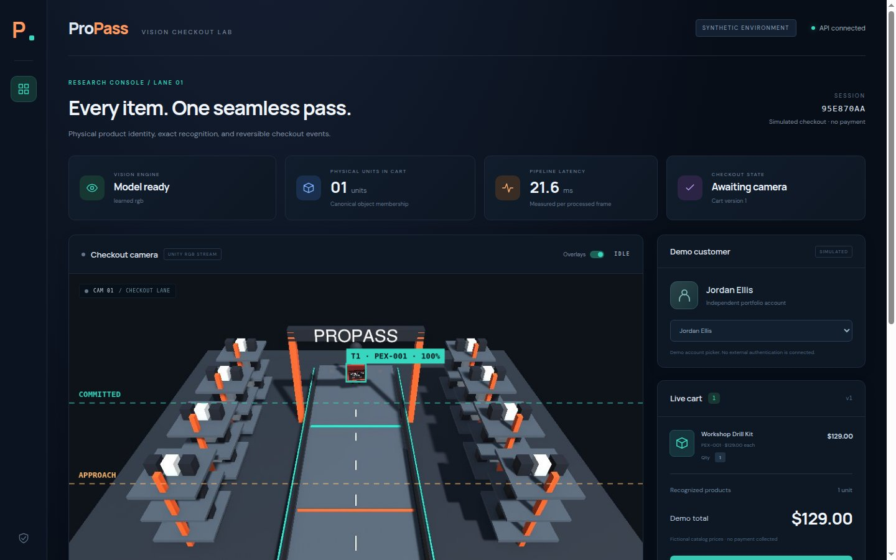
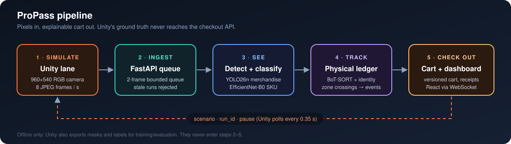

# ProPass

**A cashierless checkout lane you can run on one machine.** Unity renders the store, trained vision models read the camera pixels, every physical product gets its own identity, and a React dashboard shows the cart building itself, along with the reason for every line.






> [!NOTE]
> This is an independent portfolio project inspired by contractor checkout. It is not connected to Home Depot. The products, prices and customers are fictional, and no payment is taken. All accuracy numbers below were measured on **synthetic Unity images**. Real-camera transfer has not been tested yet.

## ⚡ Quickstart

You need Python 3.12, Node.js, Unity **6000.6.4f1** (URP 17.6), and ideally a CUDA GPU (CPU works, just more slowly).

```bash
python3 -m venv .venv
.venv/bin/python -m pip install -r requirements-vision.txt -r requirements-api.txt
(cd web && npm ci)
bash scripts/start.sh          # API on :8000, dashboard on :5173
```

1. In Unity, open `Assets/ProPass/Scenes/Checkout.unity` and press **Play**.
2. Open **http://127.0.0.1:5173**, pick a scenario such as **Identical products**, and watch the boxes cross the lane.
3. Click **Review checkout**, then **Confirm simulated checkout**.

The trained weights (`models/detector.pt`, `models/classifier.pt`) aren't in git. Copy them in, or retrain them with [docs/training.md](docs/training.md). Full setup and troubleshooting are in [docs/getting-started.md](docs/getting-started.md).

## 🎬 What it demonstrates

| Scenario | What happens | Measured |
|---|---|:---:|
| 🟥 **Single item** | One drill kit, counted once despite hundreds of observations | ✅ live + replay |
| 🟥🟥 **Identical products** | Two physical drill kits → same SKU, quantity 2 | ✅ live |
| 🟥🟨🟩 **Mixed cart** | Drill kit, measuring tape, work gloves | ✅ live |
| 🫥 **Temporary occlusion** | Box disappears briefly and is re-attached to the same identity | unit tests |
| ↩️ **Change of mind** | Added on the forward crossing, removed on the observed reverse crossing | unit tests |
| ❓ **Unknown product** | Gray unenrolled package is tracked, and checkout is blocked for review | unit tests |

## 🧭 Documentation map

| Doc | Read it to… |
|---|---|
| 🚀 [Getting started](docs/getting-started.md) | Install, run the demo, and fix common problems |
| 🔁 [Unity → web pipeline](docs/pipeline.md) | Follow a frame from Unity's camera to the cart on screen |
| 🏗️ [Architecture](docs/architecture.md) | Understand the components, the checkout state machine and the design decisions |
| 👁️ [Vision and tracking](docs/vision.md) | See how detection, classification, tracking and zone events work, and tune them |
| 🧪 [Training and results](docs/training.md) | Export data from Unity, retrain both models, and read the measured results |
| 🔌 [API reference](docs/api.md) | Look up endpoints, payloads and the snapshot shape |
| 🧩 [Extending ProPass](docs/extending.md) | Add a product, scenario, camera or model |
| 📚 [Research](docs/research/README.md) | Read the original technical report and research notes |

## 🗂️ Project layout

```text
api/          FastAPI app: frame ingress, cart/session persistence, confirmation
vision/       Learned RGB inference, SKU evidence, physical-object ledger, config.json
web/          React + TypeScript dashboard (Vite)
unity/        Unity assets (scripts, scene, prefabs, materials) for Assets/ProPass
training/     Dataset prep, model training, static and replay evaluation
models/       Checkpoints (git-ignored), hash manifest, evaluation reports
scripts/      start.sh launcher and the live end-to-end check
tests/        Ledger, engine and checkout API tests
docs/         Everything you are reading
catalog.json  The five fictional products, prices and class indices
```

## ✅ Checks

```bash
.venv/bin/python -m pytest tests -q        # 31 tests: ledger, engine, checkout races
(cd web && npm run build)                  # type-check and bundle the dashboard
.venv/bin/python scripts/verify_live.py    # needs Unity in Play mode + the API
```

## 📜 Licensing notes

Ultralytics (the YOLO detector) is AGPL-3.0 or commercially licensed, and nothing in this repo grants a license to its code or weights. Torchvision's pretrained EfficientNet weights keep their upstream attribution. Review both before you distribute any weights.
