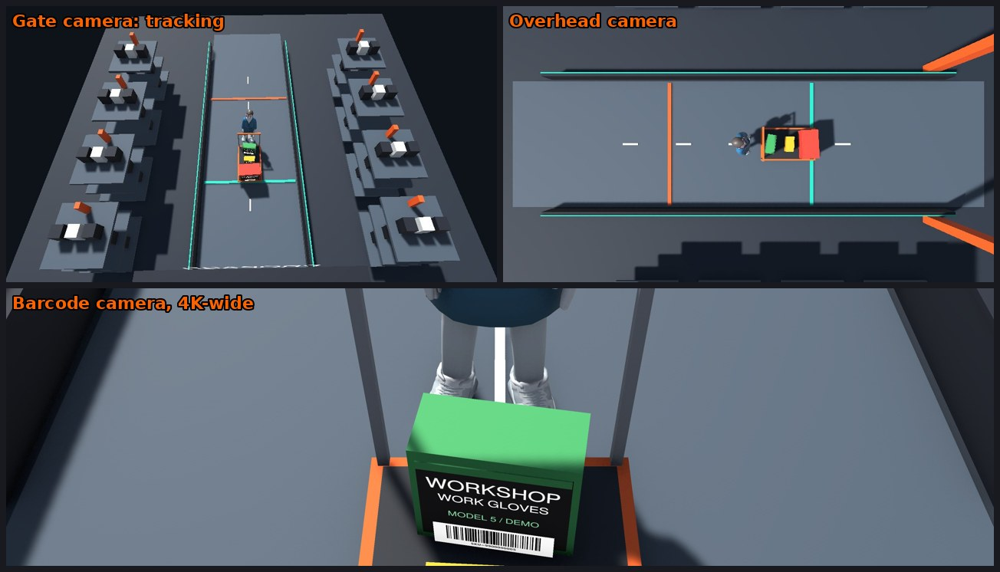
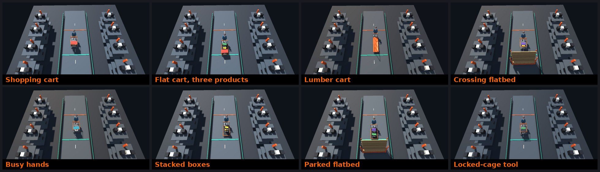
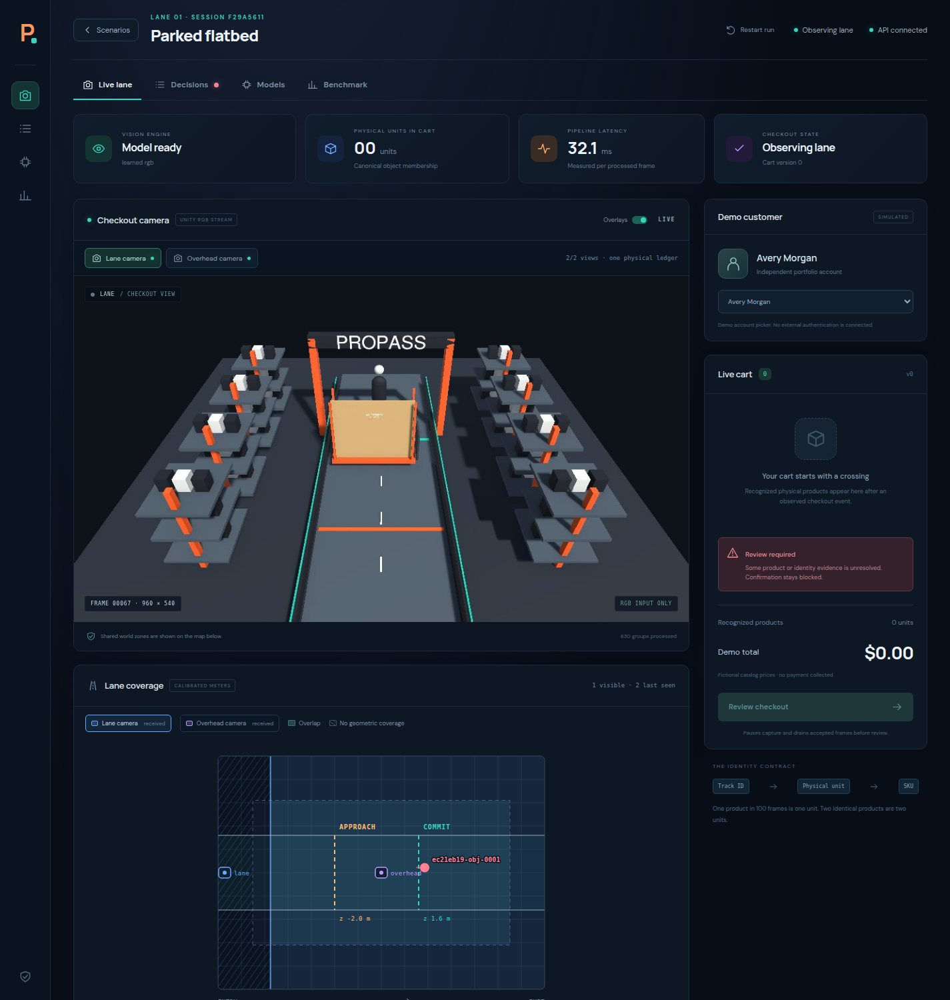
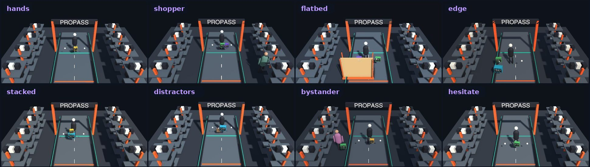

# ProPass

**A cashierless checkout lane you can run on one machine.** Unity renders the store, trained vision models read the camera pixels, every physical product gets its own identity, and a React dashboard shows the cart building itself, along with the reason for every line.


> [!NOTE]
> This is an independent portfolio project inspired by contractor checkout. It is not connected to Home Depot. The products, prices and customers are fictional, and no payment is taken. All accuracy numbers below were measured on **synthetic Unity images**. Real-camera transfer has not been tested yet.

## ⚡ Quickstart

### 1. Watch it: two minutes, no GPU, no Unity

Only Node.js is needed. Every one of the 17 scenes plays in the browser from all three cameras, with the cart and the decisions the trained models made beside it.

```bash
git clone https://github.com/dangermos/ProPass && cd ProPass/web
npm ci && npm run dev          # then open http://127.0.0.1:5173
```

The front page is the **project site**: how it works, the same run from each camera in step, the measured results and the limits. Click **Watch the 17 scenes** for the tour, or **Open the lab** for the scenario picker. Each scene is seed 2 of that scenario from the development recordings, whether it passed or not, so some end in a hand-off to an associate. The videos are rebuilt from the recordings by [scripts/build_tour.py](scripts/build_tour.py).


### 2. Run the models yourself, live, with no Unity

Needs Python 3.12 and ideally a CUDA GPU (CPU works, more slowly). The weights and the recorded runs are release assets, not in git.

```bash
python3 -m venv .venv
.venv/bin/python -m pip install -r requirements-vision.txt -r requirements-api.txt
bash scripts/get_weights.sh                 # both camera pairs, 42 MB, needs the GitHub CLI
bash scripts/get_recordings.sh              # one recorded run per scenario, 500 MB
.venv/bin/python -m pytest -q tests         # 153 tests
(cd web && npm ci)
bash scripts/start.sh                       # API on :8000, dashboard on :5173
```

Open the dashboard, click **Open the lab** and pick any scenario. The API plays the frames Unity **already rendered** through the trained models at the recorded 8 frames per second, so the **Live lane** tab shows the real thing: boxes, the cart building, ratings, the associate hand-off and checkout. Nothing is rendered again and no frame is dropped (`POST /api/replay`).

### 3. Render the scene in the browser (experimental)

The checkout scene is also built for WebGL and committed in `web/public/unity`. In the lab, **Render the scene in this browser** opens it in a small window and streams fresh frames to the API. Capturing three cameras in a browser is slow, so the scene runs in slow motion; replaying recorded frames (step 2) is the better way to watch. Rebuild it with **ProPass → Build for the browser (WebGL)**.

### 4. Run a scene live in Unity

Needs Unity **6000.6.4f1** (URP 17.6).

1. In Unity Hub, add the `unity/` folder as a project, open `Assets/ProPass/Scenes/Checkout.unity`, and press **Play**.
2. Open **http://127.0.0.1:5173** and pick a scenario on the title screen. Unity switches to it.
3. Watch the **Live lane** tab, see why each item is (or isn't) in the cart on **Decisions**, then click **Review checkout** and **Confirm demo checkout**.

The product photos and the animated characters are not in git (third-party images and a licensed asset pack), so a fresh clone renders boxes with placeholder art and capsule people. The recorded tour shows the full scene. Full setup and troubleshooting are in [docs/getting-started.md](docs/getting-started.md).

## 🎬 What it demonstrates

| Scenario | What happens | Measured |
|---|---|:---:|
| 🟥 **Single item** | One drill kit, counted once despite hundreds of observations | ✅ live + replay |
| 🟥🟥 **Identical products** | Two physical drill kits → same SKU, quantity 2 | ✅ live |
| 🟥🟨🟩 **Mixed cart** | Drill kit, measuring tape, work gloves | ✅ live |
| 🫥 **Temporary occlusion** | Box disappears briefly and is re-attached to the same identity | ✅ live |
| ↩️ **Change of mind** | Added on the forward crossing, removed on the observed reverse crossing | ✅ live |
| ❓ **Unknown product** | Gray unenrolled package is tracked, and checkout is blocked for review | ✅ live |

Eleven more **messy scenarios** stress it: busy hands, a crossing shopper, a lumber flatbed, a parked flatbed, partial views at the frame edge, stacked boxes, distractors, a shopper in the next aisle, hesitation, a locked-cage tool and bare lumber. Boxes carry **barcode labels** that a high-resolution scan camera reads. Items without one are recognized by look. Anything the system can't settle goes to an associate, and the scanned cart is kept.

### 📈 Measured results

Every round was scored on **held-out seeds the system was never tuned on**: 17 scenarios × 5 seeds = 85 recorded runs. Each round made the scene harder, and both camera model pairs were retrained for it.

| Round | Scene | Fully automatic and exactly right | Carts closed with a wrong item |
|---|---|:-:|:-:|
| 🧍 Capsule people | hand-carried boxes | **78 of 85** | **0** |
| 🚶 Animated characters | hand-carried boxes | **71 of 85** | **0** |
| 🛒 Carts (current scene) | shopping, flat and lumber carts pushed by the customer | **60 of 85** | **0** |

The number that matters most held in all three rounds: **no cart was ever closed automatically with a wrong item.** What drops as the scene gets more realistic is how often the system finishes on its own. Every other run goes to an associate with the scanned part of the cart kept. In the cart round two of those handed-off carts held one wrong line each (a second pair of gloves, a third board), which is why they were handed off. Details and per-scenario scores: [benchmark](docs/benchmark.md), [how it works](docs/pro-express-v2.md#carts-measured-2026-10-11).









## 🧭 Documentation map

| Doc | Read it to… |
|---|---|
| 🚀 [Getting started](docs/getting-started.md) | Install, run the demo, and fix common problems |
| 🖥️ [Dashboard tour](docs/getting-started.md#️-dashboard-tour) | Use the title screen and the Live lane, Decisions, Models and Benchmark tabs |
| 📷 [Camera evidence and coverage](docs/dashboard.md) | Switch views and read the calibrated map |
| 🔬 [Phase C results](docs/roadmap.md#-phase-c-results) | One camera vs two, on development and held-out seeds |
| 🔁 [Unity → web pipeline](docs/pipeline.md) | Follow a frame from Unity's camera to the cart on screen |
| 🏗️ [Architecture](docs/architecture.md) | Understand the components, the checkout state machine and the design decisions |
| 👁️ [Vision and tracking](docs/vision.md) | See how detection, classification, tracking and zone events work, and tune them |
| 🧪 [Training and results](docs/training.md) | Export data from Unity, retrain both models, and read the measured results |
| 📊 [Benchmark](docs/benchmark.md) | See current per-scenario exact-cart and review scores |
| 🔌 [API reference](docs/api.md) | Look up endpoints, payloads and the snapshot shape |
| 🧩 [Extending ProPass](docs/extending.md) | Add a product, scenario, camera or model |
| 🗺️ [Roadmap](docs/roadmap.md) | See what's next: messy lanes, learned re-ID, multi-camera coverage |
| 🧰 [Pro Express v2 plan](docs/pro-express-v2.md) | Read what's planned next: real product looks, barcode scanning, ratings, associate handoff, a customer phone view |
| 📚 [Research](docs/research/README.md) | Read the original technical report and research notes |

## 🗂️ Project layout

```text
api/          FastAPI app: frame ingress, cart/session persistence, confirmation
vision/       Learned RGB inference, SKU evidence, physical-object ledger, config.json
web/          React + TypeScript dashboard: title screen + Live/Decisions/Models/Benchmark tabs
unity/        The Unity 6.6 project; our code and scene live in unity/Assets/ProPass
training/     Dataset prep, model training, static and replay evaluation
models/       Checkpoints (git-ignored), hash manifest, evaluation reports
scripts/      start.sh launcher and the live end-to-end check
tests/        Ledger, engine and checkout API tests
docs/         Everything you are reading
catalog.json  The five fictional products, prices and class indices
```

## ✅ Checks

```bash
.venv/bin/python -m pytest tests -q        # ledger, fusion, calibration, checkout races, rejection
(cd web && npm run build)                  # type-check and bundle the dashboard
.venv/bin/python scripts/verify_live.py    # needs Unity in Play mode + the API
```

## 📜 Licensing notes

Ultralytics (the YOLO detector) is AGPL-3.0 or commercially licensed, and nothing in this repo grants a license to its code or weights. Torchvision's pretrained EfficientNet weights keep their upstream attribution. Review both before you distribute any weights.
