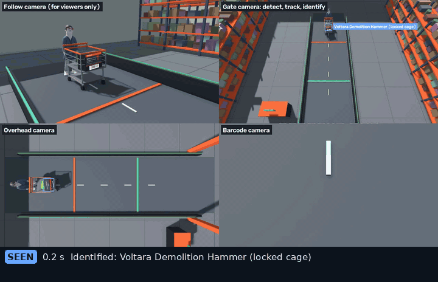
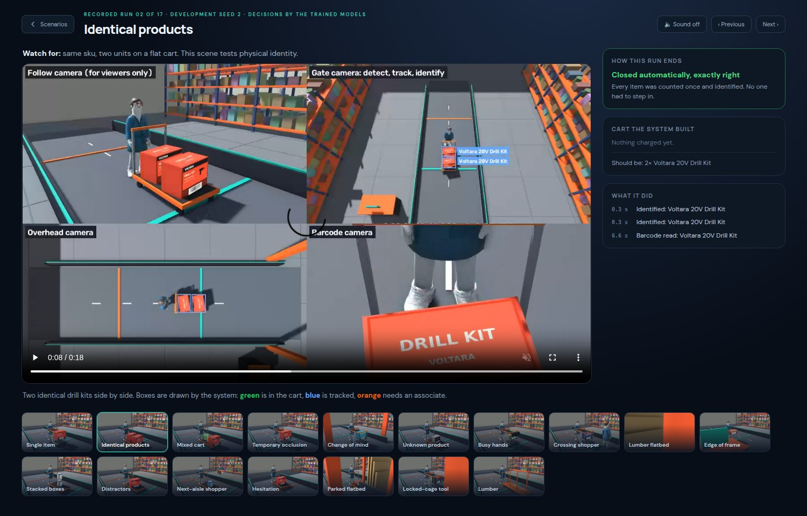
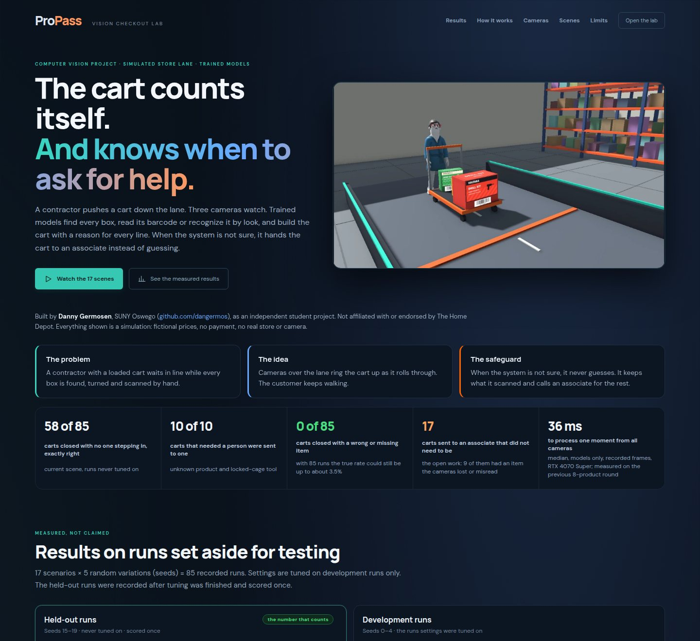

# ProPass

### [Live demo: dangermos.github.io/ProPass](https://dangermos.github.io/ProPass/)

The project page and a recorded tour of all 17 scenes, in the browser. Nothing to install.

[](https://dangermos.github.io/ProPass/)

**A checkout lane that rings up the cart as it rolls through, and calls an associate when it isn't sure.** I built it as a student project: a simulated store lane in Unity, three cameras, vision models I trained, and a ledger that gives every physical item one identity. By **Danny Germosen** (SUNY Oswego).

[](https://github.com/dangermos/ProPass/actions/workflows/ci.yml)


> [!NOTE]
> An independent student project inspired by contractor checkout. It is **not affiliated with or endorsed by The Home Depot**. Every brand, product, price and customer in it is invented, and no payment is taken. Every number below was measured on **simulated images rendered by Unity**. Nothing has been tested on a real camera.

## Known weak spots and next steps

- **Weakest scenes:** **lumber** and **stacked** pass 2 of 5 held-out runs each. The reasons per scene are in [docs/benchmark.md](docs/benchmark.md#-why-runs-fail).
- **Cautious hand-offs:** when the lane isn't sure, it sends the cart to an associate rather than risk a wrong charge. 17 of 85 held-out carts, all in scenes it could have closed, went to one as a precaution. 8 of those 17 were already right. Of the other 9, 8 were missing items (13 in all), so closing them would have undercharged; 1 had one item too many, so closing it would have overcharged. Because they went to a person, none of them closed with a wrong charge.
- **Wrong charges:** None of the held-out carts closed with a wrong or missing item, but 85 runs cannot rule out a small rate. Earlier rounds did close wrong carts: one held-out lumber cart one board short, and development runs before two bug fixes ([project log](docs/pro-express-v2.md)).
- **Next steps:** fewer precautionary hand-offs, then stacked and hidden packages; see [docs/roadmap.md](docs/roadmap.md).

## What it does

1. **See.** A small object detector finds every package, person and cart in two camera views, and a tracker follows each package.
2. **Identify.** A third camera reads the barcode on each package. Where no label is visible, an image classifier recognizes which of the 15 catalog products it is, or says it does not know.
3. **Fuse.** Camera calibration puts both views on one floor plan, so a package seen twice is one object and a hidden package is not lost.
4. **Decide.** Each physical item gets one identity. It is added when it crosses the checkout line, removed if it comes back, and rated for how sure the system is.
5. **Hand off.** Unknown products, restricted tools and anything unsettled go to an associate. The scanned part of the cart is kept.

Unity never tells the vision system what is in the cart. Each camera sends a plain image with a timestamp, and everything else is worked out from pixels.



## Measured results

The current scene has 15 invented products (boxes, pails, a locked tool, bare lumber), customers pushing shopping, flat and lumber carts, and a stocked store. It was scored on **85 held-out runs** (17 scenarios × seeds 15–19) that were recorded after tuning was finished and scored once.

| 85 runs each | Development (seeds 0–4) | **Held-out (seeds 15–19)** |
|---|:-:|:-:|
| Passed: cart exactly right, associate called only when needed | 67 | **68** |
| Closed automatically, exactly right | 57 | **58** |
| Correctly sent to an associate (unknown product, locked tool) | 10 | **10** |
| Sent to an associate as a precaution | 18 | **17** |
| Closed with a wrong or missing item | 0 | **0** |
| Items the cameras lost (all in carts sent to an associate) | 13 | 13 |
| Wrong lines inside carts sent to an associate | 0 | 1 |
| Charged items settled by barcode | 62 of 101 | 60 of 103 |

- **58 of 85 held-out carts closed with nobody stepping in, and all 10 carts that needed a person were sent to one.**
- **No cart closed with a wrong or missing item** on the held-out runs.
- **The 10 carts built to need a person all went to one. In the other 75, the lane closed 58 on its own and sent 17 to an associate rather than guess.** 8 of those 17 were already right. Of the other 9, 8 were missing items (13 in all), so closing them would have undercharged; 1 had one item too many, so closing it would have overcharged. Because they went to a person, none of them closed with a wrong charge. Most common reasons: entered merchandise disappeared before an observed checkout or reverse removal (12); product first observed beyond checkout boundary (6); conflicting sku evidence on the same physical object (3).

Models (test split of the training data): gate camera detector mAP50-95 0.818, classifier 95.5%; overhead detector mAP50-95 0.867, classifier 94.6%. Per-scenario scores are in [docs/benchmark.md](docs/benchmark.md). Earlier rounds with 8 products are in [docs/pro-express-v2.md](docs/pro-express-v2.md).

**Read these numbers with care.** 85 runs can find failures but cannot promise a rate: zero wrong closes in 85 runs still allows a true rate of up to about 3.5%. Five runs per scenario are signals, not percentages.

**An optional second opinion.** A decision model (subq-snap-1.1, SubQ's Decisions API) can review the carts the rules would hand off for a soft reason. Locked tools, unknown barcodes and barcode mismatches never reach it, and a failed call keeps the rules' decision. On development runs it closed 1 of the 15 carts it was asked about (67 → 68 runs passed, 0 wrong closes). Deciding every cart on its own, without the rules, it passed 63. It is off by default and has not been scored on held-out runs. Code: [vision/decision.py](vision/decision.py); scoring: [training/decision_eval.py](training/decision_eval.py).

## Quickstart

### 1. Watch it: two minutes, Node.js only

```bash
git clone https://github.com/dangermos/ProPass && cd ProPass/web
npm ci && npm run dev          # open http://127.0.0.1:5173
```



The front page explains the project. **Watch the 17 scenes** opens the recorded tour: every scenario from four camera angles at 60 fps, with the cart the system built and what it decided beside the video, and a **Sound** button. No GPU, Unity or model weights are needed, because the videos are in the repository. Each tour scene is development seed 2 of its scenario, pass or not. The same pages are published as a static site at [dangermos.github.io/ProPass](https://dangermos.github.io/ProPass/) ([docs/static-demo.md](docs/static-demo.md)).

### 2. Run the models live, without Unity

Needs Python 3.12 and ideally a CUDA GPU. The weights and one recorded run per scenario are release assets (they need the [GitHub CLI](https://cli.github.com/) signed in).

```bash
python3 -m venv .venv
.venv/bin/python -m pip install -r requirements-vision.txt -r requirements-api.txt
bash scripts/get_weights.sh          # both camera model pairs, 42 MB
bash scripts/get_recordings.sh       # frames Unity already rendered, about 500 MB
.venv/bin/python -m pytest -q tests  # 174 tests
(cd web && npm ci)
bash scripts/start.sh                # API on :8000, dashboard on :5173
```

Open the dashboard, click **Open the lab** and pick any scenario. The API plays the recorded frames through the trained models at the recorded pace, so the **Live lane** tab shows the real pipeline: boxes, the cart building, ratings, the associate hand-off and checkout.

### 3. Render a scene yourself

Needs Unity **6000.6.4f1** (URP 17.6). Open `unity/` in Unity Hub, load `Assets/ProPass/Scenes/Checkout.unity` and press **Play** with the API running. The dashboard follows the live scene. The animated characters come from a free Asset Store pack that is not in this repository; without it the scene uses capsule people.

### 4. Rebuild everything from scratch

One command exports the training data, trains both camera model pairs, records the development runs and scores them. It runs unattended, throttles itself, and picks up where it stopped.

```bash
scripts/round.sh            # about 40 minutes on an RTX 4070 Super
scripts/round.sh test       # record and score fresh held-out runs, once
scripts/round.sh tour       # render the 60 fps tour videos
tail -f artifacts/logs/round.log
```

## The 17 scenarios

| Group | Scenarios |
|---|---|
| Clean | single item · identical products · mixed cart · temporary occlusion · change of mind · unknown product |
| Messy | busy hands · crossing shopper · crossing flatbed · edge of frame · stacked packages · distractors · next-aisle shopper · hesitation · parked flatbed · locked-cage tool · lumber |

## Known limits

- **Simulated only.** No real camera, lighting, motion blur or lens has been tested.
- **Cautious hand-offs.** 17 of 85 held-out carts went to an associate as a precaution. A store would want fewer, and cutting that number without risking wrong charges is the main open problem.
- **Small test.** 15 products and 85 runs.
- **Hidden labels.** A package behind another package on a cart is not scanned and falls back to recognition by look.

## Documentation

| Doc | Read it to… |
|---|---|
| [Getting started](docs/getting-started.md) | Install, run, and fix common problems |
| [Architecture](docs/architecture.md) | Components, the checkout state machine, design decisions |
| [Unity → web pipeline](docs/pipeline.md) | Follow one frame from a camera to the cart on screen |
| [Vision and tracking](docs/vision.md) | Detection, classification, tracking, fusion and the ledger |
| [Training](docs/training.md) | Export data, train, record and score |
| [Benchmark](docs/benchmark.md) | Per-scenario held-out scores (generated) |
| [API reference](docs/api.md) | Endpoints, payloads and the snapshot shape |
| [Extending](docs/extending.md) | Add a product, scenario, camera or model |
| [Project log](docs/pro-express-v2.md) | Earlier rounds, what changed and why |
| [Static demo](docs/static-demo.md) | Publish the project page and tour on GitHub Pages |
| [Engineering logs](docs/engineering-logs/HANDOFF.md) | Working notes for whoever picks this up next |

## Project layout

```text
api/          FastAPI app (routes/, runtime.py, ws.py): frame ingress, replay, cart and session persistence, checkout
vision/       Inference engine, camera calibration, barcode reading, the physical-object ledger
web/          React + TypeScript dashboard: project site, recorded tour, live lab
unity/        The Unity 6.6 project; code, scene and generated label art in unity/Assets/ProPass
training/     Model training and the benchmark scorer
models/       Hash manifests and benchmark reports (weights are release assets)
scripts/      round.sh (the whole pipeline), start.sh, weight and recording downloads, tour builder
tests/        174 tests: ledger, fusion, calibration, barcodes, API, catalog consistency
docs/         Documentation
catalog.json  The 15 invented products: prices, barcodes, label art recipe
```

## Checks

```bash
.venv/bin/python -m pytest tests -q        # ledger, fusion, calibration, barcodes, API, catalog
.venv/bin/python -m pip install ruff mypy && .venv/bin/ruff check . && .venv/bin/mypy   # lint; type-check api/
(cd web && npm run lint && npm test && npm run build)   # lint, unit tests, type-check and bundle the dashboard
```

## Licensing notes

This repository is licensed under the [GNU AGPL-3.0](LICENSE), the license of the Ultralytics detector it builds on. Ultralytics (the YOLO detector) is AGPL-3.0 or commercially licensed, and nothing in this repository grants a license to its code or weights. Torchvision's pretrained EfficientNet weights carry their own terms. The character models in the videos come from the "Creative Characters FREE" pack by ithappy on the Unity Asset Store and are not included or redistributed here. The source product photos and barcodes in `Barcodes/` are git-ignored and are not included either. All product names, brands and package art were invented for this project and generated by `scripts/prepare_products.py`; the names have not been checked against registered trademarks.
