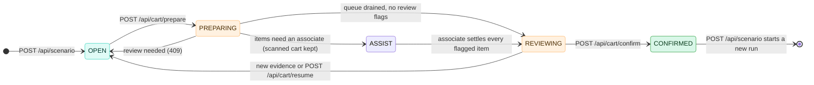

# 🔌 API reference

The FastAPI server runs on **http://127.0.0.1:8000**. Interactive docs, generated from the code, are at **[/docs](http://127.0.0.1:8000/docs)**. All of the code is in [api/app.py](../api/app.py).

## 🗺️ Endpoints at a glance

| | Method | Path | Used by | Purpose |
|:-:|---|---|---|---|
| 🩺 | `GET` | `/api/health` | anyone | Readiness, vision mode and device, latest frame age |
| 📷 | `POST` | `/api/frames` | 🎮 Unity | Submit one camera's JPEG for a capture group |
| 🎛️ | `GET` | `/api/simulator/control` | 🎮 Unity | Current `scenario`, `run_id`, `paused` |
| 📸 | `GET` | `/api/snapshot` | 🖥️ Dashboard | Full UI state (same shape as the WebSocket messages) |
| 🔴 | `WS` | `/api/ws` | 🖥️ Dashboard | Snapshot pushed after every processed frame and every action |
| 🖼️ | `GET` | `/api/frame` | 🖥️ Dashboard | The processed JPEG matching a camera and frame ID |
| 📋 | `GET` | `/api/catalog` | 🖥️ Dashboard | Products, prices, currency |
| 📊 | `GET` | `/api/reports` | 🖥️ Dashboard | Measured reports, configuration, active cameras and calibration geometry |
| 🎬 | `POST` | `/api/scenario` | 🖥️ Dashboard | Start a new run of a scenario |
| 👤 | `POST` | `/api/session` | 🖥️ Dashboard | Switch the simulated customer |
| 🔄 | `POST` | `/api/cart/reset` | 🖥️ Dashboard | Restart the current scenario with a new run |
| 🧾 | `POST` | `/api/cart/prepare` | 🖥️ Dashboard | Pause, drain and freeze a cart version for review |
| ▶️ | `POST` | `/api/cart/resume` | 🖥️ Dashboard | Cancel review and resume capture |
| 🙋 | `POST` | `/api/assist/add` | 🖥️ Associate panel | An associate adds an item, or releases a restricted one: `{"sku": "PEX-003", "object_id": "…"}` (`object_id` settles a flagged object) |
| 🚫 | `POST` | `/api/assist/dismiss` | 🖥️ Associate panel | An associate confirms a flagged detection is nothing to charge: `{"object_id": "…"}` |
| ✅ | `POST` | `/api/cart/confirm` | 🖥️ Dashboard | Write the immutable simulated receipt |

## 📷 `POST /api/frames`

```http
POST /api/frames?frame_id=42&timestamp=5.2500&run_id=7f3c…&camera_id=lane  HTTP/1.1
Content-Type: image/jpeg

<raw JPEG bytes>
```

| Response | When |
|---|---|
| `200 {"accepted": true, "frame_id": 42, "camera_id": "lane", "pending_cameras": ["overhead"], "queued": false, "queue_depth": 0}` | Accepted into a group; another configured camera is still missing |
| `200 {"accepted": true, "frame_id": 42, "camera_id": "overhead", "pending_cameras": [], "queued": true, "queue_depth": 1}` | The complete group is queued for one inference call |
| `200 {"accepted": false, "reason": "duplicate_camera"}` | This camera already arrived in the pending group |
| `200 {"accepted": false, "reason": "duplicate_or_out_of_order"}` | Older frame, or the group for this frame was already closed |
| `409` | Wrong `run_id` (poll control again), or capture is paused or confirmed |
| `413` / `415` / `422` | Over 8 MiB, not `image/jpeg`, no JPEG signature, unknown camera, or invalid capture ID/timestamp |

**Ground truth is never accepted.** There's no field for SKUs, IDs or boxes. Images can be up to 3840×2160.

Camera IDs come from `vision/config.json` (`lane`, `overhead`). Omitting `camera_id` uses `lane`. Both images for one capture share `run_id`, `frame_id` and `timestamp` (within 1 ms). They can arrive in either camera order. Frame groups are processed in increasing frame ID order; a newer ID closes the previous incomplete group. A late image for a closed group is rejected, so it cannot advance the ledger twice or pair with a different capture instant.

One inference worker calls `process_frames` once per group. The bounded two-group queue drops the oldest queued **whole group** when full, keeping cameras together. Missing-camera groups still run through the engine with the available views and increment `metrics.incomplete_frame_groups`. `metrics.missing_cameras` describes the latest processed group, while `pending_camera_group` and `pending_cameras` describe an unfinished incoming group. There is no timer flush; a stopped camera's last partial group flushes when another capture starts or when checkout preparation begins.

JPEGs are decoded and checked for image bounds on the worker. A payload with a JPEG signature but invalid image data produces `error` and requires review; it cannot produce a confirmed cart.

### 🖼️ Frame-matched camera images

Use each snapshot's `frames[camera_id].url`, for example `/api/frame?run_id=…&frame_id=42&camera_id=overhead`. The response includes `X-Frame-ID` and `X-Camera-ID`. The cache retains four processed capture groups, with each available camera's JPEG. An expired or absent view returns `404`; a view from the previous capture is never substituted. Without query parameters, `/api/frame` uses the legacy `frame` alias: the lane view if present, otherwise the first available camera.

## 🎬 Run lifecycle



| Call | Body | Notes |
|---|---|---|
| `POST /api/scenario` | `{"scenario": "duplicate"}` | One of `single` `duplicate` `mixed` `occlusion` `remove` `unknown` `hands` `shopper` `flatbed` `edge` `stacked` `distractors` `bystander` `hesitate` `parked`. Returns a snapshot with the new `session.run_id`. |
| `POST /api/session` | `{"customer_name": "Jordan Ellis"}` | A demo name only. Changing it bumps the cart version. |
| `POST /api/cart/prepare` | — | Pauses new capture, closes any partial group, then drains queued and in-flight inference before freezing the final frame watermark. `200` returns `cart.status = "REVIEWING"` and `prepared_version`. `202 {"pending": true}` means the drain is still running, so call it again. `409` means unresolved evidence, a processing failure, or no accepted capture. |
| `POST /api/cart/confirm` | `{"version": 7, "idempotency_key": "≥8 chars"}` | Returns the receipt. The same key returns the same receipt. A stale version, or a different key on a confirmed cart, returns `409`. |

## 📸 Snapshot shape

Both `GET /api/snapshot` and every WebSocket message return this. The TypeScript type is in [web/src/types.ts](../web/src/types.ts).

```jsonc
{
  "session":   { "id": "…", "customer_name": "Jordan Ellis", "status": "OPEN", "run_id": "…" },
  "cart": {
    "id": "…", "version": 3, "status": "OPEN",           // OPEN | PREPARING | REVIEWING | CONFIRMED
    "prepared_version": null, "prepared_frame_id": null,
    "items": [{ "sku": "PEX-001", "name": "Workshop Drill Kit", "quantity": 2,
                "unit_price": 129.0, "line_total": 258.0 }],
    "total": 258.0, "currency": "USD"
  },
  "simulator": { "scenario": "duplicate", "run_id": "…", "paused": false },
  "vision":    { "ready": true, "mode": "learned_rgb", "device": "cuda:0", "ground_truth_runtime": false, … },
  "cameras":   ["lane", "overhead"],                    // configured cameras
  "geometry": { "bounds": { "x": [-5, 5], "z": [-7, 7] },
                 "lane": { "half_width": 1.6, "approach_z": -2.0, "commit_z": 1.6 },
                 "cameras": [{ "id": "lane", "position": [0, 7.5, -8], "footprint": [[0,0]] }] },
  "frames": {                                          // ONLY views from capture 108
    "lane": { "camera_id": "lane", "frame_id": 108, "timestamp": 15.0, "run_id": "…",
              "width": 960, "height": 540, "url": "/api/frame?run_id=…&frame_id=108&camera_id=lane", "age_ms": 111 },
    "overhead": { "camera_id": "overhead", "frame_id": 108, "timestamp": 15.0, "run_id": "…",
                  "width": 960, "height": 540, "url": "/api/frame?run_id=…&frame_id=108&camera_id=overhead", "age_ms": 111 }
  },
  "frame":     { "camera_id": "lane", "frame_id": 108, "timestamp": 15.0, "run_id": "…",
                 "width": 960, "height": 540, "url": "/api/frame?run_id=…&frame_id=108&camera_id=lane", "age_ms": 111 },
  "detections": [{                                         // visible this frame
    "camera": "lane", "bbox": [x1, y1, x2, y2], "track_id": 3, "object_id": "7f3c1a2b-obj-0002",
    "sku": "PEX-001", "confidence": 0.98, "accepted_confidence": 0.97, "state": "ADDED", "zone": "COMMIT",
    "visible": true, "membership": true, "review_reason": null, "detector_confidence": 0.91
  }],
  "objects": [ /* canonical objects; world: [x, z] in meters when calibrated */ ],
  "events":  [{ "event_id": "…", "type": "ITEM_ADDED", "object_id": "…", "sku": "PEX-001",
                "timestamp": 11.1, "sequence": 19, "reason": null }],  // newest 60
  "review_required": false,
  "metrics": { "pipeline_ms": 21.6, "inference_ms": 19.4, "processed_frames": 689,
               "dropped_frames": 0, "queue_depth": 0, "cart_units": 2, "pending_objects": 0,
               "incomplete_frame_groups": 0, "missing_cameras": [], "pending_camera_group": null, "pending_cameras": [] },
  "receipt": null,
  "error": null,
  "demo": true
}
```

**Event types:** `TRACK_CREATED` · `SKU_RESOLVED` · `ITEM_ADDED` · `ITEM_REMOVED` · `REVIEW_REQUIRED` (has a `reason`).

`geometry` is `null` in image mode. In calibrated mode it exposes world-space lane boundaries and the active cameras' footprints; calibration is available before the first inference. `frames` is empty until a group has processed, and `frame` is then `null`. Overlay boxes use `detections[].camera` to select the matching view. Canonical `objects[].bbox` is in the ledger's map frame in world mode, so use `objects[].world` for the coverage map rather than drawing those boxes onto a camera image.

Reset discards pending groups, queued groups and image caches. In-flight inference is allowed to finish, but its old `run_id` prevents it from changing the new cart or exposing old images. Tracker resets occur on the inference worker when the run changes. Confirmation still checks the prepared run and cart version and uses an idempotency key.

## 🐍 Vision package interface

The backend only touches vision through this class in [vision/engine.py](../vision/engine.py):

```python
engine = VisionEngine(catalog_path, models_dir, config_path=None)
engine.reset(run_id)                                    # call before the first frame of a run
result = engine.process_frames({"lane": lane_bgr, "overhead": overhead_bgr}, frame_id, timestamp, run_id)
# → {frame_id, timestamp, run_id, detections, objects, events, review_required, metrics}
engine.status()                                         # → {ready, mode, device, error, …}
engine.geometry()                                       # → calibrated map geometry, or None
# process_frame(image_bgr, ...) remains a single-view convenience wrapper.
```

Any replacement detector or tracker that keeps this interface works without touching the API or the dashboard. Single-camera configurations also support the original `process_frame` interface; a multi-camera configuration requires `process_frames`. See [extending.md](extending.md#-swap-in-a-different-model).
