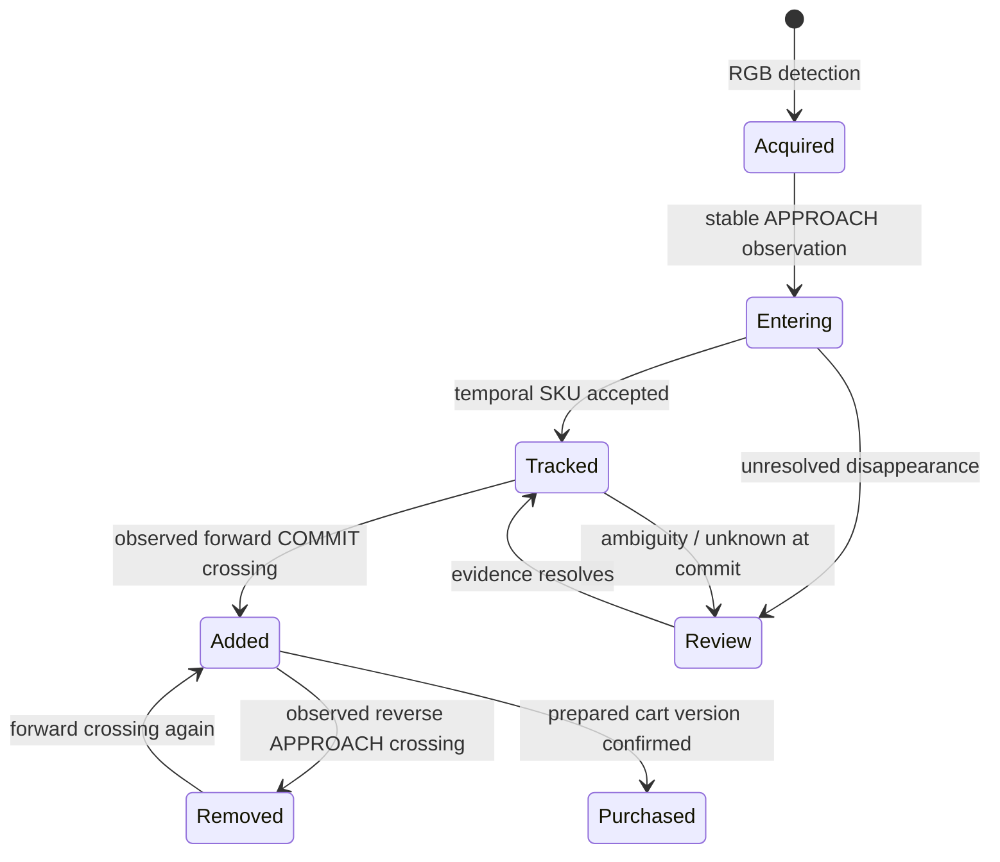

# ProPass MVP decisions

## Boundary between simulation and inference

Unity owns the physical world and produces a JPEG camera feed at 960 × 540, nominally 8 captures/second. The API receives RGB bytes plus source frame ID, scenario-relative capture time, and run ID. Unity's separate annotations are available only to offline training/evaluation. Control requests choose scripted scenarios or pause capture; they never select predicted products or quantities.

The MVP deliberately models a constrained checkout lane rather than a whole-store shelf-interaction system. An account selector represents the authenticated session. Camera geometry is fixed, product families are small and visually distinct, and a single customer owns the lane. No person-to-product attribution is inferred yet.

## Physical identity and events

This diagram describes the lifecycle; implementation exposes entering/tracked/added/removed and review evidence separately. Purchased is a transaction-level receipt state, not a tracker prediction.

ByteTrack supplies short-lived tracker IDs. The canonical ledger maintains an object ID, current position and motion estimate, normalized appearance feature, accepted SKU vote history, last observation time, stable zone, membership, and review reason. A changed tracker ID can attach to an existing canonical object only within the temporal window and spatial/appearance gates, with one-to-one assignment. Similar competing candidates force review. The tracker can preserve quantity across brief occlusion; it cannot know which identical box is which after arbitrary indistinguishable motion.

Zone y coordinates are normalized top-down image coordinates: APPROACH ≥ 0.65; COMMIT ≤ 0.40. These project near the lane's world-space markers for products at the modeled carrying height. A 0.025 hysteresis band and 0.12-second dwell reduce jitter. Height/camera changes need recalibration. Observed APPROACH→COMMIT adds; observed return to APPROACH removes. A static object appearing inside COMMIT does not establish a valid forward journey.

Quantities are grouped from active canonical memberships. A single object seen in hundreds of frames remains one unit; two objects with the same SKU remain two units. Reconciliation never merges objects merely because their SKU matches. Disappearance alone does not establish removal.

## Confirmation barrier

1. Stop accepting frames for this run and ask Unity to pause.
2. Drain accepted frames through the queue; the worker serializes learned inference and persistence.
3. Reject incomplete, unknown, ambiguous, or erroneous evidence.
4. Record prepared cart version, run ID, and last processed frame ID.
5. Confirm only that prepared version. Persist an immutable receipt and idempotency key together.

Scenario reset creates a new run; stale frames/results are ignored. Uniqueness constraints on `(run_id, event_id)` and `(session_id, object_id)` prevent duplicate mutations. A cart has one receipt; conflicting retries fail, while an identical retry returns it. Tests cover reset during preparation and review evidence arriving after preparation.

The bounded two-frame queue favors recent evidence under load and reports drops. Receipt confirmation drains what was accepted rather than relying on arbitrary sleeps. Dropped frames can still omit critical motion; a future production system needs camera-source continuity, monitored evidence completeness, and a policy for long gaps.

## Persistence and scale

The current entities are checkout_session, cart, physical_item, checkout_event, and receipt. Product catalog and camera settings are configuration files. A session carries a fictional customer display name; there is no auth/customer service. Frames remain in a small memory cache for overlay alignment, while replay recordings are separate ignored artifacts. SQLite is tested; the same SQLAlchemy schema can use optional PostgreSQL.

Future multi-lane operation would partition inference and ordered events by camera/session, use durable ingress offsets, and provide explicit transaction boundaries. A broker becomes useful when there are multiple producers or recoverable backlogs. Kafka/Redis and extra services are unnecessary for the current single lane.

Before real financial use, use integer minor currency units, real authentication/session authorization, a receipt adjustment/audit workflow, durable worker recovery, complete provenance and security controls, and payment integration. The current floating-point fictional catalog totals are adequate only for this local demo.

## Simulation versus reality

Synthetic data supplies exact labels and deliberate rare cases cheaply. Its usefulness depends on the rendered variation matching deployment. The MVP's packages have strong color cues; the simulated hands and trajectories are simple; training and demo share procedural assets and environment. Scene-level held-out splits prevent frame duplication but do not establish held-out-asset, store, or real-camera generalization. The unenrolled gray-package reject class is useful outlier exposure, not proof of arbitrary unknown recognition.

The next rigorous experiment is a domain-transfer comparison: synthetic-only, real-only, and mixed fine-tuning, evaluated on a real recording session held out by day/camera and on look-alike SKU variants. Report exact-cart correctness, false additions/removals, identity switches, review rate, and latency alongside detector/classifier accuracy.
