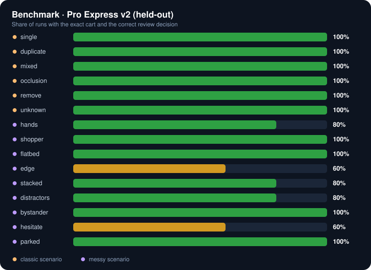

# 📊 Benchmark

<!-- Generated by training/benchmark.py. Edit the script, not this file. -->

**baseline** · 70 recorded runs · 46 passed (66%) · median latency 9.4 ms per frame

A run **passes** when the final cart is exactly right *and* checkout is blocked only when it should be (the unknown package). Every run is synthetic and was rendered offline by Unity from a fixed seed, so it can be reproduced exactly. See [training.md](training.md#-scenario-benchmark) for how to record and score runs.

| | Scenario | Pass | Exact cart | False adds | Missed | ID switches / run | Phantom objects / run | Blocked for review | Detection recall |
|:-:|---|:-:|:-:|:-:|:-:|:-:|:-:|:-:|:-:|
| 🟢 | **single** One drill kit, one clean crossing | 100% | 100% | 0 | 0 | 0.0 | 0.0 | 0% | 100% |
| 🟢 | **duplicate** Two identical drill kits side by side | 100% | 100% | 0 | 0 | 0.0 | 0.0 | 0% | 100% |
| 🟢 | **mixed** Drill kit, measuring tape and work gloves | 100% | 100% | 0 | 0 | 0.0 | 0.0 | 0% | 100% |
| 🟢 | **occlusion** A hand hides the drill kit for 0.6 s | 100% | 100% | 0 | 0 | 0.0 | 0.0 | 0% | 97% |
| 🟢 | **remove** Driver kit carried in, then carried back out | 100% | 100% | 0 | 0 | 0.0 | 0.0 | 0% | 100% |
| 🟢 | **unknown** An unenrolled gray package | 100% | 100% | 0 | 0 | 0.0 | 0.0 | 100% | 100% |
| 🟢 | **hands** Hands repeatedly cover the products while they are carried | 100% | 100% | 0 | 0 | 0.4 | 0.0 | 0% | 100% |
| 🟡 | **shopper** Another shopper walks across the lane in front of the camera | 60% | 100% | 0 | 0 | 9.8 | 1.2 | 40% | 95% |
| 🔴 | **flatbed** A flatbed of lumber rolls between the camera and the products for several seconds | 0% | 0% | 0 | 6 | 1.2 | 0.2 | 100% | 92% |
| 🔴 | **edge** Products enter from below the frame and hug the lane rail | 20% | 100% | 0 | 0 | 3.4 | 0.0 | 80% | 90% |
| 🔴 | **stacked** One package carried on top of another | 0% | 20% | 3 | 4 | 38.6 | 0.0 | 100% | 74% |
| 🟡 | **distractors** A phone, a coffee cup and a bag travel through the lane with the products | 60% | 100% | 0 | 0 | 0.0 | 1.0 | 40% | 100% |
| 🔴 | **bystander** A shopper in the next aisle carries a product past the lane; it must not be charged | 0% | 60% | 2 | 0 | 0.0 | 1.8 | 100% | 83% |
| 🟢 | **hesitate** The customer pauses mid-lane, steps back, then either finishes or turns around | 80% | 100% | 0 | 0 | 0.0 | 0.0 | 20% | 100% |

## 🔎 Why runs fail

The most common review reasons the ledger reported, per scenario:

- **shopper**: Entered merchandise disappeared before an observed checkout or reverse removal; Product first observed beyond checkout boundary
- **flatbed**: Entered merchandise disappeared before an observed checkout or reverse removal; Product first observed beyond checkout boundary
- **edge**: Entered merchandise disappeared before an observed checkout or reverse removal; Product first observed beyond checkout boundary
- **stacked**: Product first observed beyond checkout boundary; Entered merchandise disappeared before an observed checkout or reverse removal
- **distractors**: Product first observed beyond checkout boundary; Entered merchandise disappeared before an observed checkout or reverse removal
- **bystander**: Product first observed beyond checkout boundary; Unresolved product disappeared after a checkout crossing

## 📖 Column guide

| Column | Meaning |
|---|---|
| False adds / Missed | Units charged that weren't purchased / purchased units that weren't charged, summed over runs |
| ID switches | Times a real box's matched canonical object ID changed. Lower means steadier identity. |
| Phantom objects | Canonical objects that never matched a real product, usually distractors or occluders detected as merchandise |
| Blocked for review | Share of runs that ended with checkout blocked |
| Detection recall | Share of frames where an in-frame product was matched to a tracked detection (amodal boxes, IoU ≥ 0.3), so heavy occlusion lowers it |
