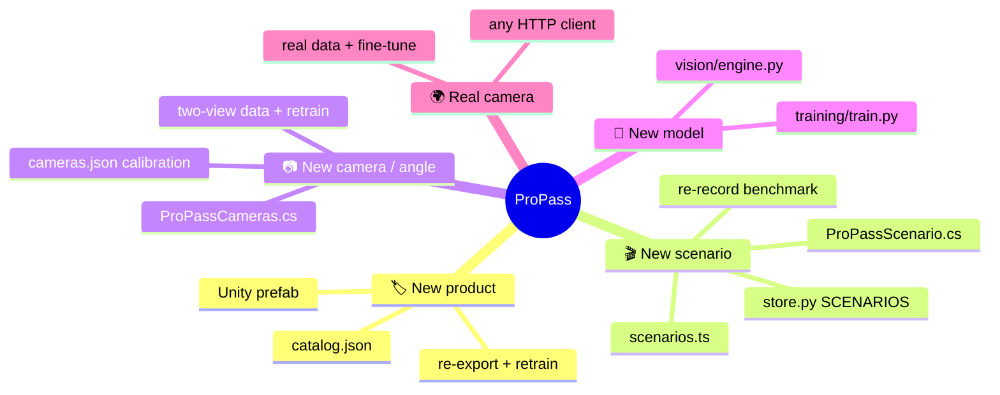

# 🧩 Extending ProPass

These are recipes for the most common changes. Each one lists every file you'll touch, so nothing gets missed.



## 🏷️ Add a product

1. **Catalog:** add an entry to [catalog.json](../catalog.json) with the next `class_index`:
   ```json
   {"sku":"PEX-006","name":"Cordless Impact Driver","price":159.00,"class_index":5,"color":[0.95,0.55,0.10]}
   ```
2. **Unity:** in [ProPassSceneBuilder.cs](../unity/Assets/ProPass/Editor/ProPassSceneBuilder.cs), extend `Colors`, `Names` and `Sizes`. Keep the gray *unenrolled* package **last**, then update the `"PEX-00"+(i+1)` and `i<5` logic and known-product bounds. In [ProPassDatasetExporter.cs](../unity/Assets/ProPass/Editor/ProPassDatasetExporter.cs), update crop folders, known-product sampling/modulo bounds, crop eligibility and the gray-prefab index. Run **ProPass → Build checkout scene**.
3. **Scenario indices:** move the `unknown` scenario's gray-prefab index in [ProPassScenario.cs](../unity/Assets/ProPass/Runtime/ProPassScenario.cs) after the new known products; otherwise the unknown demo would show the newly enrolled SKU.
4. **Data and models:** export both camera perspectives, extract unknown crops, retrain **the classifiers** for both cameras (see [training.md](training.md)). The classifier's SKU order and output size come from the catalog. Evaluate whether the merchandise detector needs retraining for the new package's appearance or geometry.
5. **Check:** the engine refuses to load a classifier whose SKU order doesn't match the catalog, so a stale checkpoint fails loudly instead of mislabeling. Re-run static evaluation and the temporal benchmark, including two identical units of the new SKU.

## 🎬 Add a scenario

Scenarios are **deterministic plans**: every actor's position is a function of `(scenario, seed, time)`. Live Play mode and the benchmark recorder run the same plan.

| File | Change |
|---|---|
| [ProPassScenario.cs](../unity/Assets/ProPass/Runtime/ProPassScenario.cs) | Add the name to `Messy` (or `Classic`), then add a `case` in `Build` that adds actors: `Walk(...)` products, `Hand`, `Shopper`, `Flatbed` or `Prop` actors, with waypoints, `follow` offsets and visibility windows |
| [ProPassScenarioRunner.cs](../unity/Assets/ProPass/Runtime/ProPassScenarioRunner.cs) | Only if you need a new kind of actor geometry |
| [api/store.py](../api/store.py) | Add the name to `SCENARIOS` |
| [web/src/scenarios.ts](../web/src/scenarios.ts) | Add an entry (name, one-line detail, what it tests). Drop a 480×270 preview at `web/public/scenarios/<id>.jpg` |
| [training/benchmark.py](../training/benchmark.py) | Add the name to `CLASSIC` or `MESSY` so it's grouped in reports |

Then re-record and re-score the benchmark ([training.md](training.md#-scenario-benchmark)). The expected cart is derived automatically from world-space motion, so there's nothing to hand-label.

> [!TIP]
> Script **evidence**, not outcomes. A scenario should move objects and occluders around. It should never tell the API what's in the cart.

## 📷 Change or add a camera

The current lane uses **two views and one physical ledger**. The lane and overhead images project onto the same 0.9 m carry plane using [vision/cameras.json](../vision/cameras.json); checkout zones are world-space markers. Moving a camera requires new calibration, rather than adjusting two horizontal image lines.

1. Move the saved `Checkout Camera` in the scene or [ProPassSceneBuilder.cs](../unity/Assets/ProPass/Editor/ProPassSceneBuilder.cs). Change the overhead pose in [ProPassCameras.cs](../unity/Assets/ProPass/Runtime/ProPassCameras.cs), which creates that camera at runtime.
2. Stop Play mode, open `Checkout.unity`, and use **ProPass → Export camera calibration**, saving to `vision/cameras.json`. The exporter forces the capture aspect before deriving point pairs and footprints. Camera IDs must match `cameras` in [vision/config.json](../vision/config.json).
3. Restart the API, run a product through the lane, and inspect both image views and the coverage map. Confirm projections agree before adjusting `fuse_radius_m`; map-specific `world_ledger` settings use normalized map units, not pixels or meters.
4. Export new training data from both perspectives and retrain/recalibrate when the view changes materially. Record new development and held-out benchmark runs into fresh folders so the prior camera recordings remain available.

For **single-view offline ablations**, keep the same dual-view recordings and use `training.benchmark --cameras lane` for world mode or `--image-mode` for the original lane image zones. Do not create a separate ledger per camera: observations fuse before the one lane ledger generates events.

A **third camera** needs more than another ID in the config. Generalize `ProPassCameras`, capture/export/recording, and `_fuse`'s current two-view pairing into multi-view groups with at most one observation per camera. Test that one item remains one unit across all views and that duplicate items remain separate. The existing implementation is a two-camera lane, not arbitrary multi-camera tracking.

## 🧠 Swap in a different model

The API only depends on the [`VisionEngine` interface](api.md#-vision-package-interface).

- **A different detector** (another YOLO size, RT-DETR, and so on): change per-camera model loading and `self.detectors[camera].track(...)` in [vision/engine.py](../vision/engine.py). Return the same `CameraObservation` fields; calibrated projection/fusion then produces ledger `Observation`s.
- **A different tracker:** set `"tracker"` in [vision/config.json](../vision/config.json) (`botsort.yaml` is the default, `bytetrack.yaml` is faster), or plug in your own. The ledger already tolerates ID switches.
- **A different classifier** (for example, a stronger embedding backbone): update runtime, training, calibration and static evaluation together. Keep per-SKU probabilities, a normalized embedding and an `unknown` flag.
- Record the checkpoint in [models/manifest.json](../models/manifest.json), then re-run `training.evaluate` and `training.benchmark` with fixed seeds and camera modes so results stay comparable. Tune on development runs before opening the held-out split.

## 🌍 Use a real camera

Any client can submit JPEGs with `camera_id` and shared capture metadata. [pipeline.md](pipeline.md#-feeding-the-pipeline-from-something-other-than-unity) has a webcam example. Recognition on real footage still needs its own measured dataset:

1. Record and label a small consented real dataset of your own products.
2. Fine-tune both models with synthetic + real data, and evaluate on a **held-out real session**.
3. For one webcam, configure `cameras: ["lane"]`, `world_mode: false` and appropriate image zones/lane polygon. For two real cameras, synchronize capture instants and build calibration for their actual placement and carrying plane. Never reuse Unity's homographies for physical cameras.

## 🧹 Conventions

- **Never send simulator ground truth to the API.** Use offline files only.
- **Config over constants:** tuning values belong in `vision/config.json` or `catalog.json`.
- **Every behavior change gets a test.** `.venv/bin/python -m pytest tests -q` must stay green.
- **Report measured numbers with their source file**, and label synthetic results as synthetic.
- Generated data, weights, logs and the database stay out of git (see [.gitignore](../.gitignore)).
