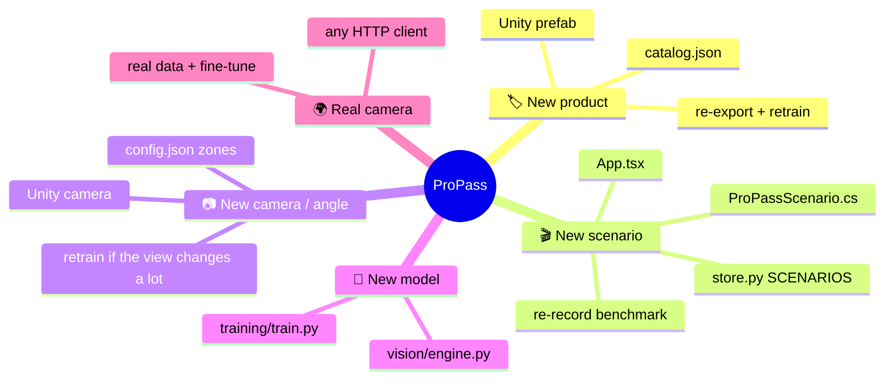

# 🧩 Extending ProPass

These are recipes for the most common changes. Each one lists every file you'll touch, so nothing gets missed.



## 🏷️ Add a product

1. **Catalog:** add an entry to [catalog.json](../catalog.json) with the next `class_index`:
   ```json
   {"sku":"PEX-006","name":"Cordless Impact Driver","price":159.00,"class_index":5,"color":[0.95,0.55,0.10]}
   ```
2. **Unity:** in [ProPassSceneBuilder.cs](../unity/Assets/ProPass/Editor/ProPassSceneBuilder.cs), extend `Colors`, `Names` and `Sizes`. Keep the gray *unenrolled* package **last**, then update the `"PEX-00"+(i+1)` and `i<5` logic and the loop counts. Also update the crop folders in [ProPassDatasetExporter.cs](../unity/Assets/ProPass/Editor/ProPassDatasetExporter.cs). Run **ProPass → Build checkout scene**.
3. **Data and models:** re-export the dataset, then retrain **the classifier** (its output size and SKU order come from the catalog). The detector usually doesn't need retraining, because everything is still `merchandise`. Retrain it if the new package looks very different. See [training.md](training.md).
4. **Check:** the engine refuses to load a classifier whose SKU order doesn't match the catalog, so a stale checkpoint fails loudly instead of mislabeling.

## 🎬 Add a scenario

Scenarios are **deterministic plans**: every actor's position is a function of `(scenario, seed, time)`. Live Play mode and the benchmark recorder run the same plan.

| File | Change |
|---|---|
| [ProPassScenario.cs](../unity/Assets/ProPass/Runtime/ProPassScenario.cs) | Add the name to `Messy` (or `Classic`), then add a `case` in `Build` that adds actors: `Walk(...)` products, `Hand`, `Shopper`, `Flatbed` or `Prop` actors, with waypoints, `follow` offsets and visibility windows |
| [ProPassScenarioRunner.cs](../unity/Assets/ProPass/Runtime/ProPassScenarioRunner.cs) | Only if you need a new kind of actor geometry |
| [api/store.py](../api/store.py) | Add the name to `SCENARIOS` |
| [web/src/App.tsx](../web/src/App.tsx) | Add an entry to `scenarioOptions` |
| [training/benchmark.py](../training/benchmark.py) | Add the name to `CLASSIC` or `MESSY` so it's grouped in reports |

Then re-record and re-score the benchmark ([training.md](training.md#-scenario-benchmark)). The expected cart is derived automatically from world-space motion, so there's nothing to hand-label.

> [!TIP]
> Script **evidence**, not outcomes. A scenario should move objects and occluders around. It should never tell the API what's in the cart.

## 📷 Change or add a camera

The zone lines are **normalized image y-coordinates**, so they depend on the camera pose.

1. Move the `Checkout Camera` in the scene builder (or the scene).
2. Play a single-item run and note the y-value (0 = top, 1 = bottom) where boxes pass the orange and teal floor markers. The dashboard overlay draws the current lines.
3. Update `approach_y` and `commit_y` in [vision/config.json](../vision/config.json). The dashboard's overlay lines in `VideoCanvas` ([App.tsx](../web/src/App.tsx)) are hard-coded to 0.40 and 0.65 today, so update them to match.
4. If the viewpoint changes a lot, re-export and retrain the detector so it sees the new perspective.

A **second camera** currently needs a second ledger, because each `VisionEngine` holds one lane's state. You'd also need a rule for fusing the two cameras' events. That's design work and is covered in the [roadmap](roadmap.md#-phase-c-multiple-cameras-and-a-coverage-map).

## 🧠 Swap in a different model

The API only depends on the [`VisionEngine` interface](api.md#-vision-package-interface).

- **A different detector** (another YOLO size, RT-DETR, and so on): change the loading and `self.detector.track(...)` in [vision/engine.py](../vision/engine.py). Keep the output `Observation`s the same.
- **A different tracker:** swap `tracker="bytetrack.yaml"` for `botsort.yaml` (BoT-SORT with optional ReID) or plug in your own. The ledger already tolerates ID switches.
- **A different classifier** (for example, a stronger embedding backbone): replace the EfficientNet block, but keep returning per-SKU probabilities, an L2-normalized embedding and an `unknown` flag.
- Record the new checkpoint in [models/manifest.json](../models/manifest.json), and re-run `training.evaluate` and `training.replay` so results stay comparable.

## 🌍 Use a real camera

Any client that POSTs JPEGs works. [pipeline.md](pipeline.md#-feeding-the-pipeline-from-something-other-than-unity) has a 15-line webcam example. To get *correct* results you'll also need to:

1. Record and label a small consented real dataset of your own products.
2. Fine-tune both models with synthetic + real data, and evaluate on a **held-out real session**.
3. Recalibrate the zone lines for the real camera.

## 🧹 Conventions

- **Never send simulator ground truth to the API.** Use offline files only.
- **Config over constants:** tuning values belong in `vision/config.json` or `catalog.json`.
- **Every behavior change gets a test.** `.venv/bin/python -m pytest tests -q` must stay green.
- **Report measured numbers with their source file**, and label synthetic results as synthetic.
- Generated data, weights, logs and the database stay out of git (see [.gitignore](../.gitignore)).
