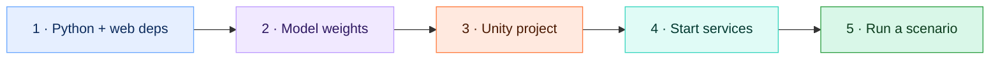
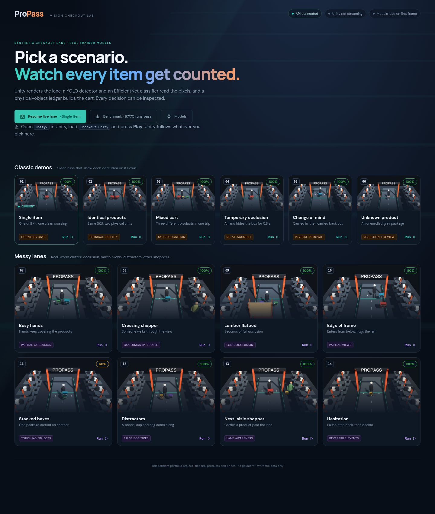
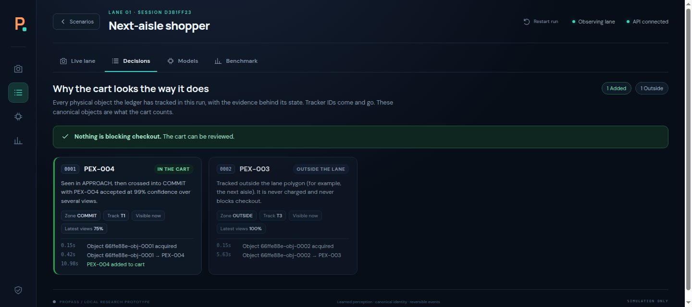
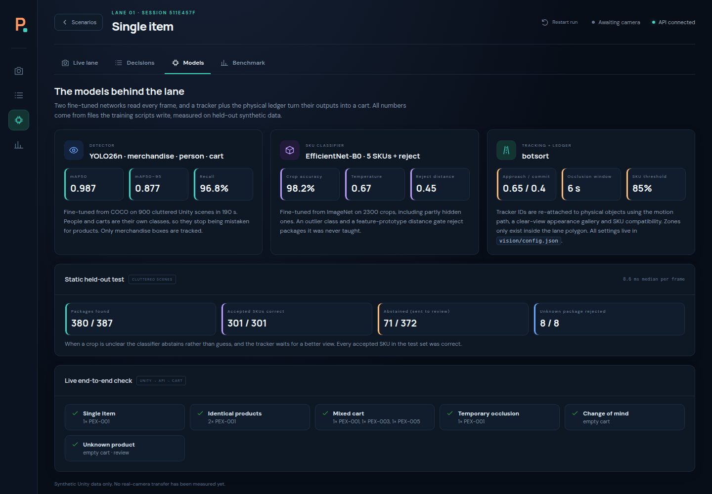

# 🚀 Getting started

This page takes you from a fresh clone to a confirmed simulated checkout.



## ✅ Prerequisites

| Tool | Version | Notes |
|---|---|---|
| 🐍 Python | 3.12 | |
| 🟩 Node.js | 20+ | For the Vite dashboard |
| 🎮 Unity | **6000.6.4f1** with URP 17.6 | Install through Unity Hub |
| 🟢 NVIDIA GPU | optional | Tested on an RTX 4070 Super. CPU inference works but is slower. |

## 1️⃣ Install Python and web dependencies

```bash
python3 -m venv .venv
.venv/bin/python -m pip install -r requirements-vision.txt -r requirements-api.txt
(cd web && npm ci)
```

If `torch.cuda.is_available()` is `False` on a GPU machine, install the matching wheel from [pytorch.org](https://pytorch.org/get-started/locally/) before training.

## 2️⃣ Get the model weights

Weights are git-ignored. You need:

```text
models/detector.pt            ← lane camera: fine-tuned YOLO26n
models/classifier.pt          ← lane camera: fine-tuned EfficientNet-B0 + rejection calibration
models/overhead/detector.pt   ← overhead camera pair
models/overhead/classifier.pt
```

Download them with one command (needs the [GitHub CLI](https://cli.github.com/), signed in to an account that can read the repository), or rebuild them with `scripts/round.sh` ([training.md](training.md)):

```bash
bash scripts/get_weights.sh       # both camera pairs, 42 MB; prints their SHA-256, which should match models/manifest.json
bash scripts/get_recordings.sh    # one recorded run per scenario (about 500 MB), so scenes run without Unity
```

Without weights, the API still starts and the dashboard says the models are missing.

### Product label art

```bash
.venv/bin/python scripts/prepare_products.py
```

This draws every product's printed front, top and barcode label from `catalog.json`. All 15 products and their brands are invented, so the art is generated and already in the repository; rerun the script only after changing the catalog, then rebuild the scene (**ProPass → Build checkout scene**).

## 3️⃣ Open the Unity project

The whole Unity project lives in this repo under [`unity/`](../unity), including `Assets/`, `Packages/` and `ProjectSettings/`. Unity regenerates `Library/` and the other caches on first open, and they're git-ignored.

> 🧍 **People are optional assets.** With the free [Creative Characters pack](https://assetstore.unity.com/packages/3d/characters/humanoids/creative-characters-free-animated-pack-304841) imported (Package Manager → My Assets, it lands in `unity/Assets/ithappy/`, which is git-ignored), **ProPass → Build checkout scene** uses animated characters. Without it, the same scenes run with capsule people. The published weights were trained with the characters.

1. In **Unity Hub**, choose **Add → Add project from disk** and select the repo's `unity/` folder.
2. Open it with **6000.6.4f1**. The first import takes a few minutes.
3. Open `Assets/ProPass/Scenes/Checkout.unity`.

The saved scene has the oblique **lane camera**. The **overhead camera** is created automatically when the simulation starts; no additional camera hardware or scene setup is needed. Each capture instant produces two 960×540 RGB images with one shared frame ID. The matching fixed calibration is [vision/cameras.json](../vision/cameras.json).

If the scene is missing or broken, regenerate it with **ProPass → Build checkout scene**. If you change either camera's pose, stop Play mode and use **ProPass → Export camera calibration**, saving to `vision/cameras.json`, then restart the API. See [extending.md](extending.md#-change-or-add-a-camera).

## 4️⃣ Start the API and dashboard

```bash
bash scripts/start.sh
```

| Service | URL |
|---|---|
| 🖥️ Dashboard | http://127.0.0.1:5173 |
| ⚙️ API health | http://127.0.0.1:8000/api/health |
| 📖 Interactive API docs | http://127.0.0.1:8000/docs |

Keep that terminal open, and press Ctrl+C to stop both services. Logs go to `artifacts/logs/`. If both services are already running, the script says so and exits.

## 5️⃣ Run a scenario

1. In Unity, open **Checkout.unity** and press **▶ Play**. Make sure the Editor's Pause button is off.
2. Open the dashboard. The **title screen** lists 17 scenarios, with previews and benchmark scores when reports are available. Start with **Identical products** to inspect two physical units of one SKU.
3. Click a card. Unity switches to that scenario within about 0.35 s, and the dashboard opens the **Live lane** tab.
4. In **Live lane**, switch between **Lane camera** and **Overhead camera**. The view counter should show both images present. The coverage map shows the shared lane, orange approach marker and teal commit marker; one physical object has the same canonical ID across its image views and map dot.
5. Items join the cart after an observed forward crossing with accepted SKU evidence. For the clean scenarios, wait about 15 seconds, then click **Review checkout** and **Confirm demo checkout** once evidence is resolved. Review pauses capture, drains accepted camera groups and freezes the cart version before confirmation.

| Scenario | Expected after ~15 s |
|---|---|
| Single item | 1 × Workshop Drill Kit |
| Identical products | 2 × Workshop Drill Kit |
| Mixed cart | Drill kit, measuring tape, work gloves |
| Temporary occlusion | 1 × drill kit after a brief disappearance |
| Change of mind | Driver kit added, then removed on the way back (~29 s) |
| Unknown product | Gray package tracked, checkout blocked for review |
| Messy lanes (9) | Products vary by run. The **Decisions** tab explains pending or reviewed evidence. |
| Parked flatbed (messy) | The overhead view is intended to preserve evidence while the lane view is hidden for 7–9 seconds; inspect the measured report and both views. |

## 🖥️ Dashboard tour



| Tab | What it's for |
|---|---|
| 🎥 **Live lane** | Camera switcher, frame-matched boxes/IDs/SKUs, calibrated coverage map and object trails, plus cart, timeline and checkout controls. World zones appear on the map; image-mode zones appear on the camera overlay. |
| 🧾 **Decisions** | One card per physical object, with its state and a plain-language reason ("crossed into COMMIT with PEX-001 accepted at 97%"), its events, and exactly what is blocking checkout |
| 🧠 **Models** | Detector, classifier and tracker settings and measured results, read live from `models/*.json` |
| 📊 **Benchmark** | Measured per-scenario results and the report's labeled comparison. **Run live** starts that scenario in Unity. |





The ◀ **Scenarios** button (or the **P** logo) goes back to the title screen. The URL hash (`#/lab/decisions`, for example) keeps your place on refresh.

## 🩺 Troubleshooting

| Problem | Fix |
|---|---|
| Dashboard stuck on *Awaiting camera* | Unity isn't in Play mode, or it's paused. See [pipeline.md → When the pipeline stalls](pipeline.md#-when-the-pipeline-stalls). |
| *Model initialization failed* | Weights are missing, or `classifier.pt` was trained with a different catalog order |
| Review checkout says evidence is unresolved | Expected while an item is still mid-lane, or for the unknown product. Wait, or click **Resume**. |
| Port 8000 or 5173 is already in use | Something else is running there. Stop it, or check `artifacts/logs/` |
| Very slow, `dropped_frames` rising | You're on CPU. Lower `captureHz` on the Unity component |
| Only one camera is present | Check Unity's upload status and configured camera IDs; the API processes available views, but shows missing evidence instead of an older image. |
| Map dots disagree with the camera views | Export calibration after camera changes; check capture dimensions/aspect and carrying height. |
| Want to try PostgreSQL | See [architecture.md → Data model](architecture.md#-data-model) |
