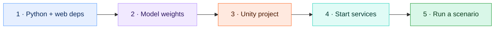

# 🚀 Getting started

This page takes you from a fresh clone to a confirmed simulated checkout.



## ✅ Prerequisites

| Tool | Version | Notes |
|---|---|---|
| 🐍 Python | 3.12 | |
| 🟩 Node.js | 20+ | For the Vite dashboard |
| 🎮 Unity | **6000.6.4f1** with URP 17.6 | Install through Unity Hub |
| 🟢 NVIDIA GPU | optional | Tested on an RTX 4070 Super. CPU inference works but is slower. |

## 1️⃣ Install Python and web dependencies

```bash
python3 -m venv .venv
.venv/bin/python -m pip install -r requirements-vision.txt -r requirements-api.txt
(cd web && npm ci)
```

If `torch.cuda.is_available()` is `False` on a GPU machine, install the matching wheel from [pytorch.org](https://pytorch.org/get-started/locally/) before training.

## 2️⃣ Get the model weights

Weights are git-ignored. You need:

```text
models/detector.pt     ← fine-tuned YOLO26n
models/classifier.pt   ← fine-tuned EfficientNet-B0 + calibration
```

Either copy them from a machine that already has them (check the SHA-256 against [models/manifest.json](../models/manifest.json)), or reproduce them with [training.md](training.md). Without them the API still starts, but `/api/health` reports `awaiting_checkpoints`. It never fakes predictions.

## 3️⃣ Open the Unity project

The whole Unity project lives in this repo under [`unity/`](../unity), including `Assets/`, `Packages/` and `ProjectSettings/`. Unity regenerates `Library/` and the other caches on first open, and they're git-ignored.

1. In **Unity Hub**, choose **Add → Add project from disk** and select the repo's `unity/` folder.
2. Open it with **6000.6.4f1**. The first import takes a few minutes.
3. Open `Assets/ProPass/Scenes/Checkout.unity`.

If the scene is ever missing or broken, regenerate it from the menu with **ProPass → Build checkout scene**.

## 4️⃣ Start the API and dashboard

```bash
bash scripts/start.sh
```

| Service | URL |
|---|---|
| 🖥️ Dashboard | http://127.0.0.1:5173 |
| ⚙️ API health | http://127.0.0.1:8000/api/health |
| 📖 Interactive API docs | http://127.0.0.1:8000/docs |

Keep that terminal open, and press Ctrl+C to stop both services. Logs go to `artifacts/logs/`. If both services are already running, the script says so and exits.

## 5️⃣ Run a scenario

1. In Unity, open **Checkout.unity** and press **▶ Play**. Make sure the Editor's Pause button is off.
2. Open the dashboard. The **title screen** lists all 14 scenarios, each with a preview and its benchmark pass rate. **Identical products** is the best first demo.
3. Click a card. Unity switches to that scenario within about 0.35 s, and the dashboard opens the **Live lane** tab.
4. Items join the cart when they cross the teal **COMMITTED** line inside the lane outline. After about 15 seconds, click **Review checkout**, then **Confirm demo checkout**.

| Scenario | Expected after ~15 s |
|---|---|
| Single item | 1 × Workshop Drill Kit |
| Identical products | 2 × Workshop Drill Kit |
| Mixed cart | Drill kit, measuring tape, work gloves |
| Temporary occlusion | 1 × drill kit after a brief disappearance |
| Change of mind | Driver kit added, then removed on the way back (~29 s) |
| Unknown product | Gray package tracked, checkout blocked for review |
| Messy lanes (8) | Products vary by run. The **Decisions** tab explains every outcome. |

## 🖥️ Dashboard tour


| Tab | What it's for |
|---|---|
| 🎥 **Live lane** | The processed camera frame with the lane outline, zone lines, boxes, track IDs and SKUs, plus the cart, the event timeline and the checkout buttons |
| 🧾 **Decisions** | One card per physical object, with its state and a plain-language reason ("crossed into COMMIT with PEX-001 accepted at 97%"), its events, and exactly what is blocking checkout |
| 🧠 **Models** | Detector, classifier and tracker settings and measured results, read live from `models/*.json` |
| 📊 **Benchmark** | Pass rate per scenario against the Phase A baseline. **Run live** starts that scenario in Unity. |


The ◀ **Scenarios** button (or the **P** logo) goes back to the title screen. The URL hash (`#/lab/decisions`, for example) keeps your place on refresh.

## 🩺 Troubleshooting

| Problem | Fix |
|---|---|
| Dashboard stuck on *Awaiting camera* | Unity isn't in Play mode, or it's paused. See [pipeline.md → When the pipeline stalls](pipeline.md#-when-the-pipeline-stalls). |
| *Model initialization failed* | Weights are missing, or `classifier.pt` was trained with a different catalog order |
| Review checkout says evidence is unresolved | Expected while an item is still mid-lane, or for the unknown product. Wait, or click **Resume**. |
| Port 8000 or 5173 is already in use | Something else is running there. Stop it, or check `artifacts/logs/` |
| Very slow, `dropped_frames` rising | You're on CPU. Lower `captureHz` on the Unity component |
| Want to try PostgreSQL | See [architecture.md → Data model](architecture.md#️-data-model) |
