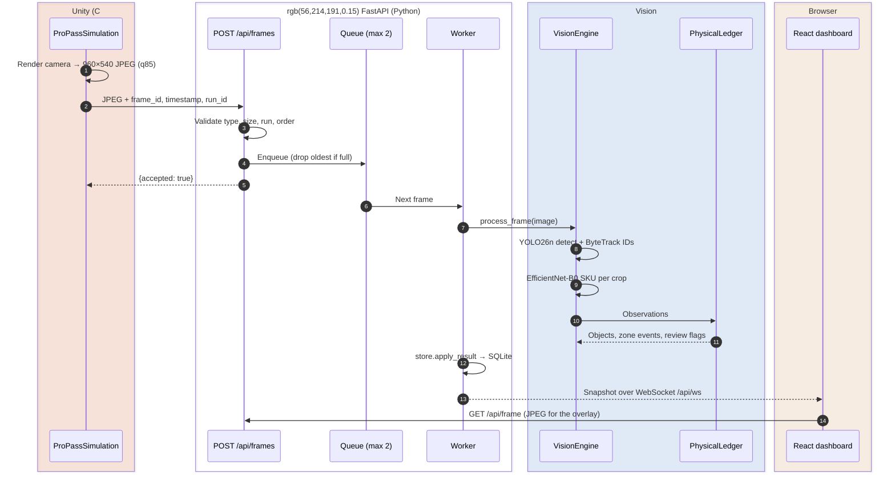
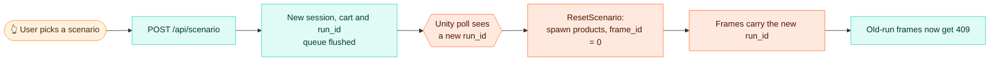

# 🔁 Unity → web pipeline

This page follows a single camera frame from Unity's renderer to the cart on the dashboard, then walks through the control loop that runs in the other direction.


<table>
<tr>
<td width="50%"><br><sub><b>Unity:</b> the camera the pipeline sees</sub></td>
<td width="50%"><br><sub><b>Dashboard:</b> detections, zones and the cart it produced</sub></td>
</tr>
</table>

## 🧱 The one rule

> [!IMPORTANT]
> **Only pixels and timing cross the boundary.** Unity knows each box's SKU, ID and position, but it sends the API nothing except a JPEG, a frame number, a timestamp and a run ID. Everything in the cart has to be *inferred* from pixels. Ground truth exists only in offline training and evaluation files.

That's why the project counts as computer vision rather than a scripted animation. Any change to the pipeline has to keep this rule.

## 🎞️ A frame's journey



| # | Step | Where in the code | Notes |
|:-:|---|---|---|
| 1 | Capture | `ProPassSimulation.SendFrame` in [unity/…/ProPassSimulation.cs](../unity/Assets/ProPass/Runtime/ProPassSimulation.cs) | Renders `checkoutCamera` into a RenderTexture, then `EncodeToJPG(85)`. Runs every `1/captureHz` s (8 Hz) and skips a tick if the previous upload is still in flight. |
| 2 | Upload | same | `POST {serverUrl}/api/frames?frame_id=…&timestamp=…&run_id=…`, body `image/jpeg`, with a 3 s timeout. `timestamp` is scenario time in seconds. |
| 3 | Validate | `frames()` in [api/app.py](../api/app.py) | Rejects anything that isn't JPEG (415), anything over 8 MiB (413), a wrong `run_id` (409) and paused capture (409). A duplicate or out-of-order `frame_id` is acknowledged but ignored. |
| 4 | Queue | `Runtime.queue` | `maxsize=2`. When it's full, the **oldest** frame is dropped and `dropped_frames` goes up. Fresh evidence beats a growing backlog. |
| 5 | Infer | `Runtime.worker` → `VisionEngine.process_frame` in [vision/engine.py](../vision/engine.py) | Runs in a worker thread, one frame at a time. Details are in [vision.md](vision.md). |
| 6 | Persist | `Store.apply_result` in [api/store.py](../api/store.py) | Adds or removes physical items idempotently, keyed on `(run_id, event_id)`. Bumps the cart version. |
| 7 | Publish | `Runtime.publish` | Pushes the full snapshot to every WebSocket client. A client that takes longer than 0.5 s gets dropped. |
| 8 | Render | `VideoCanvas` in [web/src/App.tsx](../web/src/App.tsx) | Fetches the processed JPEG, then draws zone lines, boxes and labels on a canvas. Vite proxies `/api` to `:8000`. |

## 🎛️ The control loop (dashboard → Unity)

Unity never receives instructions pushed to it. Instead it **polls** `GET /api/simulator/control` every 0.35 s and gets back:

```json
{ "scenario": "duplicate", "run_id": "7f3c…", "paused": false }
```



The `run_id` is the synchronization key. Each run has its own ID, and the API rejects frames from any other run. So a reset can never leak old frames into a new cart.

**Pausing for checkout.** `POST /api/cart/prepare` sets `paused = true`. Unity's next poll stops the capture loop and freezes the scene. The API then **drains** every frame it already accepted and freezes a cart version plus the last processed `frame_id`. Confirmation only succeeds for that exact version. See [architecture.md](architecture.md#-the-confirmation-barrier).

## ⏱️ Timing at a glance

| Stage | Typical | Source |
|---|---:|---|
| Unity capture rate | 8 frames/s | `captureHz` |
| Control poll interval | 350 ms | `PollControl` |
| Detector + classifier (GPU, static test) | 9.8 ms median, 12.8 ms p95 | [evaluation-static-test.json](../models/evaluation-static-test.json) |
| Full pipeline per frame (dashboard) | ~20 ms | `metrics.pipeline_ms` in the snapshot |
| Upload timeout | 3 s | `SendFrame` |

Inference is roughly 6× faster than the frame rate, so the queue usually sits at 0–1 frames.

## 🎥 Recording replays

Set **Replay Directory** on the `ProPass Simulation` component in the Inspector (for example `…/propass/artifacts/replays`). During Play, Unity then also writes, for up to `maximumReplayFrames` (260) frames:

```text
artifacts/replays/<scenario>/<run_id>/000001.jpg   ← exactly what was sent
artifacts/replays/<scenario>/<run_id>/000001.json  ← ground truth: sku, physical_id, image x/y
```

[training/replay.py](../training/replay.py) re-runs the vision engine over the JPEGs **without** the API, and reads the JSON only afterwards to score the cart. That gives repeatable temporal evaluation without having Unity open. See [training.md](training.md#-temporal-replay-evaluation).

For larger, exactly repeatable test sets, use the **benchmark recorder** instead. It renders seeded scenarios offline, frame by frame, without Play mode. See [training.md → Scenario benchmark](training.md#-scenario-benchmark).

## 🔌 Feeding the pipeline from something other than Unity

The API doesn't care where the pixels come from. Any client can drive it:

```python
import cv2, requests, time, uuid
api = "http://127.0.0.1:8000"
run_id = requests.post(f"{api}/api/scenario", json={"scenario": "single"}).json()["session"]["run_id"]
cam, t0, frame_id = cv2.VideoCapture(0), time.time(), 0
while True:
    ok, img = cam.read()
    frame_id += 1
    jpeg = cv2.imencode(".jpg", img, [cv2.IMWRITE_JPEG_QUALITY, 85])[1].tobytes()
    requests.post(f"{api}/api/frames", data=jpeg, headers={"Content-Type": "image/jpeg"},
                  params={"frame_id": frame_id, "timestamp": time.time() - t0, "run_id": run_id})
    time.sleep(1 / 8)
```

> [!WARNING]
> The models were trained only on synthetic boxes, so a real webcam will work end to end but won't recognize real products until you collect real data and fine-tune on it. Also note that the zone lines are in normalized image coordinates, so a new camera angle needs new `approach_y` and `commit_y` values in [vision/config.json](../vision/config.json).

## 🩺 When the pipeline stalls

| Symptom | Likely cause | Fix |
|---|---|---|
| Dashboard says *Awaiting camera* | Unity isn't in Play mode, or the Editor is paused | Press Play and make sure the Pause button is off. `Application.runInBackground` is already true. |
| Unity status shows *API connection pending* | The API isn't running on `:8000` | Run `bash scripts/start.sh`, then check `artifacts/logs/api.log` |
| Frames get `409 Stale simulator run` | Unity hasn't polled the new `run_id` yet | This is normal for up to ~0.35 s after a reset |
| `dropped_frames` keeps climbing | Inference is slower than 8 Hz (usually CPU mode) | Lower `captureHz`, or check `vision.device` in `/api/health` |
| *Model initialization failed* | Weights are missing or don't match the catalog | Put `detector.pt` and `classifier.pt` in `models/` (see [training.md](training.md)) |
