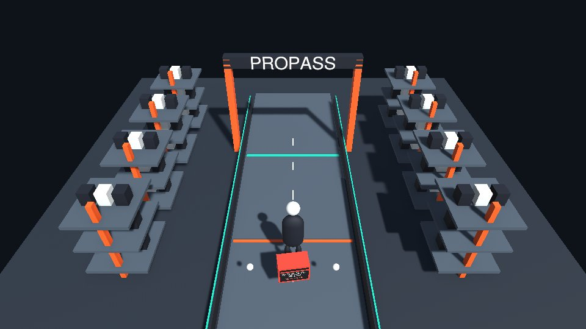
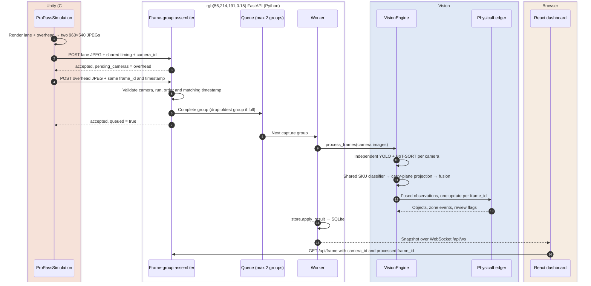
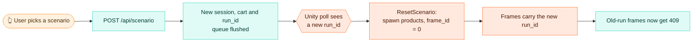

# 🔁 Unity → web pipeline

This page follows one **synchronized capture group** from Unity's lane and overhead cameras to the dashboard cart, then follows the control loop back to Unity. Both images share a frame number, timestamp and run ID; the backend performs one ledger update for the group.


<table>
<tr>
<td width="50%"><br><sub><b>Unity:</b> the lane camera; the overhead view supplies a second angle</sub></td>
<td width="50%"><br><sub><b>Dashboard:</b> detections, zones and the cart it produced</sub></td>
</tr>
</table>

## 🧱 The one rule

> [!IMPORTANT]
> **Only pixels and source-frame metadata cross the live boundary.** Each upload contains a JPEG plus `camera_id`, frame number, timestamp and run ID. Unity's product SKUs, physical IDs and live transforms never enter the API. Fixed camera calibration is separate configuration; product ground truth exists only in offline training and evaluation files.

That's why the project counts as computer vision rather than a scripted animation. Any change to the pipeline has to keep this rule.

## 🎞️ A frame's journey



| # | Step | Where in the code | Notes |
|:-:|---|---|---|
| 1 | Capture | `ProPassSimulation.SendFrame` in [unity/…/ProPassSimulation.cs](../unity/Assets/ProPass/Runtime/ProPassSimulation.cs) | Renders both cameras before yielding to the upload loop. JPEG quality is 85; capture dimensions are 960×540. Camera setup lives in [ProPassCameras.cs](../unity/Assets/ProPass/Runtime/ProPassCameras.cs). |
| 2 | Upload | same | Two `POST /api/frames` requests, each with `camera_id`, shared `frame_id`, `timestamp` and `run_id`; body is `image/jpeg`, timeout is 3 s. Timestamp is scenario time in seconds. |
| 3 | Validate and group | `frames()` in [api/app.py](../api/app.py) | Checks JPEG type/size, configured camera, current run and capture state. One camera cannot contribute twice. Timestamps in a group must agree within 1 ms. Late or duplicate payloads cannot reopen a completed group. |
| 4 | Queue | `Runtime.flush_pending` / `Runtime.queue` | At most **two groups**. The oldest whole group is dropped when full. Complete groups enqueue immediately; the next frame number flushes an incomplete group with its available views. |
| 5 | Infer | `Runtime.worker` → `VisionEngine.process_frames` in [vision/engine.py](../vision/engine.py) | Decodes available images and processes one group at a time in a worker thread. Missing images are not substituted with older ones. Details are in [vision.md](vision.md). |
| 6 | Persist | `Store.apply_result` in [api/store.py](../api/store.py) | Adds or removes physical items idempotently, keyed on `(run_id, event_id)`. Bumps the cart version. |
| 7 | Publish | `Runtime.publish` | Pushes the full snapshot to every WebSocket client. A client that takes longer than 0.5 s gets dropped. |
| 8 | Render | `VideoCanvas` in [web/src/LiveTab.tsx](../web/src/LiveTab.tsx) | Camera selection fetches that camera's processed JPEG and draws only its boxes. [CoverageMap](../web/src/CoverageMap.tsx) shows fused world positions and fixed camera footprints. Vite proxies `/api` to `:8000`. |

Snapshots expose `frames[camera_id]`, detections tagged with `camera`, and canonical `objects[].world`. The JPEG cache is keyed by **run, frame and camera** and retains four processed capture instants. A missing camera is shown as missing, rather than displaying an old view under new detections. `geometry` is available in snapshots and `GET /api/reports`.

The assembler keeps just one pending group. If only one camera arrives, a newer frame closes that group and the engine uses the available evidence. `incomplete_frame_groups`, `pending_cameras` and `missing_cameras` expose this condition. The engine can continue with one view, but coverage and checkout reliability may degrade; the dashboard does not imply that a missing camera supplied evidence.

## 🎛️ The control loop (dashboard → Unity)

Unity never receives instructions pushed to it. Instead it **polls** `GET /api/simulator/control` every 0.35 s and gets back:

```json
{ "scenario": "duplicate", "run_id": "7f3c…", "paused": false }
```



The `run_id` is the synchronization key. Each run has its own ID, and the API rejects frames from any other run. Reset clears the pending camera group and queue. The worker resets model trackers and fusion aliases before the next run's inference, so an in-flight old result cannot become evidence for a new cart.

**Pausing for checkout.** `POST /api/cart/prepare` sets `paused = true`, flushes the last accepted incomplete camera group, and **drains** the accepted queue. Unity's next poll stops capture and freezes the scene. Preparation rejects unresolved evidence, then freezes a cart version and last processed frame ID. Confirmation only succeeds for that exact version. See [architecture.md](architecture.md#-the-confirmation-barrier).

## ⏱️ Timing at a glance

| Stage | Typical | Source |
|---|---:|---|
| Unity capture cadence | nominal 8 groups/s, two images/group | `captureHz`; upload time lowers the actual cadence |
| Control poll interval | 350 ms | `PollControl` |
| Detector + classifier, static images | measured median and p95 | [evaluation-static-test.json](../models/evaluation-static-test.json); static timing is not two-camera pipeline timing |
| Full pipeline per group | measured live | `metrics.pipeline_ms` in the snapshot |
| Upload timeout | 3 s | `SendFrame` |

Use observed queue depth, dropped groups and per-group latency to assess throughput. Two cameras require two detector passes; static single-image latency does not establish live headroom.

## 🎥 Recording reproducible dual-view runs

The live component has no Replay Directory setting. Use the **benchmark recorder**, which renders seeded scenarios offline at fixed 8 Hz, without Play mode or the API. Each capture instant has both views:

```text
artifacts/benchmark/<scenario>/seed_00/
  000001.jpg           ← lane RGB
  000001.overhead.jpg  ← overhead RGB, same instant
  000001.json          ← timing + separate offline product truth
  run.json             ← seeded scenario + expected final cart
```

[training/benchmark.py](../training/benchmark.py) sends only JPEGs and timing to `process_frames`, then compares predictions against the offline oracle. It can score lane image mode, calibrated lane-only mode and calibrated two-camera mode on the **same recordings**. See [training.md → Scenario benchmark](training.md#-scenario-benchmark). The older `training/replay.py` remains for historical single-camera recordings; it is not the dual-camera scorer.

## 🔌 Feeding the pipeline from something other than Unity

The API accepts other RGB sources. For a single webcam, first configure `cameras: ["lane"]` and `world_mode: false`, set appropriate image zones/lane polygon, and restart the API. For real dual cameras, export or construct a new calibration for their placement and a common carry plane. Unity's calibration is not valid for a real webcam.

```python
import cv2, requests, time
api = "http://127.0.0.1:8000"
run_id = requests.post(f"{api}/api/scenario", json={"scenario": "single"}).json()["session"]["run_id"]
cam, t0, frame_id = cv2.VideoCapture(0), time.time(), 0
while True:
    ok, img = cam.read()
    if not ok:
        break
    frame_id += 1
    jpeg = cv2.imencode(".jpg", img, [cv2.IMWRITE_JPEG_QUALITY, 85])[1].tobytes()
    response = requests.post(f"{api}/api/frames", data=jpeg, headers={"Content-Type": "image/jpeg"},
                  params={"camera_id": "lane", "frame_id": frame_id,
                          "timestamp": time.time() - t0, "run_id": run_id}, timeout=3)
    if response.status_code == 409:
        break  # paused checkout or a changed run needs a new control decision
    response.raise_for_status()
    time.sleep(1 / 8)
cam.release()
```

> [!WARNING]
> The models were trained on five fictional synthetic packages. Recognition and tracking performance on real products have not been measured. Collect consented real-camera footage and fine-tune/evaluate before claiming transfer. Camera changes also require recalibration of world geometry or image-space zones.

## 🩺 When the pipeline stalls

| Symptom | Likely cause | Fix |
|---|---|---|
| Dashboard says *Awaiting camera* | Unity isn't in Play mode, or the Editor is paused | Press Play and make sure the Pause button is off. `Application.runInBackground` is already true. |
| Unity status shows *API connection pending* | The API isn't running on `:8000` | Run `bash scripts/start.sh`, then check `artifacts/logs/api.log` |
| Frames get `409 Stale simulator run` | Unity hasn't polled the new `run_id` yet | This is normal for up to ~0.35 s after a reset |
| `dropped_frames` keeps climbing | Inference is slower than 8 Hz (usually CPU mode) | Lower `captureHz`, or check `vision.device` in `/api/health` |
| One view says *missing* | That camera did not arrive for the current processed group | Check `camera_id`, shared timing and upload errors; inspect incomplete-group metrics |
| Map positions disagree between views | Camera moved, capture aspect changed, or carrying height differs | Export calibration, restart the API and test projection agreement before widening fusion gates |
| *Model initialization failed* | Weights are missing or don't match the catalog | Put `detector.pt` and `classifier.pt` in `models/` (see [training.md](training.md)) |
