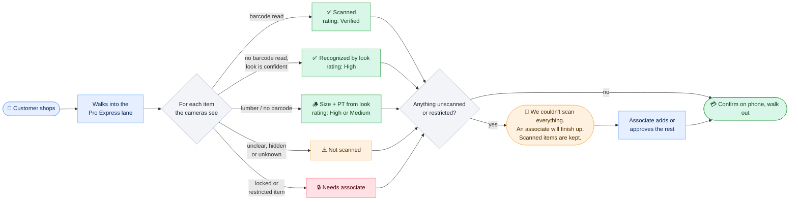
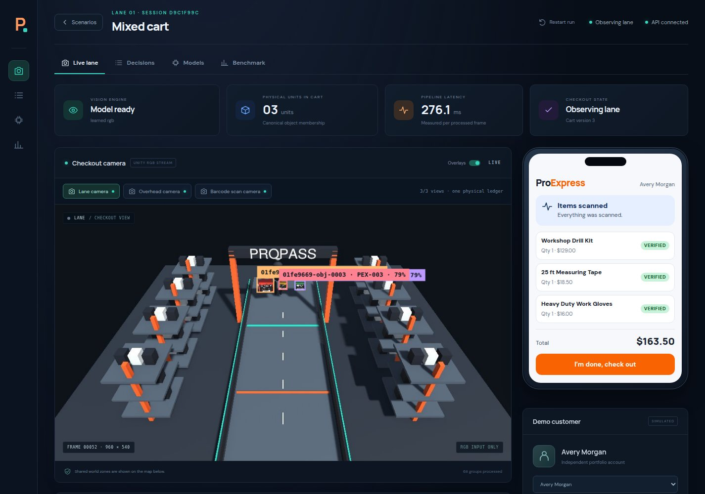
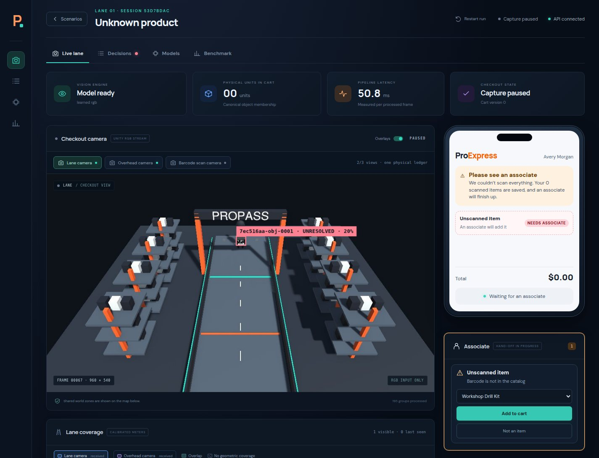

# 🧰 Pro Express v2: plan

> [!NOTE]
> **Status: in progress on the `pro-express-v2` branch.** Written on 2026-10-06 from Danny's brief, before any code, so the work can be picked up by anyone. Progress is tracked in the checklist at the bottom.

## 🎯 The brief, in Danny's words (condensed)

- Use **real assets**: an animated character pack from the Unity Asset Store for people, and products that look like real boxed Home Depot merchandise.
- Every boxed product carries a **barcode**. **The cameras' job is to scan the barcode.** That is as close to real life as it gets.
- It should also handle **partials**, and things with no barcode: for lumber, the size and whether it's pressure-treated (PT) can be read from how it looks.
- It needs a **rating system**.
- **Flow:** the customer comes in, shops, and goes to the Pro line. Locked items (a tool from a locked cage, say) can't go through the express lane, just as people can't walk off with them. For everything else the system does its best to scan products or their barcodes. If anything is ambiguous, it says **not everything could be scanned, please see an associate to finish up**. It doesn't throw away what was scanned. The associate just adds to it. The point is to save time.
- **For the reviewer:** make it obvious what's happening, in the web interface or otherwise. Ideally a **mock phone** on the side shows what the customer sees.

## 🚶 Customer flow

## 🔄 What changes from today

| Today | v2 |
|---|---|
| Five colored boxes, recognized by color and shape | Realistic boxed products with printed **barcodes**, plus lumber with no barcode |
| SKU comes from an image classifier | SKU comes from **decoding the barcode**. The classifier is the fallback when no barcode is readable. |
| Any uncertainty **blocks** checkout | Uncertainty leads to an **associate handoff**. The scanned part of the cart is kept and can be added to. |
| No notion of restricted items | **Locked items** are always routed to an associate |
| Capsule people | Animated characters from the Asset Store pack |
| One dashboard for the reviewer | Dashboard **plus a mock customer phone** showing what the shopper sees |
| Checkout is pass or review | Every line carries a **confidence rating** |

Everything that already works stays: physical-object identity, lane zones, two-camera fusion, reversible events, the seeded benchmark, and the rule that Unity's ground truth never reaches the API.

## 🧱 Design

### 1. Products and barcodes

- **Catalog** grows from 5 to about 12 products across categories a pro buys: power tools, fasteners, measuring, safety gear, adhesives, electrical. Each entry's `sku` becomes the 10-digit store SKU, and it gains `category`, `restricted` (bool) and `barcoded` (bool).
- **Boxes** are textured: a front panel with product art and name, and a **barcode label on at least two faces** (like real retail packaging), sized so it can be read at lane distance.
- **Lumber** has no barcode. Variants: 2×4 and 2×6, each untreated (pale) or pressure-treated (green-brown), in a couple of lengths. Recognized by the classifier from proportions and color.
- **Barcodes** follow the sample Danny supplied: a **Code 128** label encoding the store SKU (for example `1015765383`), as on a shelf or box tag. Supplied barcode images are used as they are. For products without one, the same format is generated from the catalog SKU, so every code in the simulation decodes to a catalog entry.

**Product asset folder.** Danny started a `Barcodes/` folder with one product: `1015765383.png` (the product photo) and `1015765383.gif` (its barcode). That's the convention: **two files per product, named by SKU**. The scene builder makes one box per SKU found there: photo on the front panel, barcode label on two faces.

> [!IMPORTANT]
> **Whose images.** Product photos from homedepot.com belong to Home Depot and the manufacturers. Claude won't copy them from the site. Danny adds the ones he wants to the product folder himself. The folder is **kept out of git by default**, so the repository never redistributes them and can be made public later. Any SKU without a photo gets original placeholder art made for this project, so the simulation always runs. The "independent portfolio project, not affiliated with Home Depot" notice stays on the README and the dashboard.

### 2. Scan cameras and the barcode reader

A barcode label on a box is only a few pixels wide in today's 960×540 frames, so barcodes can't be read from them. Real stores solve this with several high-resolution cameras around a scan zone. The plan:

- Keep the **lane** and **overhead** cameras for tracking (unchanged).
- Add **scan cameras** at the gantry, close to the lane and at high resolution (2560×1440 to start), looking at box faces from the front and both sides.
- **Pipeline per tracked object:** crop the object from each scan camera → locate and decode the barcode with **zxing-cpp** (OpenCV's built-in reader only handles UPC/EAN, and it could not read the Code 128 sample) → look the SKU up in the catalog → attach the SKU to the physical object with source `barcode`.
- **Fallback:** if no barcode has been read by the time the object commits, use the visual classifier (source `visual`). If neither is confident, the item is `unscanned`.
- A barcode that decodes to a SKU **not in the catalog** is an unknown product, also `unscanned`.
- New dependency: `zxing-cpp` (pip). It needs Danny's OK before it's installed.

### 3. Rating system

Assumption (to confirm with Danny): "rating" means **how sure the system is about each line**, shown to the customer and the associate.

| Rating | Meaning | Source |
|---|---|---|
| 🟢 **Verified** | Barcode decoded and matched the catalog, ideally in 2+ frames | barcode |
| 🔵 **High** | No barcode read, but the look is unambiguous over several views | visual |
| 🟡 **Medium** | Recognized by look with a smaller margin (typical for lumber variants) | visual |
| 🔴 **Needs associate** | Unscanned, unknown barcode, conflicting evidence, or a restricted item | — |

Each cart line shows its rating and why. A cart-level **trip rating** summarizes: all Verified/High → express checkout, otherwise associate assist. Thresholds are tuned on development seeds only.

### 4. Locked and restricted items

Catalog entries with `restricted: true` (for example, a tool that comes from a locked cage) are never self-checked-out. If one is seen in the lane, its line is marked **Needs associate** with the reason "restricted item", whatever the scan confidence.

### 5. Partial checkout and associate handoff

The cart gets a third outcome beside "confirmed" and "blocked":

- **`ASSIST`**: some items are scanned, some aren't. The scanned lines are kept. The customer sees "We couldn't scan everything. An associate will finish up."
- The **associate view** lists the unresolved objects with their best camera crops and lets the associate **add an item** (pick from the catalog), **approve a restricted item**, or **dismiss** a false detection. Each action is an event in the same ledger of events, attributed to the associate.
- When nothing is unresolved, the customer confirms as before. The receipt records which lines were scanned and which were added by an associate.
- Reported metric: **time saved**, as the share of items that needed no associate.

### 6. What the reviewer and the customer see

- **Mock customer phone** beside the dashboard: welcome → "Scanning… 3 items" with the list growing live and each line's rating → either "All set, confirm" or "See an associate" → receipt.
- **Dashboard** gains: barcode boxes drawn on the scan-camera view when a code is read, the rating on every cart line, an **Associate** panel, and a plain-language banner of what the system is doing right now.
- **Animated characters** replace the capsule people (see Assets).

### 7. Assets

| Asset | Source | Notes |
|---|---|---|
| Characters | [Creative Characters FREE – Animated Pack](https://assetstore.unity.com/packages/3d/characters/humanoids/creative-characters-free-animated-pack-304841) | Danny must add it to his Unity account (it's tied to the account and its license terms). Asset Store content may not be redistributed, so the imported folder is **git-ignored** and the repo documents how to re-import it. Scenes fall back to the capsule people when it's missing. |
| Product photos | Supplied by Danny in the product folder, git-ignored | Placeholder art for any SKU without one |
| Barcodes | Supplied per SKU, or generated as Code 128 from the catalog SKU | Same folder and naming |

## 🧪 How it gets measured

Same discipline as before: seeded scenarios, tune on seeds 0–4, report once on 5–9.

- **Barcode read rate:** share of barcoded items with at least one correct decode before commit, by scenario.
- **SKU source mix:** barcode vs visual vs unscanned.
- **Cart accuracy:** exact cart among lines the system accepted. A wrong accepted line is the worst error.
- **Assist rate:** share of trips that needed an associate, and share of items.
- **Restricted items:** must be routed to an associate 100% of the time.
- New scenarios: barcode facing away, barcode covered by a hand, restricted item in the cart, lumber mixed with boxes, unknown barcode.

## 🗺️ Phases

| | Phase | Done when |
|---|---|---|
| E1 | **Catalog and barcodes:** new catalog fields, barcode generator, textured boxes with labels, lumber variants | Unity renders every product in the folder with a decodable label |
| E2 | **Scan cameras and reader:** high-res cameras, per-object crops, decode, SKU source on the object | A recorded single-item run is charged by barcode with no classifier vote |
| E3 | **Retrain for the new look:** detector and fallback classifier on the textured products and lumber | Static test and benchmark numbers recorded; visual fallback works on lumber |
| E4 | **Ratings, restricted items, assist flow:** ledger, API and cart states | Tests for every rating tier, restricted routing and partial carts; benchmark reports assist rate |
| E5 | **Customer phone and associate view** in the dashboard | A reviewer can follow a full trip, including a handoff, without reading docs |
| E6 | **Characters:** import the pack, animate the customer and other shoppers, retrain the person class if needed | Scenes run with characters, and with capsules when the pack is absent |
| E7 | **Benchmark, docs, demo recording** | Held-out results published; docs match the code |

## ❓ Open questions for Danny

1. **Rating:** is it the per-item confidence rating described above, or something else (for example, the customer rating their trip)?
2. **Product folder:** keep it local-only and out of git (default), or commit it to the private repo?
3. **Barcode reader:** OK to `pip install zxing-cpp` into the project's `.venv`?
4. **Characters:** please click **Add to My Assets** on the pack's Asset Store page while signed in, so it can be imported.

## 📈 Results so far

Five products with barcode labels, lane + overhead + scan cameras, 15 scenarios × 5 seeds.

| | Old models on the new boxes | Retrained (dev seeds 0–4) | Retrained (**held-out seeds 5–9**) |
|---|:-:|:-:|:-:|
| Runs fully automatic and exactly right | 51 / 75 | 71 / 75 | **68 / 75** |
| Items missed / wrongly charged | 2 / 0 | 0 / 0 | 2 / 1 |
| Charged items identified by barcode | most | most | most (100% in 11 of 15 scenarios) |
| Median time per frame, three cameras | 37 ms | 32 ms | 32 ms |

- **Barcodes settle what looks couldn't.** Stacked identical boxes went from 60% (two cameras, no barcodes) to 100% on development seeds and 80% on held-out seeds.
- **Where barcodes aren't read**, the system falls back to recognizing the box by look: the parked flatbed hides the scan camera's view too, and the reversed walk in *change of mind* turns the label away.
- **The one wrongly charged item** is in an edge-of-frame run on the held-out seeds. That's the error that matters most and the first thing to trace.
- The retraining mattered: the earlier models fragmented the new-look boxes (51 / 75), mostly on the photo-fronted Ridgid box.

## ✅ Progress

- [ ] **E1 Catalog and barcodes**
  - [x] `barcode` field in `catalog.json`; `scripts/prepare_products.py` builds label and photo textures from `Barcodes/`
  - [x] Scene builder puts a Code 128 label (and the photo, when supplied) on every product prefab
  - [ ] More products (needs photos and barcodes from Danny), a restricted item, lumber variants
- [x] **E2 Scan cameras and reader**
  - [x] 3840×1080 scan camera over the lane entrance (`ProPassCameras.cs`), streamed and recorded with the others
  - [x] `VisionEngine._read_barcodes` / `_attach_barcodes` with zxing-cpp; text must match `SKU=<10 digits>`
  - [x] Live: the mixed cart is charged entirely by barcode, all lines rated Verified
- [x] **E3 Retrain for the new look:** a lane pair and an overhead pair, each on its own camera's scenes (`training.train --camera`). Needs repeating when the catalog grows.
- [x] **E4 Ratings, restricted items, assist flow**
  - [x] Ledger: barcode evidence outranks the classifier, ratings, restricted SKUs, assist list (`vision/ledger.py`, `tests/test_ledger_scanning.py`)
  - [x] API: `ASSIST` cart status, `POST /api/assist/add` and `/api/assist/dismiss`, line ratings (`api/`, `tests/test_api_assist.py`)
  - [x] Benchmark reports the barcode share of charged items and assist counts
  - [ ] A catalog product marked `restricted`, with a scenario for it
- [x] **E5 Customer phone and associate view** (`web/src/CustomerPhone.tsx`, `AssociatePanel.tsx`), plus barcode outlines on the scan camera view
- [ ] **E6 Characters** (waiting for the pack to be downloaded and imported in Unity)
- [ ] **E7 Benchmark, docs, demo recording**
  - [x] Development set re-recorded with labels and the scan camera (`artifacts/benchmark`; the earlier sets are `artifacts/benchmark-2cam*`)
  - [x] Held-out set recorded and scored once; [benchmark.md](benchmark.md) regenerated
  - [ ] The other docs brought up to date (vision.md, pipeline.md, getting-started.md, roadmap.md)

