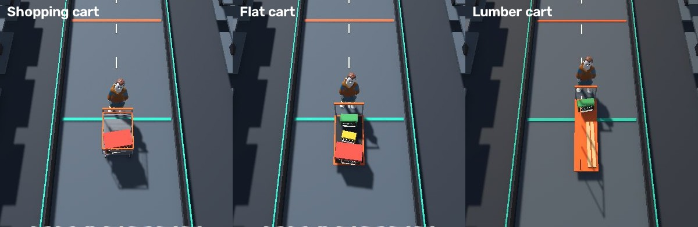
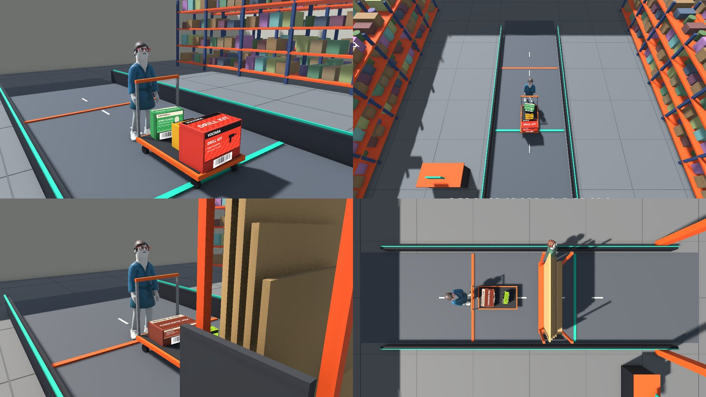

# 🧰 Pro Express v2: plan

> [!NOTE]
> **This is the project log.** It records each round as it was built and measured, including numbers that were later corrected. The current scene (15 invented products, stocked store, fresh held-out seeds 15–19) and its results are in the [README](../README.md#measured-results).

> [!NOTE]
> **Status: in progress on the `pro-express-v2` branch.** Written on 2026-10-06 from the project brief, before any code, so the work can be picked up by anyone. Progress is tracked in the checklist at the bottom.

## 🎯 The brief (condensed)

- Use **real assets**: an animated character pack from the Unity Asset Store for people, and products that look like real boxed home-improvement merchandise.
- Every boxed product carries a **barcode**. **The cameras' job is to scan the barcode.** That is as close to real life as it gets.
- It should also handle **partials**, and things with no barcode: for lumber, the size and whether it's pressure-treated (PT) can be read from how it looks.
- It needs a **rating system**.
- **Flow:** the customer comes in, shops, and goes to the Pro line. Locked items (a tool from a locked cage, say) can't go through the express lane, just as people can't walk off with them. For everything else the system does its best to scan products or their barcodes. If anything is ambiguous, it says **not everything could be scanned, please see an associate to finish up**. It doesn't throw away what was scanned. The associate just adds to it. The point is to save time.
- **For the reviewer:** make it obvious what's happening, in the web interface or otherwise. Ideally a **mock phone** on the side shows what the customer sees.

## 🚶 Customer flow

## 🔄 What changes from today

| Today | v2 |
|---|---|
| Five colored boxes, recognized by color and shape | Realistic boxed products with printed **barcodes**, plus lumber with no barcode |
| SKU comes from an image classifier | SKU comes from **decoding the barcode**. The classifier is the fallback when no barcode is readable. |
| Any uncertainty **blocks** checkout | Uncertainty leads to an **associate handoff**. The scanned part of the cart is kept and can be added to. |
| No notion of restricted items | **Locked items** are always routed to an associate |
| Capsule people | Animated characters from the Asset Store pack |
| One dashboard for the reviewer | Dashboard **plus a mock customer phone** showing what the shopper sees |
| Checkout is pass or review | Every line carries a **confidence rating** |

Everything that already works stays: physical-object identity, lane zones, two-camera fusion, reversible events, the seeded benchmark, and the rule that Unity's ground truth never reaches the API.

## 🧱 Design

### 1. Products and barcodes

- **Catalog** grows from 5 to about 12 products across categories a pro buys: power tools, fasteners, measuring, safety gear, adhesives, electrical. Each entry's `sku` becomes the 10-digit store SKU, and it gains `category`, `restricted` (bool) and `barcoded` (bool).
- **Boxes** are textured: a front panel with product art and name, and a **barcode label on at least two faces** (like real retail packaging), sized so it can be read at lane distance.
- **Lumber** has no barcode. Variants: 2×4 and 2×6, each untreated (pale) or pressure-treated (green-brown), in a couple of lengths. Recognized by the classifier from proportions and color.
- **Barcodes** follow the supplied sample: a **Code 128** label encoding the store SKU (for example `1015765383`), as on a shelf or box tag. Supplied barcode images are used as they are. For products without one, the same format is generated from the catalog SKU, so every code in the simulation decodes to a catalog entry.

**Product asset folder.** The `Barcodes/` folder started with one product: `1015765383.png` (the product photo) and `1015765383.gif` (its barcode). That's the convention: **two files per product, named by SKU**. The scene builder makes one box per SKU found there: photo on the front panel, barcode label on two faces.

> [!IMPORTANT]
> **Whose images.** Real product photos belong to their retailers and manufacturers and are never copied into the project. The folder is **kept out of git**, so the repository never redistributes them. Any SKU without a photo gets original placeholder art made for this project, so the simulation always runs.

### 2. Scan cameras and the barcode reader

A barcode label on a box is only a few pixels wide in today's 960×540 frames, so barcodes can't be read from them. Real stores solve this with several high-resolution cameras around a scan zone. The plan:

- Keep the **lane** and **overhead** cameras for tracking (unchanged).
- Add **scan cameras** at the gantry, close to the lane and at high resolution (2560×1440 to start), looking at box faces from the front and both sides.
- **Pipeline per tracked object:** crop the object from each scan camera → locate and decode the barcode with **zxing-cpp** (OpenCV's built-in reader only handles UPC/EAN, and it could not read the Code 128 sample) → look the SKU up in the catalog → attach the SKU to the physical object with source `barcode`.
- **Fallback:** if no barcode has been read by the time the object commits, use the visual classifier (source `visual`). If neither is confident, the item is `unscanned`.
- A barcode that decodes to a SKU **not in the catalog** is an unknown product, also `unscanned`.
- New dependency: `zxing-cpp` (pip).

### 3. Rating system

Assumption: "rating" means **how sure the system is about each line**, shown to the customer and the associate.

| Rating | Meaning | Source |
|---|---|---|
| 🟢 **Verified** | Barcode decoded and matched the catalog, ideally in 2+ frames | barcode |
| 🔵 **High** | No barcode read, but the look is unambiguous over several views | visual |
| 🟡 **Medium** | Recognized by look with a smaller margin (typical for lumber variants) | visual |
| 🔴 **Needs associate** | Unscanned, unknown barcode, conflicting evidence, or a restricted item | — |

Each cart line shows its rating and why. A cart-level **trip rating** summarizes: all Verified/High → express checkout, otherwise associate assist. Thresholds are tuned on development seeds only.

### 4. Locked and restricted items

Catalog entries with `restricted: true` (for example, a tool that comes from a locked cage) are never self-checked-out. If one is seen in the lane, its line is marked **Needs associate** with the reason "restricted item", whatever the scan confidence.

### 5. Partial checkout and associate handoff

The cart gets a third outcome beside "confirmed" and "blocked":

- **`ASSIST`**: some items are scanned, some aren't. The scanned lines are kept. The customer sees "We couldn't scan everything. An associate will finish up."
- The **associate view** lists the unresolved objects with their best camera crops and lets the associate **add an item** (pick from the catalog), **approve a restricted item**, or **dismiss** a false detection. Each action is an event in the same ledger of events, attributed to the associate.
- When nothing is unresolved, the customer confirms as before. The receipt records which lines were scanned and which were added by an associate.
- Reported metric: **time saved**, as the share of items that needed no associate.

### 6. What the reviewer and the customer see

- **Mock customer phone** beside the dashboard: welcome → "Scanning… 3 items" with the list growing live and each line's rating → either "All set, confirm" or "See an associate" → receipt.
- **Dashboard** gains: barcode boxes drawn on the scan-camera view when a code is read, the rating on every cart line, an **Associate** panel, and a plain-language banner of what the system is doing right now.
- **Animated characters** replace the capsule people (see Assets).

### 7. Assets

| Asset | Source | Notes |
|---|---|---|
| Characters | [Creative Characters FREE – Animated Pack](https://assetstore.unity.com/packages/3d/characters/humanoids/creative-characters-free-animated-pack-304841) | It has to be added to the developer's own Unity account (it's tied to the account and its license terms). Asset Store content may not be redistributed, so the imported folder is **git-ignored** and the repo documents how to re-import it. Scenes fall back to the capsule people when it's missing. |
| Product photos | Supplied locally in the product folder, git-ignored | Placeholder art for any SKU without one |
| Barcodes | Supplied per SKU, or generated as Code 128 from the catalog SKU | Same folder and naming |

## 🧪 How it gets measured

Same discipline as before: seeded scenarios, tune on seeds 0–4, report once on 5–9.

- **Barcode read rate:** share of barcoded items with at least one correct decode before commit, by scenario.
- **SKU source mix:** barcode vs visual vs unscanned.
- **Cart accuracy:** exact cart among lines the system accepted. A wrong accepted line is the worst error.
- **Assist rate:** share of trips that needed an associate, and share of items.
- **Restricted items:** must be routed to an associate 100% of the time.
- New scenarios: barcode facing away, barcode covered by a hand, restricted item in the cart, lumber mixed with boxes, unknown barcode.

## 🗺️ Phases

| | Phase | Done when |
|---|---|---|
| E1 | **Catalog and barcodes:** new catalog fields, barcode generator, textured boxes with labels, lumber variants | Unity renders every product in the folder with a decodable label |
| E2 | **Scan cameras and reader:** high-res cameras, per-object crops, decode, SKU source on the object | A recorded single-item run is charged by barcode with no classifier vote |
| E3 | **Retrain for the new look:** detector and fallback classifier on the textured products and lumber | Static test and benchmark numbers recorded; visual fallback works on lumber |
| E4 | **Ratings, restricted items, assist flow:** ledger, API and cart states | Tests for every rating tier, restricted routing and partial carts; benchmark reports assist rate |
| E5 | **Customer phone and associate view** in the dashboard | A reviewer can follow a full trip, including a handoff, without reading docs |
| E6 | **Characters:** import the pack, animate the customer and other shoppers, retrain the person class if needed | Scenes run with characters, and with capsules when the pack is absent |
| E7 | **Benchmark, docs, demo recording** | Held-out results published; docs match the code |

## ❓ Open questions

1. **Rating:** is it the per-item confidence rating described above, or something else (for example, the customer rating their trip)?
2. **Product folder:** keep it local-only and out of git (default), or commit it to the private repo?
3. **Barcode reader:** OK to `pip install zxing-cpp` into the project's `.venv`?
4. **Characters:** please click **Add to My Assets** on the pack's Asset Store page while signed in, so it can be imported.

## 📈 Results

Eight products (six boxed with barcode labels, including one locked-cage tool, plus two kinds of lumber with no barcode). Lane, overhead and scan cameras. 17 scenarios × 5 seeds.

| 85 runs each | Development seeds 0–4 | **Held-out seeds 5–9** |
|---|:-:|:-:|
| Runs passed (cart exactly right, associate called only when needed; 10 of these are by-design hand-offs) | 78 | **78** |
| Items wrongly charged | 0 | **0** |
| Items missed | 0 | 1 |
| Charged items identified by barcode | 96 of 114 | 96 of 114 |
| Items handed to an associate | 17 | 14 |
| Locked-cage tool routed to an associate | 5 of 5 runs | 5 of 5 runs |
| Lumber runs (no barcode, recognized by look) | 3 of 5 | 4 of 5 |
| Median time per frame, three cameras | 37 ms | 32 ms |

- **Nothing was wrongly charged on the held-out runs**, and one lumber board was missed.
- **Barcodes settle what looks couldn't.** Stacked identical boxes pass 4 of 5 held-out runs. Without barcodes it was 3 of 5.
- **Where barcodes aren't read**, the system falls back to recognizing the item by look: lumber has none, the parked flatbed hides the scan camera's view, and the reversed walk in *change of mind* turns the label away.
- Of the 14 hand-offs, 10 are by design: the unknown-barcode package and the locked tool. The other 4 are single items in the shopper, flatbed, edge and stacked scenarios.
### With animated characters

The capsule people were replaced by animated characters, both camera model pairs were retrained on the new look, and both sets were re-recorded. Same 17 scenarios × 5 seeds.

| 85 runs each | Development seeds 0–4 | **Held-out seeds 5–9** | Held-out with capsule people |
|---|:-:|:-:|:-:|
| Runs passed (cart exactly right, associate called only when needed; 10 of these are by-design hand-offs) | 77 | **71** | 78 |
| Items wrongly charged | 0 | **0** | 0 |
| Items missed | 2 | 2 | 1 |
| Charged items identified by barcode | 94 of 112 | 93 of 113 | 96 of 114 |
| Items handed to an associate | 19 | 27 | 14 |
| Locked-cage tool routed to an associate | 5 of 5 runs | 5 of 5 runs | 5 of 5 runs |
| Lumber runs | 4 of 5 | 1 of 5 | 4 of 5 |
| Parked flatbed runs | 3 of 5 | 1 of 5 | 5 of 5 |
| Median time per frame, three cameras | 34 ms | 33 ms | 32 ms |

- **Characters cost 7 held-out runs, and still nothing was wrongly charged.** Every lost run is the cautious kind: the cart is sent to an associate instead of closing on its own.
- **The loss is in two scenarios:** lumber and the parked flatbed. The development seeds did not show it (77 of 85), so it was found only by the held-out score, which is what that set is for. It has not been tuned against.
- **What had to change to get here:** the label exporter was putting people into every product's mask (a clothing tint leaked into the mask render), training scenes never showed the customer right behind a box, and lumber was being carried through the customer's body.
- **Hats are left out of the cast.** A straw hat showing above a carried box was read as a small yellow product at the far end of the lane. With hats, development seeds scored 65 of 85. This is an open problem, not a fix.
- The capsule-people weights are kept in `models/v5/`, their recordings in `artifacts/benchmark-v2b` and `artifacts/benchmark-test-v2b`, and their held-out report in `models/benchmark-v2-test-capsules.json`.

### Carts (measured, 2026-10-11)

The scene uses the three cart types a contractor uses, pushed by the customer.

| Cart | Holds | Used in |
|---|---|---|
| 🛒 Shopping cart | one or two boxes in a wire basket | single, occlusion, change of mind, and by seed in the messy scenarios |
| 🟧 Flat cart | up to three boxes on a low deck | identical products, mixed cart, unknown product, and by seed elsewhere |
| 🪵 Lumber cart | boards along one side of a divider, a box at the back | lumber |

- Carts are built in `ProPassCarts.cs`, which also says where products sit on each. `ProPassScenarios.LoadCart` moves a plan's products onto a cart and the runner walks the customer behind its handle. *Edge of frame* stays hand-carried.
- **The tracking camera moved above the exit gate and looks back down the lane.** Seen from behind, the person pushing hid most of their own cart. The exit gate itself moved to z = 4.6, past where carts stop.
- **The barcode camera faces oncoming carts** from a bar 2.3 m up, and labels face forward. Stated assumption: customers load boxes label-forward. A box behind another box is not scanned and falls back to recognition by look.
- Calibration is now on a plane 0.6 m up (cart loads), not 0.9 m (hand carry).
- Label text is depth-tested (`Shaders/Text3D.shader`): it used to show through a box in front.

Both camera model pairs were retrained on 2,640 scenes (1,728 earlier + 912 with carts), both sets were re-recorded, and held-out moved to **fresh seeds 10–14** because seeds 5–9 had been looked at.

| 85 runs each | Development seeds 0–4 | **Held-out seeds 10–14** | Characters, no carts (held-out 5–9) |
|---|:-:|:-:|:-:|
| Runs passed (cart exactly right, associate called only when needed) | 68 | **60** | 71 |
| of which closed automatically, no associate | 58 | **50** | 61 |
| of which correctly sent to an associate (unknown product, locked tool) | 10 | 10 | 10 |
| Runs sent to an associate as a precaution | 17 | 25 | 14 |
| Carts closed automatically with a wrong item | 0 | **0** | 0 |
| Wrong lines inside carts handed to an associate | 0 | 2 | 0 |
| Items missed | 9 | 16 | 2 |
| Charged items identified by barcode | 68 of 105 | 65 of 100 | 93 of 113 |
| Items handed to an associate | 30 | 49 | 27 |
| Locked-cage tool routed to an associate | 5 of 5 runs | 5 of 5 runs | 5 of 5 runs |
| Mixed cart (three products on a flat cart) | 5 of 5 | 5 of 5 | 5 of 5 |
| Lumber runs | 3 of 5 | 2 of 5 | 1 of 5 |
| Stacked boxes | 1 of 5 | 0 of 5 | 4 of 5 |

- **Carts cost 11 held-out runs, and no cart was closed with a wrong item.** Only 50 carts closed with no associate; earlier wording on this page called all 60 passes "fully automatic", which was wrong. The lost runs are handed to an associate, and 15 of those 25 carts were incomplete. Two of those carts held one wrong line each: a second pair of gloves in *busy hands* seed 11, and a third board in *lumber* seed 13.
- **One real bug was found and fixed on development seeds.** A label on a cart sits below the calibration plane, so it projects toward the barcode camera and lands on the neighboring box. Nine development runs were charged the wrong product (56 of 85). The label now goes to the first box behind it (`VisionEngine._attach_barcodes`, test in `tests/test_barcode_reading.py`): 68 of 85 and nothing wrongly charged. Held-out was scored once, after the fix.
- **Weakest scenarios on held-out:** stacked boxes (0 of 5: two boxes pressed together on a cart read as one), busy hands, the next-lane shopper and hesitation (2 of 5 each), lumber (2 of 5). None of these has been tuned against.
- **Barcodes are read less often than before** (65% of charged items, was 82%): on a cart, a box behind another box hides its label.
- **Earlier rounds, same split:** characters 61 automatic, 10 by design, 14 unnecessary; capsule people 68, 10, 6, and one lumber run (seed 7) that closed automatically one board short.
- Median time per frame was 36 ms on development seeds (models only, recorded frames). The held-out report says 67.5 ms because a game was running on the same GPU during scoring; do not quote that number.
- Reports: `models/benchmark-v3-dev.json`, `models/benchmark-v3-test.json`. The cart weights are archived in `models/v7/`. The pre-cart character weights are in `models/v6/`, their recordings in `artifacts/benchmark-nocart` and `artifacts/benchmark-test-nocart`.
- **Not redone for carts:** the dashboard screenshots in this document and the README title screen are from before carts, and the live end-to-end check has not been repeated with the cart weights.

### Fictional catalog and a stocked store (measured, 2026-10-12)

Goals for this round: everything fictional and far more varied, better-looking videos, and a faster pipeline.

- **Catalog:** 15 invented products from six invented brands, up from 8 (one of which carried a real brand and photo, now removed). Boxes of many proportions and two pails. Every printed front, top and barcode is drawn by `scripts/prepare_products.py`.
- **Store:** stocked pallet racking, walls, signage, an associate station. The crossing flatbed now rolls at walking pace with an associate pushing it.
- **Pipeline:** `scripts/round.sh` runs export, training, recording and scoring unattended in about 40 minutes; scoring uses four processes.
- **First pass, 58 of 85 on development runs, one wrong close.** Two causes, both fixed on development runs: package tops that repeated the front's dark brand bar made one box look like two to the detector (redrawn as plain panels: 67 of 85), and a pail standing on a box took the box's barcode (a barcode that disagrees with how a package looks now goes to an associate).
- **Held-out seeds 15–19, scored once: 68 of 85 pass.** 58 close automatically, 10 are correct hand-offs, 17 went to an associate as a precaution (8 of them already right), none closed wrong. The same table for the previous 8-product cart round was 60, 50, 10, 25, 0.
- Weights: `models/v8/` and release `weights-v8-fictional`. Reports: `models/benchmark-dev.json`, `models/benchmark-test.json`.

### Earlier rounds

- An earlier round with five products scored 68 of 75 on held-out seeds, with one wrongly charged item. That set of recordings is kept in `artifacts/benchmark-test-v2a`.
- Retraining mattered: the pre-barcode models fragmented the new-look boxes (51 of 75 on development seeds).

## ✅ Progress

- [ ] **E1 Catalog and barcodes**
  - [x] `barcode` field in `catalog.json`; `scripts/prepare_products.py` builds label and photo textures from `Barcodes/`
  - [x] Scene builder puts a Code 128 label (and the photo, when supplied) on every product prefab
  - [x] A restricted locked-cage tool (PEX-006) and two lumber variants (PEX-007, PEX-008), with `locked` and `lumber` scenarios
  - [ ] More boxed products (needs more product photos and barcodes)
- [x] **E2 Scan cameras and reader**
  - [x] 3840×1080 scan camera over the lane entrance (`ProPassCameras.cs`), streamed and recorded with the others
  - [x] `VisionEngine._read_barcodes` / `_attach_barcodes` with zxing-cpp; text must match `SKU=<10 digits>`
  - [x] Live: the mixed cart is charged entirely by barcode, all lines rated Verified
- [x] **E3 Retrain for the new look:** a lane pair and an overhead pair, each on its own camera's scenes (`training.train --camera`). Needs repeating when the catalog grows.
- [x] **E4 Ratings, restricted items, assist flow**
  - [x] Ledger: barcode evidence outranks the classifier, ratings, restricted SKUs, assist list (`vision/ledger.py`, `tests/test_ledger_scanning.py`)
  - [x] API: `ASSIST` cart status, `POST /api/assist/add` and `/api/assist/dismiss`, line ratings (`api/`, `tests/test_api_assist.py`)
  - [x] Benchmark reports the barcode share of charged items and assist counts
  - [x] A catalog product marked `restricted`, with a scenario for it
- [x] **E5 Customer phone and associate view** (`web/src/CustomerPhone.tsx`, `AssociatePanel.tsx`), plus barcode outlines on the scan camera view
- [x] **E6 Characters:** animated customer and shoppers (`ProPassCharacters.cs`), capsules when the pack is absent, both model pairs retrained, both sets re-recorded and scored (see *With animated characters* above)
- [ ] **E7 Benchmark, docs, demo recording**
  - [x] Development set re-recorded with labels and the scan camera (`artifacts/benchmark`; the earlier sets are `artifacts/benchmark-2cam*`)
  - [x] Held-out set recorded and scored once; [benchmark.md](benchmark.md) regenerated
  - [ ] The other docs brought up to date (vision.md, pipeline.md, getting-started.md, roadmap.md)

