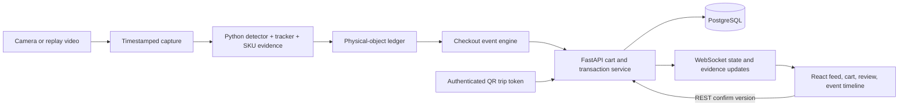

# Pro Express: commercial architecture, identity, cameras, and software-system research

Research date: 2026-10-02. Evidence labels below distinguish public company descriptions from independent verification. The recommendations are engineering judgments for a constrained personal prototype, not claims about Home Depot infrastructure.

## Recommendation from this workstream

Build an authenticated, single-customer checkout portal, initially using one fixed oblique camera and staged video, with a real merchandise detector, temporal physical-object ledger, exact-SKU recognition, reversible boundary events, customer confirmation, and persisted transactions. Collect a complementary second view immediately if a second phone is available, but defer automatic cross-camera association until the single-view system passes a held-out scenario suite. Keep the lane narrow and products visible; uncertainty triggers review rather than an invented charge. This is a reduced exit-verification/checkout-zone architecture, not an Amazon Go clone.

The minimum convincing subset is: authenticated trip ID; calibrated capture zone; merchandise observations; physical-object hypotheses distinct from tracker IDs; multi-frame SKU evidence; directional crossing/removal events; idempotent cart projection; versioned confirmation; immutable transaction record. These represent the difficult vision-to-business boundary. Full-store shelf instrumentation, biometrics, person ReID across many cameras, payment integrations, and theft detection are unnecessary for the first demo.

## Commercial systems: public evidence and what it teaches

| System | Publicly described mechanism | Evidence strength | Reproducible lesson |
|---|---|---|---|
| Amazon Just Walk Out, camera version | Ceiling cameras, shelf interactions, weight sensors, virtual cart, payment association at entry/exit | Amazon's public documentation; algorithms and independent accuracy are undisclosed | Account identity can be attached once at entry, followed by trip-local visual tracking; inventory changes require temporal events |
| Amazon's 2024 JWO update | Transformer multimodal model consumes sensor inputs jointly; store 3D map and image catalog support inference | Company claim, not released architecture/checkpoint | Store geometry and product catalog are useful priors; do not assume a generic pretrained detector solves the system |
| Amazon RFID JWO | Unique RFID tag per item; exit reader determines merchandise; payment attached at gate | Public product behavior and company description | RFID has physical instance identity; barcode/SKU alone does not distinguish two copies |
| Amazon Dash Cart | Cart-centric sensing, weight, live receipt, add/remove handling; current generation includes a built-in scanner | Generation-specific company documentation | Instrumenting a constrained cart lowers ownership ambiguity; verify generation before calling it completely scanless |
| Sam's Club exit arches | Multiple views of cart, merchandise detection/feature matching, outstanding receipt matching, item/receipt comparison | Explicit Walmart engineering blog, exact algorithms undisclosed | Exit verification is a narrower problem than autonomous purchase inference because a paid cart already exists |
| Sam's Scan & Go | Customer scans product barcode and pays in authenticated app | Official customer workflow | A reliable fallback, not evidence of autonomous vision checkout |
| Zippin | Overhead camera tracking with shelf sensors and edge processing; newer offerings also advertise vision-only | Company documentation/whitepapers | Sensor choice is deployment-specific; confidence-based human review is part of engineering design |
| AiFi | Camera-first, keypoint tracking, digital representation of people/objects/actions; non-biometric trip tracking | Company claims | Pose/person tracking and account authentication are different modules |
| Mashgin | Products placed on a bounded tray; multiple cameras construct 3D representation and recognize many items together | Company claims; accuracy numbers differ between pages and lack independent benchmark context | A controlled observation surface can trade interaction constraints for reliability |
| Trigo loss prevention | Connect shelf pick history, shopper movement, POS payment, and alerts; existing CCTV claimed | Company claims | An alert based on historical evidence is different from direct SKU recognition of a currently hidden item |

### Citation-ready commercial summaries

Use these concise passages to avoid overextending what each source supports.

**Amazon JWO, official company description:** Amazon describes ceiling cameras and hand–shelf interactions, augmented by shelf weight sensors for small items. A payment method is associated with a temporary trip code; Amazon says the camera-based JWO system does not itself collect biometrics. Returning merchandise removes it from the virtual cart. Amazon One is a separate optional biometric identity/payment system. These are company descriptions, not public implementation details or independent accuracy measurements. [Amazon explanation](https://www.aboutamazon.com/news/retail/how-does-amazon-just-walk-out-work).

**2024 JWO update, company claim:** Amazon says a multimodal transformer model analyzes cameras and sensors together, rather than handling shopping actions sequentially, with a 3D store map and merchandise image catalog. Architecture, training data, weights, and quantitative independent evaluations are not published in this announcement. [Amazon model update](https://www.aboutamazon.com/news/retail/amazon-just-walk-out-improves-accuracy).

**RFID, separate offering:** Amazon's RFID checkout assigns unique tags to sale items and reads those tags at an exit gate, attaching payment there. This differs from inferring merchandise from ceiling-camera shelf interactions. [Amazon RFID explanation](https://www.aboutamazon.com/news/retail/amazon-just-walk-out-rfid-technology).

**Dash Cart, generation caveat:** The 2022 cart description includes vision/sensor fusion and weighing produce while the cart moves. Amazon's current 2026 announcement explicitly describes a built-in scanner, computer vision for removals, and a produce scale using cameras, weight sensors, and models. Do not present every generation as an entirely scanless cart. [2022 cart](https://www.aboutamazon.com/news/retail/amazon-dash-cart-new-features-whole-foods), [2026 cart](https://www.aboutamazon.com/news/retail/amazon-redesigned-dash-cart-whole-foods-market).

**Sam's exit technology, documented company pipeline:** Walmart describes multiple cameras imaging carts under exit arches; models detect items and extract size, shape, color, brand, and logo evidence; inventory matching identifies merchandise; supplementary algorithms match the cart to an outstanding receipt; item/receipt comparison is sent to an associate. The company says its models are trained on millions of item images. This verifies an already paid basket; it does not demonstrate creating an unpaid cart from unconstrained storewide video. [Walmart technical explanation](https://tech.walmart.com/content/walmart-global-tech/en_us/blog/post/sams-club-ai-exit-technology.html), [Walmart deployment statement](https://corporate.walmart.com/about/samsclub/news/2024/04/30/sams-club-deploys-ai-powered-exit-technology-at-120-locations-leading-retail-industry-with-customer-experience-innovation).

**Scan & Go:** Sam's customer documentation describes scanning product barcodes, an app-maintained running total, app payment, and a digital exit receipt. [Sam's workflow](https://www.samsclub.com/content/scan-and-go).

**Zippin:** Official documentation describes overhead cameras, shelf sensors, edge devices, and payment association. An older whitepaper describes low-confidence clips escalated to remote operators. Newer pages advertise both vision-only and sensor-supported deployments; the older sensor design should not be presented as mandatory in all current offerings. [Product](https://www.getzippin.com/product), [older whitepaper](https://www.getzippin.com/hubfs/Future%20of%20Retail_Zippin.pdf), [current deployment variants](https://www.getzippin.com/zippin-store).

**AiFi:** AiFi advertises camera-first and sensor-agnostic deployment, sometimes using existing ceiling cameras. Its FAQ describes keypoint tracking without biometric identifiers, while allowing optional biometric integrations. Performance and privacy assertions are vendor claims. [AiFi current platform](https://www.aifi.com/), [AiFi FAQ](https://www.aifi.com/blog/aifi-faq-your-burning-questions-answered).

**Mashgin:** Mashgin describes a bounded tray and multiple cameras producing a real-time 3D item representation, with new products added to a pricebook. Its home page and FAQ give different recognition accuracy claims; those should not be adopted as comparable benchmark results. [Mashgin](https://www.mashgin.com/), [recognition FAQ](https://faq.mashgin.com/faq/how-mashgin-recognizes-items).

**Loss prevention:** Trigo says it links shelf activity, shopper trajectories, and POS data, preserving accountability when products later become concealed. Its ability to infer a concealed item's presence comes from preceding evidence; that is not an X-ray camera. Existing-CCTV compatibility and accuracy are vendor claims. [Trigo loss prevention](https://www.trigoretail.com/loss-prevention/).

### Patents are design-space evidence, not product facts

Amazon patent application US20150012396A1 describes automatically identifying picked merchandise, associating it with users, and transitioning ownership at an exit region, with cameras and other sensing options. It is useful for reasoning about event semantics and sensor fusion, but a patent does not establish that any particular method was deployed, succeeds, or is the current JWO implementation. [Original patent text](https://patents.google.com/patent/US20150012396A1/en).

Do not repeat the broad historical claim that cashierless checkout was simply thousands of humans watching every shopper. Public company descriptions acknowledge confidence-based review in some systems; specific rates or operational arrangements cannot be inferred from those descriptions.

## Academic systems and physical setup

**Grab (2020 research):** This system combines pose/hand tracking with probabilistic fusion of camera, weight, and RFID evidence. Its prototype used shelf-mounted IP cameras streaming 720p over Ethernet; webcams reportedly produced similar precision/recall. The paper used inexpensive load-cell/HX711/Arduino infrastructure and evaluated sensor ablations. Its headline result was 93% precision and 91% recall on its own pilot; that is not a guarantee for a Home Depot merchandise prototype. [Grab paper](https://arxiv.org/html/2001.01033v1), [demo referenced by authors](https://vimeo.com/245274192).

**FAIM (2020 research):** Shelf weight changes trigger buffered vision analysis; item layout, weight, and appearance are fused. Four camera viewpoints were examined: top, front, left, and right. In that shelf experiment, left plus right already reached the highest fused identification accuracy, 92.6%; this is not a universal two-camera accuracy claim. Authors recorded product rotations from multiple angles and used composited training imagery, while reporting domain-gap limitations. [FAIM paper](https://www.frontiersin.org/journals/built-environment/articles/10.3389/fbuil.2020.568372/full).

### Engineering camera recommendation, not a cited product-performance claim

| Level | Setup | Why | Limit |
|---|---|---|---|
| Minimum | Existing phone on rigid mount, fixed oblique view of a narrow checkout lane; prerecorded 1080p/30 video | No purchase required; repeatable evidence; captures packaging faces and direction | Backside/hand occlusion and fully hidden products remain unresolved |
| Improved | Two existing phones or wired cameras: raised oblique view plus opposite-side or overhead view, substantial checkout-zone overlap | Second view sees complementary packaging and separates some overlaps | Synchronization, view association, bandwidth, and labeling effort increase |
| Ideal hobbyist | Two or three fixed wired USB/PoE cameras, diffuse lighting, rigid frame, event-time capture, optional depth or real load cell | Stable real-time capture and repeatable calibration; a real independent sensor enables measurable fusion ablation | Does not reproduce whole-store coverage; depth is not exact SKU recognition |

Default record at 1920×1080, 30 fps; phones may record 4K to preserve readable text while the detector uses 640–960 input. Keep native-resolution crops for SKU/OCR. Aim for the smallest important product face to span roughly 120–200 pixels in the recording; validate this empirically rather than treating it as a theorem. Exposure short enough to avoid hand-motion blur matters more than nominal 4K; use even lighting and lock focus/exposure where practical. Disable digital stabilization or account for its changed crop if calibrating fixed ROIs.

For a table or cart demonstration, one elevated oblique view is usually more useful for packaging than a distant straight-down view. For a passage lane, set the camera roughly 1.8–2.4 m high and angled toward the monitored strip, adjusting to the actual room and keeping the customer from blocking every product. Two cameras 60–120 degrees apart improve complementary views; opposite side plus top is another candidate. These are starting geometry estimates.

Do not buy a cheap cloud-only security camera merely because it resembles CCTV: demand accessible local video (USB UVC or RTSP), consistent timing, controllable focus/exposure, and the ability to disable changing autofocus or image transformations. PoE simplifies persistent deployment; phones give excellent research footage but streaming may introduce latency and variable frame rates. Action cameras' wide lenses need calibration/cropping and can reduce SKU face pixels. A second existing phone provides more research value than buying one expensive camera before recording a baseline.

As a reference rather than a required purchase, the original Logitech BRIO datasheet supports 4K/30, 1080p/30–60, and 720p up to 90 fps. Verify local Linux capture modes and real exposure before assuming advertised frame rate. [Manufacturer datasheet](https://www.logitech.com/assets/65040/2/brio-datasheet.ENG.pdf).

For two prerecorded phones, clap or flash at the start, estimate offset, store presentation timestamps, and resample timelines; recheck end-of-recording drift. Real-time independent cameras need per-frame monotonic/event timestamps and measured synchronization error. Homography aligns a floor plane only: handheld products above the floor cannot safely be fused by identical projected pixel positions. Calibrated intrinsics/extrinsics and epipolar/3D constraints are an extended-version option.

## Identity/authentication

### Distinguish three identities

1. Account identity: which authenticated person controls a software account.
2. Trip/person identity: which currently observed customer corresponds to that account in this lane.
3. Merchandise identity: which physical item is present, independent of its SKU and temporary tracker ID.

A face embedding, clothing ReID vector, QR code, and object tracker each answer different questions. Correct account login alone does not prove which of two people owns a visible drill. ReID follows a visual appearance; it is not an authentication factor or authorization to charge an account.

### Recommended MVP: real local QR trip authentication

Use seeded local demo customer accounts clearly labeled as prototype accounts. A customer logs into the mobile/page session, then requests a short-lived one-use checkout token. The QR encodes an opaque random token, not raw account ID or credentials. The server stores a hash, customer ID, expiration, intended lane/camera group, and redemption status. The lane scanner redeems it atomically; the resulting checkout session gets a distinct UUID. Bind the observed person track at the entry anchor only when a single unambiguous person is present. Keep binding stable until session closure; do not reassign to the nearest person each frame.

Suggested implementation choices: at least 128 random bits, 60–120 s token TTL, one-use compare-and-set redemption, rate limiting, authenticated lane client, and HTTPS outside localhost. TTL and parameters are engineering defaults to tune, not public standards asserted here. Tokens are bearer credentials: a screenshot can be used during validity; that is why short TTL, one use, lane binding, and account-side cart confirmation matter. A static QR containing a customer ID should be explicitly labeled a mock, not secure authentication.

The checkout confirmation comes from the customer's authenticated session, not any browser viewing the overlay. A single active customer per lane is a legitimate scope constraint. Detecting a second person crossing into the association region sets SESSION_AMBIGUOUS and suspends automatic additions until reviewed/re-authenticated; hiding the second person or assigning all objects to the logged-in account would make the result less credible.

### Comparing options

| Option | Engineering behavior | MVP recommendation |
|---|---|---|
| Opaque QR trip token | Establishes account-to-session association at explicit entry point | Implement |
| NFC phone/card | Can transport authenticated token; raw tag UID is cloneable and insufficient alone | Optional extension if reader already exists |
| Manual account selector | Useful seeded/demo fallback, no authentication proof | Label as simulated |
| Phone token/passkey | Proves account control and can authorize trip creation | Passkey is a worthwhile later extension |
| 1:1 face verification after account claim | Compares a face to that account's enrolled template; requires rejection threshold and liveness/PAD | Optional isolated research extension |
| 1:N face identification | Searches all customers; increases false-match/unknown-person complexity | Defer |
| Gait/person ReID | Matches visible appearance across time/views | Tracking cue only, not authentication |

### Face-ID-like long-term approach

Strongest engineering path: use the customer's device biometric to unlock a passkey, authenticate the account, issue a one-use trip token, then track the anonymous trip in cameras. WebAuthn keeps biometric data local to the authenticator and returns a signed assertion; Pro Express receives account authorization, not the face template. [W3C WebAuthn biometric explanation](https://www.w3.org/TR/webauthn-2/).

If implementing actual camera face verification for research: explicit opt-in enrollment; face detection/alignment; pretrained face embedding; compare only to the already claimed account; multiple enrollment conditions; calibrated threshold; unknown rejection; presentation-attack detection; alternative QR method; protected template storage and deletion; no claim of payment-grade security. Test genuine/impostor attempts and report false-match/false-non-match rates, not only closed-set classification accuracy. Camera-to-customer association still needs an explicit entry anchor.

Apple Face ID uses TrueDepth sensing, secure sensor-to-Secure-Enclave handling, and protected templates. A webcam plus face-recognition library does not recreate those security properties. [Apple biometric security](https://support.apple.com/en-ca/guide/security/sec067eb0c9e/web), [Apple facial matching](https://support.apple.com/en-ie/guide/security/sece151358d1/web).

NIST SP 800-63B-4 states that biometrics are not secrets, supports them with a physical authenticator rather than as standalone authentication, requires facial presentation-attack detection in its context, and favors local comparison to reduce centralized attack consequences. This is engineering guidance from a federal digital-identity standard, not a blanket legal mandate for this personal project. [Current NIST guidance](https://pages.nist.gov/800-63-4/sp800-63b.html).

Keep published demo footage staged with consenting participants, local accounts, and optional face blurring. Product footage and transaction metadata are sufficient for the project; model embeddings and raw video do not need indefinite retention. Actual deployment and biometric data use would require jurisdiction-specific legal review; this research prototype should not claim legal compliance on the basis of these sources.

## Independent brainstorming before convergence

Times below are engineering estimates for focused work, assuming basic web/backend familiarity and footage access. They are not measured promises.

| Architecture | Distinct inference problem | Difficulty / novelty | Robustness and failure | Data / hardware / training | Demo and resume value | Time |
|---|---|---|---|---|---|---|
| A. Single-camera authenticated portal + detector, tracker, SKU evidence, directional event ledger | Which physical items cross an owned boundary | Medium; substantial custom temporal logic | Good in visible lane; complete occlusion and identical reentry can be unobservable | Own 5–10 SKU clips; one camera; fine-tune detector and small SKU head | Strong vision plus transactional-system story | 2–3 days scoped MVP |
| B. Dual-view portal with joint physical object hypotheses | Cross-view matching of the same product without double charging | High; stronger CV depth | Better view coverage; synchronization and identical-item association remain hard | Two cameras, calibration, synchronized IDs; same model plus cross-view validation | Excellent extension, measurable ablation | 1–2 additional weeks |
| C. Shelf-centric trip tracking + hand/shelf interactions + weight fusion | Who removed/returned what, even if later hidden | High; closest JWO subset | Complementary sensors address visual limits; shelf calibration and concurrency complex | Mini fixture, cameras, real load cells, item mass catalog; detector and pose | Most impressive research extension if evaluated honestly | 1–3 weeks mini-store |
| D. Cart/basket-centric add/remove recognition | Contents of a cart assigned once to an account | Medium-high | Ownership easy; stacked/hidden items and basket rim occlusion hard | Cart, camera at rim plus overhead; transitions and SKU data | Strong demo; changes interaction from walk-through to cart sensing | 3–7 days |
| E. Bounded multi-item checkout tray, segmentation/counting + SKU recognition | Stable scene inventory at confirmation | Medium | Good static observation, poor full pile occlusion; customer places items | Table/tray, oblique camera(s); detector/segmentation and SKU head | Fast reliable exact-SKU demo; less temporal novelty | 2–3 days |
| F. Barcode-first walk-through + visual tracker | Read encoded product identity and maintain temporal quantity | Low-medium | Excellent when barcode visible; arbitrary orientation fails | Existing barcodes, high-resolution crops; decoder mostly pretrained | Good baseline/fallback; lower CV training depth | 1–2 days |
| G. Real unique RFID + vision fusion | Identify exact physical instances; use vision for account/path evidence | Medium hardware complexity | Strong hidden-item counting; RF zone leakage, metal/liquid products, reader calibration | UHF reader/tags; vision inference, fusion calibration | Honest sensor-fusion engineering; vision is secondary | 3–10 days if hardware available |
| H. Person–hand–product temporal interaction graph | Attribute possession and handovers between customers | Very high; deep CV/event challenge | Resolves visible transfers but many hidden transfer ambiguities | Pose plus object data, interaction annotations, temporal evaluation | Excellent research depth; fragile short demo | 2–4 weeks |
| I. SAM2 propagation + re-detection + identity ledger | Persist masks over time, classify best object crops | High integration, moderate novelty | Masks help overlaps but do not prove physical identity after disappearance | Prompt/detector, segmentation; evaluate drift and reentry | Useful controlled occlusion experiment | 3–7 days |

**Provisional ranking for this user's goal:** A first; B extended; D or C as distinct later experimental branch; E as reliable fallback demo; H as ambitious research; F as baseline and recovery mechanism; G only with real hardware; I as tracking ablation. Avoid synthetic RFID being described as evidence of real hidden-item sensing. Simulated sensor events are useful architecture tests but do not add computer-vision credibility.

The credible minimum is not determined by fewest technologies. It is determined by observability: a controlled zone, one known customer, visible merchandise, a small explicit catalog, and honest uncertainty behavior let the system demonstrate physical-item accounting without silently relying on impossible information. Two identical objects disappearing together and reappearing without distinguishable evidence cannot always be correctly assigned individual identities; the system can preserve quantity hypotheses or ask for review.

## Backend/software recommendations

These are design proposals, not descriptions of commercial proprietary backends.

Use one Python inference worker and one FastAPI application initially, with PostgreSQL and a React/TypeScript client. Keep detector, tracker, SKU recognizer, event engine, and cart projection as separable Python modules behind typed interfaces; do not spend the first three days implementing cross-language microservices. Rust/Java are later options if profiling or a clearly defined transactional-service goal justifies them.

REST is appropriate for accounts/catalog/session start, cart reads, review decisions, and transaction confirmation. WebSocket carries compact overlay observations, event timeline, current cart projection, and status. Use MJPEG for the first live local video or served MP4 for deterministic replay; avoid base64 full frames inside every event message. WebRTC is an extended version if latency justifies the extra integration. Overlay/video both reference source timestamp/frame ID, rather than displaying whatever boxes arrived latest over unrelated frames.

Capture/inference: use a bounded queue and explicit dropped-frame counters. Under load, drop stale capture frames rather than letting a purported live demo become seconds behind; tracker time deltas use timestamps rather than frame index. Replay test mode processes every configured frame deterministically. A separate in-process queue or multiprocessing channel is sufficient; Kafka adds no value for one lane. Redis is optional later for cross-worker fanout or short-lived shared sessions, not required for PostgreSQL-backed one-use token redemption.

Events contain `event_id`, `schema_version`, `session_id`, `camera_id`, `stream_epoch`, `frame_id`, `source_timestamp`, `physical_object_id`, `track_segment_id`, `sku_id`, `event_type`, `confidence`, `evidence_refs`, and `model_version`. Never use a camera-local integer track ID as a globally unique product key: tracker restart, video restart, and second camera all collide.

PostgreSQL provides the correctness boundary. Record event and update cart projection in one transaction; uniqueness on event ID makes retries idempotent. Quantity is derived from active physical-object commitments, not number of detections. A SKU has many physical units. Corrections append compensating/removal events instead of silently editing history. Confirm requires the current cart version and locks/snapshots product identifiers, quantities, integer minor-unit prices, and total. Confirmation retries use an idempotency key with a unique transaction per cart; a changed cart returns conflict and prompts a fresh review. Mark the recorded transaction as demo/simulated payment, not paid by a real payment provider.

A transactional outbox plus recoverable per-session event sequence is useful when separating workers later. WebSocket is a delivery mechanism, not the source of truth: reconnect fetches snapshot and resumes event sequence. If the worker crashes, cart should not accumulate duplicates on replay. Store detections selectively or asynchronously for evidence/evaluation rather than requiring a blocking database write for every bounding box at 30 fps.

Commercial comparison for this service boundary: Zippin's public integration documentation separates scanned loyalty-code verification, loyalty identity, virtual-cart construction, discounts, final charging, and POS cart submission. That supports designing vision as an evidence producer with commerce responsibilities in separate services, without requiring access to Zippin's APIs. [Zippin integration guide](https://api-docs.getzippin.com/).

## Essential hard-case tests from this workstream

- Same object appears in 100 frames: exactly one active physical-object commitment.
- Tracker loses and recreates ID: no second cart addition when reassociation is unambiguous; ambiguity is surfaced when it is not.
- Two identical products simultaneously visible: quantity two even though SKU matches; appearance alone must not merge tracks.
- Object crosses boundary forward, backward, forward: reversible state transitions, one active charge.
- Customer/auth token replay: atomic redemption prevents a second session.
- A second customer enters: association ambiguity suspends additions; no nearest-account assignment.
- SKU evidence changes from low-quality early view to a clear package face: same physical object, revised SKU proposal, auditable correction.
- Confirm twice or network retry: one transaction.
- Confirm stale cart version while worker adds merchandise: conflict, not a transaction with invisible changed total.
- Two video replays/camera restarts produce the same tracker number: global IDs remain distinct.
- Video reconnect or stream lag: status clearly shows missing evidence; confidence does not increase merely because wall-clock time passed.
- Two-camera extension: same object in both cameras produces one physical ledger item; two identical copies remain two.

## Source and uncertainty notes

No source reviewed publishes enough information to reproduce JWO's full architecture or infer its exact detector/tracker/model selection. Vendor percentages are not interchangeable with per-frame detector accuracy, per-SKU accuracy, event recall, physical-ID accuracy, or exact-cart transaction accuracy. Evaluate Pro Express using its own held-out footage and report those metrics separately. The full-store papers are useful design evidence, but their object sets, cameras, sensor modalities, and assumptions differ from handheld hardware-store products.
