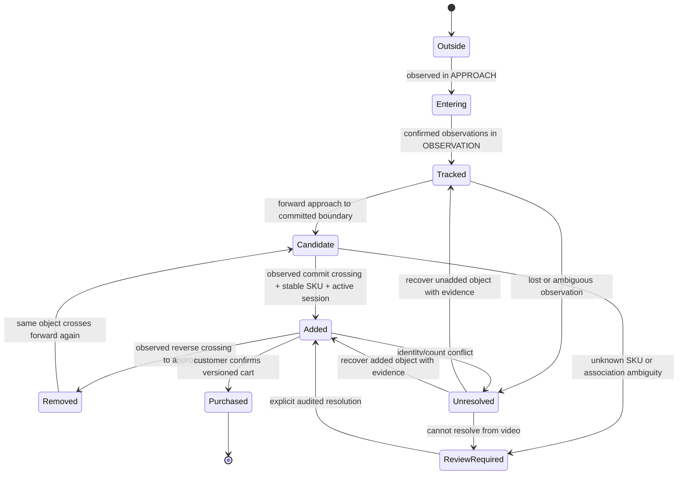
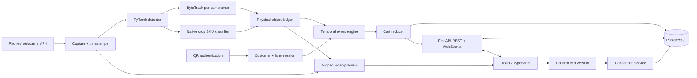

# Pro Express: technical research and executable prototype plan

**Research date:** October 2, 2026. **Purpose:** an independent software engineering and computer vision portfolio project inspired by contractor checkout. This report does not describe an integration with Home Depot.

This is a research and design deliverable. No prototype has been trained, benchmarked, or implemented during this research. Unless a result is attributed to a source, numerical budgets and thresholds below are proposed starting points, not measured performance. Public sources are linked beside the claims they support. Hardware estimates require a pilot on your actual machine.

Research was conducted across four parallel workstreams covering all ten requested areas: commercial systems/identity/cameras; datasets/footage; detection/SKU recognition/training/open-source code; and tracking/events/backend/MVP feasibility. Each proposed alternatives before synthesis. Dataset transfers and repository execution were not performed; codebase assessments are static inspections, not runtime validation.

**Reading guide:** sections 1, 4, 6–8 and 13 give the build decisions; section 3 contains the full footage catalog; sections 10–12 specify the software system; sections 15–18 define evaluation and portfolio presentation.

| Section | Focus | Section | Focus |
|---|---|---|---|
| [1](#1-executive-recommendation) | Recommendation and architecture competition | [11](#11-data-model) | Data model |
| [2](#2-key-research-findings-what-real-systems-teach-us) | Commercial systems and cameras | [12](#12-recommended-repository-structure) | Repository structure |
| [3](#3-dataset-findings-and-self-recorded-data) | 24-source dataset catalog and recording plan | [13](#13-development-roadmap) | First hours and Days 1–3 |
| [4](#4-proposed-training-strategy) | Checkpoints, training and open-source study | [14](#14-training-roadmap-relative-to-application-development) | Training/application sequencing |
| [5](#5-computer-vision-architecture) | Vision pipeline | [15](#15-testing-and-measurement) | Hard-case tests and metrics |
| [6](#6-tracking-architecture-identity-for-physical-merchandise) | Physical merchandise identity | [16](#16-recruiter-demo-script-6090-seconds) | Recruiter demo |
| [7](#7-product-recognition-architecture) | Exact SKU recognition | [17](#17-resume-bullets) | Resume bullets |
| [8](#8-checkout-event-engine) | State machine and cart invariants | [18](#18-interview-talking-points) | Interview discussion |
| [9](#9-identity-system) | Authentication | [19](#19-future-extensions) | Extended/production versions |
| [10](#10-full-software-architecture-and-frontend) | Backend, frontend and architecture diagram | | |

## 1. Executive recommendation

**Build a single-customer, single-camera checkout lane for eight known packaged hardware products, with two physical copies of at least one SKU. Fine-tune a merchandise detector and an exact-SKU crop classifier. Use ByteTrack for local trajectories, a separate physical-object ledger for transaction identity, a reversible checkout state machine, QR session authentication, and a React/FastAPI/PostgreSQL application.**

Mount a phone or webcam at an oblique angle over a narrow, well-lit passage or workbench. Define APPROACH, OBSERVATION, and COMMITTED zones. A customer authenticates, carries visible products through the lane, reviews the inferred cart, and confirms a simulated transaction. Demonstrate two identical units, a brief occlusion, backward removal, and an uncertain recognition requiring review. Package a deterministic replay alongside live capture. Retain a separate frozen COCO person detector for a best-effort occupancy gate; one-class merchandise fine-tuning removes person recognition from that detector.

The first MVP may use five products; eight is the preferred target. Choose a mix of distinct packaging and one deliberately similar pair, such as two bit-set sizes or two fastener packages from the same brand. Include packaged tools or hardware you already own. Give them local catalog identifiers such as `PEX-001`; store manufacturer model numbers and UPCs separately. Prices are clearly labeled demo catalog prices. Product names must come from the actual packages. Never invent a Home Depot SKU or claim an internal account connection.

The concrete initial model choices are **Ultralytics `yolo26n.pt`, fine-tuned to one `merchandise` class**, and **torchvision EfficientNet-B0 with ImageNet pretrained weights, fine-tuned to the selected SKUs**. Keep DINOv2 ViT-S/14 gallery retrieval as a comparative experiment and possible ambiguity resolver. Start from pretrained weights, not random initialization. The classifier sees native-resolution detector crops; tracking is independent of unstable per-frame SKU predictions.

The distinctive engineering work is the **physical-object ledger + evidence-backed, reversible cart reducer + replay evaluation**. Loading a detector or drawing boxes is insufficient. Your system should explain why an item was counted, preserve that decision through a tracker reset, and refuse automatic completion when identity or quantity is unresolved.

The 2–3 day scope has explicit conditions: one authenticated customer per lane; fixed camera; small closed catalog; visible, separable merchandise; short occlusions; no arbitrary hidden stack counting. If the lane sees a second person, an unknown product, or ambiguous same-SKU recovery, pause automatic additions or mark review required. This is an operational boundary you can defend experimentally.

### Competing architectures before convergence

The following are engineering candidates, not claims about commercial implementations. Time estimates assume familiarity with the stack and include a small demo, not production reliability.

| Candidate | Mechanism | Difficulty / novelty | Robustness and failure mode | Data / hardware | Training | Demo / resume value | Initial effort |
|---|---|---|---|---|---|---|---|
| A. SKU-specific detector + tripwire | Detector emits SKU classes; tracker counts crossings | Low–medium / modest | Strong controlled baseline; class flicker and track fragmentation alter counts | 300–800 labeled frames; one RGB camera | Fine-tune detector | Clear demo, shallow if it only counts raw IDs | 2–3 days |
| B. Detector + crop recognition + physical ledger | Independent localization, SKU evidence, canonical object identity, reversible events | Medium / meaningful systems contribution | Handles short occlusion and uncertain SKU; explicitly abstains on unobservable identities | Own footage and multi-view product crops; one camera | Detector + small classifier; frozen retrieval baseline | Best balanced CV and backend story | 2–3 days constrained; 1–2 weeks strengthened |
| C. Barcode-first visual checkout | Track visible products; decode UPC/model text; visual recognition handles gaps | Low–medium / modest | Exact when code is readable; fails on back-facing or tiny codes | Catalog codes; close RGB view | Optional detector; no barcode training | Excellent baseline, less passive/frictionless | 1–3 days |
| D. Cart-centric insertion/removal | Rim cameras monitor objects crossing cart opening; session belongs to cart | Medium–high / high | Strong ownership; hidden contents and multiple simultaneous insertions remain hard | Mounted cart/basket, rim footage; preferably two cameras | Product detector + crop classifier | Very convincing smart-cart project | 4–10 days |
| E. Person–hand–product interaction graph | Pose + object tracks + shelf take/put events infer ownership | High / high | Supports transfers and putback; hand occlusion and crowded ownership difficult | Interaction videos, shelf map, person/hand labels; several views | Product models; pose pretrained; temporal model later | Highest interaction depth, weak quick delivery probability | 2–4 weeks |
| F. Overlapping multi-camera checkout portal | Synchronized side/top views; cross-view object matching and fused counts | High / high | Better visibility; calibration, synchronization and duplicate reconciliation add risk | Two phones; paired identities/calibration footage | Same product models; association initially geometric | Strong extension once single-view baseline exists | 1–2 weeks |
| G. Segmentation + video memory | Grounding/box prompts initialize SAM2/3 object masks; masks propagate | Medium–high / high | More precise boundaries; similar objects, long occlusion, runtime and identity initialization remain issues | Masks or box prompts; GPU; own difficult clips | Detector/classifier; foundation tracker frozen | Visually impressive, less predictable MVP | 3–7 days |
| H. Vision + item-specific RFID/weight | Tags give physical identity, vision locates; load cell verifies additions | Medium–high / high | Sensor diversity resolves some ambiguities; tag read zones and weight sums still need design | Real reader/tags or load cell + calibration | Vision model optional | Excellent fusion project if genuine; simulated RFID is only a software experiment | 1–2 weeks with actual hardware |
| I. Exit snapshot with multi-view counting | At exit, classify and count visible cart contents; reconcile against earlier views/receipt | Medium / medium | Avoids long item trajectories; opaque stacks make complete counting impossible | Cart images, multi-view masks/boxes | Detector + retrieval | Good receipt verification branch, weaker temporal story | 3–7 days |

Ratings below use 1–5, where higher is better, and are judgments for **your hardware and portfolio objective**. Weighted total: credibility 20%, feasibility 15%, demo quality 15%, CV depth 15%, engineering depth 15%, speed 10%, portfolio usefulness 10%. Scores are preference estimates, not experimental measurements.

| Rank | Approach | Credibility | Feasibility | Demo | CV depth | Engineering | Speed | Portfolio | Weighted / 5 |
|---|---|---:|---:|---:|---:|---:|---:|---:|---:|
| 1 | B: modular vision + physical ledger | 5 | 4 | 5 | 4 | 5 | 4 | 5 | 4.60 |
| 2 | F: multi-camera portal | 5 | 3 | 5 | 5 | 5 | 2 | 5 | 4.40 |
| 3 | D: cart-centric | 5 | 3 | 5 | 4 | 5 | 3 | 5 | 4.35 |
| 4 | E: interaction graph | 5 | 2 | 4 | 5 | 5 | 1 | 5 | 4.00 |
| 5 | A: SKU detector + crossing | 4 | 5 | 4 | 3 | 3 | 5 | 4 | 3.95 |
| 6 | H: real sensor fusion | 5 | 2 | 4 | 3 | 5 | 2 | 5 | 3.80 |
| 7 | G: segmentation memory | 4 | 3 | 5 | 5 | 3 | 2 | 4 | 3.80 |
| 8 | C: barcode-first | 5 | 5 | 3 | 2 | 3 | 5 | 3 | 3.75 |
| 9 | I: exit snapshot | 4 | 4 | 4 | 3 | 3 | 4 | 4 | 3.70 |

Candidates with equal scores favor temporal relevance; the barcode baseline remains worth implementing for comparison. **Choose B.** The multi-camera approach is its first major extension. Shelf interaction and sensor fusion remain credible longer-term directions, not prerequisites for a strong first demo.

## 2. Key research findings: what real systems teach us

### Evidence discipline

**Documented public behavior** establishes a described customer flow or deployed function. **Company claims** describe vendor architecture/performance without an independent benchmark. **Patents** reveal possible designs, not deployment proof. **Academic research** establishes results only in the paper's setup. **Engineering analysis** below proposes how to reproduce a subset. **Speculation** about undisclosed production models is not used to choose this build.

| System | Public evidence and mechanism | What it teaches Pro Express |
|---|---|---|
| Amazon Just Walk Out, camera version | Amazon describes ceiling cameras, hand–shelf interactions, shelf weight sensing, a virtual cart and a temporary trip/payment association; returning items reverses the cart. Company architecture description, not released code. [Amazon explanation](https://www.aboutamazon.com/news/retail/how-does-amazon-just-walk-out-work) | Authentication can happen once at entry; temporal inventory evidence matters more than exit-frame detection counts |
| Amazon's multimodal JWO update | Amazon describes jointly analyzing camera/sensor inputs with a transformer, store geometry and an image catalog. Weights, training recipe and exact production association logic are undisclosed. [Amazon update](https://www.aboutamazon.com/news/retail/amazon-just-walk-out-improves-accuracy) | Use catalog and geometry priors; do not claim you are reproducing their proprietary neural architecture |
| JWO RFID offering | Item-specific tags read at an exit gate are a distinct solution from shelf-camera inference. [Amazon RFID](https://www.aboutamazon.com/news/retail/amazon-just-walk-out-rfid-technology) | RFID can encode instance identity; a barcode/SKU denotes product type |
| Amazon Dash Cart | Earlier generations described vision/sensor fusion and weight-based produce handling; the current 2026 announcement includes a scanner, vision for removals and produce sensing. [2022 cart](https://www.aboutamazon.com/news/retail/amazon-dash-cart-new-features-whole-foods), [2026 cart](https://www.aboutamazon.com/news/retail/amazon-redesigned-dash-cart-whole-foods-market) | Cart-centric ownership simplifies association; do not call every generation fully scanless |
| Sam's Club exit arches | Walmart documents multiple cart images → detection → size/shape/color/brand/logo feature matching → receipt association → item/receipt comparison. This verifies already-paid merchandise. [Walmart engineering description](https://tech.walmart.com/content/walmart-global-tech/en_us/blog/post/sams-club-ai-exit-technology.html) | A constrained portal with multiple views is reproducible; receipt verification and creating an unpaid cart are different tasks |
| Scan & Go | Authenticated customers scan barcodes and pay in the app, receiving an exit receipt. [Sam's customer workflow](https://www.samsclub.com/content/scan-and-go) | Reliable exact-code recognition is a useful fallback, but scanning itself is not passive CV checkout |
| Zippin | Public documents describe overhead cameras, shelf sensors, edge processing and payment association; newer variants advertise vision-only. An older whitepaper describes review of low-confidence clips. [Product](https://www.getzippin.com/product), [current variants](https://www.getzippin.com/zippin-store), [whitepaper](https://www.getzippin.com/hubfs/Future%20of%20Retail_Zippin.pdf) | Sensor configuration varies; uncertainty handling and review belong in a serious architecture |
| AiFi autonomous retail | Advertises camera-first/keypoint tracking and non-biometric trip tracking, with optional integrations. Vendor claims, not a public reproducible benchmark. [Platform](https://www.aifi.com/), [FAQ](https://www.aifi.com/blog/aifi-faq-your-burning-questions-answered) | Person/pose tracking and account authentication are separate responsibilities |
| Mashgin bounded checkout | Describes a tray, multiple cameras and 3D item representation. Vendor accuracy claims are not interchangeable with your exact-cart evaluation. [Recognition explanation](https://faq.mashgin.com/faq/how-mashgin-recognizes-items) | Improving observability through placement/geometry can matter more than a larger model |
| Trigo loss prevention | Describes linking shelf picks, shopper movements and POS data, including evidence about items later concealed. Vendor claims. [Loss-prevention system](https://www.trigoretail.com/loss-prevention/) | Hidden-item inference can use earlier visible events; it is not recognition through an opaque object |

An Amazon inventory patent describes product/user association and ownership transition at an exit region, with multiple possible sensors. Treat it as design-space evidence, not proof that those exact components are deployed or accurate. [Patent US20150012396A1](https://patents.google.com/patent/US20150012396A1/en).

### What consumer hardware can reproduce

The minimum reproducible subset is **trip authentication, a known observation region, merchandise localization, physical-object continuity, SKU evidence, reversible item events, cart review and durable confirmation**. Those functions create a meaningful cashierless-checkout research prototype. You can omit store-wide person ReID, ceiling coverage of every aisle, shelf sensing and real payment integration while still demonstrate the difficult video-to-transaction boundary.

Overlapping views reduce blind spots but add synchronization and association problems. Person tracking gives a session-local visual reference, not an account credential. Cart tracking can bind ownership once. Hand–object interaction can explain transfers or shelf picks but requires interaction data. Depth improves geometry/separation but cannot reveal unreadable model numbers. Weight helps detect net inventory change but can confuse equal masses and combinations. Barcodes give exact type when readable. RFID can give tagged-unit identity but needs real hardware and appropriate read-zone design. Sensor fusion is valuable when modalities add independent information, not when several classifiers repeat the same ambiguity.

**Academic evidence:** Grab combines pose/arm tracking with camera, weight and RFID evidence, including a prototype using 720p shelf-mounted IP cameras and comparison with webcams. FAIM studies shelf weight changes plus buffered vision and compares top/front/left/right views; complementary views helped within its specific shelf setup. These are useful hobbyist design precedents, not proof of arbitrary contractor checkout accuracy. [Grab paper](https://arxiv.org/html/2001.01033v1), [FAIM paper](https://www.frontiersin.org/journals/built-environment/articles/10.3389/fbuil.2020.568372/full).

### Camera and physical setup recommendation

| Setup | Concrete arrangement | Value / tradeoff |
|---|---|---|
| Minimum | Existing phone or webcam, rigid raised oblique mount, diffuse light, taped narrow approach/observation/commit regions | Enough for a real one-customer prototype; no camera purchase required |
| Improved | Two existing phones or locally accessible cameras, side/top or opposite oblique views with checkout-area overlap | Complementary visibility and labeled multi-view footage; adds timing/calibration/duplicate-fusion work |
| Ideal hobbyist | Two or three rigid wired UVC/PoE cameras, controllable exposure, timestamped capture, optional real load cell or depth camera | More reliable long-running capture and genuine fusion experiments; still not a whole-store setup |

Record 1080p/30fps. Use 4K only if important packaging text is too small, and preserve full-resolution crops independently of detector resolution. Aim for roughly 120–200 pixels across a relevant packaging face; inspect actual blurred/occluded examples rather than relying on resolution alone. For a passage, start around 1.8–2.4 m mount height and adjust the oblique angle so hands and the person's body do not hide all products. These are practical proposed starting points, not universal camera requirements.

A webcam with native USB/UVC capture is convenient for live inference. A phone is excellent for dataset capture; phone streaming adds timing/latency variability. A GoPro's wide view may reduce product pixel size and requires distortion consideration. A security camera is useful only with accessible local RTSP/ONVIF or another usable stream; a cloud-only app camera can obstruct your pipeline. Purchase a rigid mount and lighting before an expensive camera. If buying a camera, verify Linux capture modes, focus/exposure control and local access; do not assume advertised frame rate holds under low light. Logitech's BRIO datasheet is one manufacturer example of 4K/30 and 1080p/30–60 modes, not a required purchase. [Manufacturer datasheet](https://www.logitech.com/assets/65040/2/brio-datasheet.ENG.pdf).

For two recorded phones, capture a clap/flash visible in both, estimate offset using presentation timestamps, and measure end-of-clip drift. For live fusion, log capture timestamps and synchronization error. More expensive resolution does not compensate for products fully blocked in every view.

## 3. Dataset findings and self-recorded data

Researched October 2, 2026. This report distinguishes published dataset facts from engineering recommendations. “Unknown” means not established from the inspected primary source; it is not a claim that the information does not exist. Download sizes are source-reported unless explicitly marked estimates. No large dataset downloads were performed, so links can be identified without guaranteeing successful transfer.

### Recommendation and ranking

**Build a small staged, self-recorded checkout-zone dataset using the exact physical products and camera geometry of the demo.** Public datasets provide useful benchmarks and techniques, but no verified public source supplies Home Depot hardware SKUs, persistent handheld-product identities, customer ownership, and checkout events together. A detector trained on grocery shelves does not automatically recognize a boxed drill, and a video anomaly label is not transaction ground truth.

Ranked for Pro Express: (1) self-recorded 5–8 SKU MVP, then 10–20 SKU extension; (2) Grocery Vision 2023 for cart add/remove and exact-product retrieval, if access arrives; (3) ARC/AI City 2023 Track 4 for one-camera product counting methods and synthetic-to-real evaluation; (4) RPC for cluttered exact-product detection/counting; (5) RetailAction for real overhead shelf Take/Put/Touch interactions; (6) D2S for instance segmentation and copy-paste augmentation; (7) Unitail-OCR for packaging text; (8) RP2K/Products-10K for retrieval pretraining; (9) SKU110K for generic dense merchandise boxes; (10) EPIC VISOR for hand-object contact and temporal segmentation. The rest below are research leads or stress-test data, not primary MVP training data.

The strongest combination is **self-recorded detector/recognizer training + self-recorded fully held-out transaction videos + ARC/RPC methods as external baselines**. The second-week extension can use Grocery Vision for cart interactions or RetailAction for shelf events. Avoid merging all datasets into one training set indiscriminately: their class definitions, camera views, rights, and tasks differ.

### Comparison: all 17 requested fields

The three aligned tables collectively contain: name, URL, type, count, resolution, perspective, annotations, product annotations, tracking IDs, person IDs, hand/object interaction labels, licensing, publication restrictions, approximate download size, training suitability, public GitHub suitability, and Pro Express usefulness. “No” means that label type is not supplied by the published description, not that the imagery contains no such objects. Dataset product IDs are not automatically Home Depot SKU IDs.

#### Table A: source, scale, imaging, annotations (fields 1–7 and 14)

| ID / Name / source URL | Type and published count | Resolution / camera perspective | Core annotations | Approximate download size |
|--- |--- |--- |--- |--- |
| 1. Self-recorded Pro Express | Proposed 60 short clips MVP, 120–180 extension; exact owned/borrowed products | 1920×1080, 30 fps; fixed elevated oblique camera; optional opposite side camera | Boxes, physical instance IDs, SKU, session/customer pseudonym, event timestamps, final cart; chosen by developer | Estimate: 10–30 min at 8–20 Mbps ≈0.6–4.5 GB per camera, plus images |
| 2. [Grocery Vision 2023 / PRAW](https://physicalstoreworkshop.github.io/challenge.html) | TAL/STAL 73,683 image-annotation pairs; ABV 74,200 product images | Cart-mounted GoPro in grocery stores; image dimensions not stated on challenge page | Add/remove basket actions, temporal/spatial action localization; ABV filenames carry product barcodes | Unknown; affiliation-email request required |
| 3. [ARC / AI City 2023 Track 4](https://www.aicitychallenge.org/2023-data-and-evaluation/) | 116,500 synthetic images; 116 merchandise assets; [authors report ~22 min real video](https://arxiv.org/html/2308.09708v1); exact clip count unknown | Synthetic variable camera pose; real top-down camera above white checkout tray; exact released-video dimensions not established here | Synthetic class and segmentation labels; evaluated once-per-item recognition time/frame within ROI | Unknown; [current official access page](https://www.aicitychallenge.org/ai-city-challenge-dataset-access/) and [download page](https://www.aicitychallenge.org/2023-track4-download/) |
| 4. [RPC](https://rpc-dataset.github.io/) / [paper](https://arxiv.org/abs/1901.07249) | 83,739 images: 53,739 exemplars +30,000 checkout images; 200 products | Exemplars 2592×1944, checkout 1800×1800; multi-view turntable and top-down whiteboard ([benchmark paper](https://isrc.iscas.ac.cn/zhanglibo/pdfs/2019/ACMMM_2019.pdf)) | Product category and boxes; checkout quantity/shopping-list task | Project page: ~15 GB |
| 5. [RetailAction](https://huggingface.co/datasets/standard-cognition/RetailAction) / [paper](https://openaccess.thecvf.com/content/ICCV2025W/RetailVision/papers/Mazzini_RetailAction_Dataset_for_Multi-View_Spatio-Temporal_Localization_of_Human-Object_Interactions_in_ICCVW_2025_paper.pdf) | 21,000 two-view samples; publisher reports ~41 h and >10,000 shoppers /10 stores | Source cameras 2880×2880, 30 fps, ceiling ≈2.5 m; released clips cropped and motion-subsampled to ≤32 frames (not dense 30 fps video) | Take/Put/Touch intervals and interaction points; subject pose and face locations, timestamps | HF repository: 31.9 GB |
| 6. [MVTec D2S](https://www.mvtec.com/research-teaching/datasets/mvtec-d2s) / [paper](https://openaccess.thecvf.com/content_ECCV_2018/papers/Patrick_Follmann_D2S_Densely_Segmented_ECCV_2018_paper.pdf) | 21,000 images, 60 classes; 4,380 train/3,600 validation/13,020 test | 1920×1440; controlled top-down industrial checkout, rotations/light/background changes | Pixel-precise instance masks/boxes; test annotations withheld | Official page does not establish total archive size; reserve several GB, verify actual archive |
| 7. [SKU110K](https://github.com/eg4000/SKU110K_CVPR19) | 11,743 official fixed-split images; >1.7M boxes; 8,219 train/588 val/2,936 test | Variable high-resolution store shelf images; primarily frontal/oblique dense shelves | One generic merchandise box class; not 110k SKU classes | Distribution-dependent roughly 13–17 GB; do not quote one format as universal |
| 8. [Unitail](https://unitedretail.github.io/) / [paper](https://arxiv.org/abs/2204.00298) | Det: 1.8M quadrilateral instances; OCR: 1,454 product categories, 30k text regions, 21k transcriptions | Real shelf imagery + product gallery; variable image sizes, not stated consistently | Quadrilateral detection; product text boxes and transcriptions; matching | Unknown; Det access restricted since June 2024, contact author; OCR links remain |
| 9. [RP2K](https://arxiv.org/abs/2006.12634) / [original project](https://www.pinlandata.com/rp2k_dataset) | >500,000 product images; 2,000 products | Variable-size real shelf crops, natural lighting | Product identity + size/shape/flavor/scent attributes | Unknown; original site did not load during research; mirrors require provenance checks |
| 10. [Products-10K](https://products-10k.github.io/) / [paper](https://arxiv.org/html/2008.10545v1) | Paper: nearly 150,000 images; 10,000 SKU-level products | Variable catalog and customer photos from JD.com | Expert-checked image-level SKU labels/hierarchy | Unknown on inspected primary pages |
| 11. [MERL Shopping](https://www.merl.com/research/highlights/merl-shopping-dataset) | Released page: 106 videos ≈2 min each; 41 subjects in [mirrored release README](https://github.com/quental96/merl-shopping/blob/master/ORIGINAL.md), not independently archive-verified; older paper reports 96/32, so use release version | Overhead static lab grocery shelf; release documentation 920×680 at 30 fps | Five temporal shopping action classes | Unknown; official historical FTP address on project page; availability not transfer-tested |
| 12. [GroZi-120](https://cseweb.ucsd.edu/~echristiansen/papers/CVAVI_07.pdf) / [historical project](https://grozi.calit2.net/) | 120 products; paper average 5.6 exemplar images/product; 29 shelf videos | 720×480 mobile shelf video; web exemplars | Product exemplars and in-situ product localization annotations; inspect release variant | Unknown; historical project timed out |
| 13. [Freiburg Groceries](https://github.com/PhilJd/freiburg_groceries_dataset) | 5,000 images, 25 food categories | 256×256; real stores/apartments, varied lighting and views | Image-level category and supplied splits | Unknown; small image dataset |
| 14. [Grocery Store Dataset](https://github.com/marcusklasson/GroceryStoreDataset) | 5,125 natural images; 81 fine-grained/42 coarse classes; iconic image/text per fine class | Smartphone object-centric grocery photos; actual dimensions inspect repository | Fine/coarse class, iconic reference and description | Unknown; directly in repository |
| 15. [Amazon Berkeley Objects](https://amazon-berkeley-objects.s3.amazonaws.com/index.html) / [Amazon Science](https://www.amazon.science/code-and-datasets/amazon-berkeley-objects-abo-dataset) | 147,702 listings, 398,212 catalog images; 8,222 spin products; 7,953 models | Variable originals; small images max 256 px; isolated spin views; synthetic renderable 3D | Product metadata, 3D geometry/materials; some benchmark renders have masks/depth/normals | Small 3 GB; original 110 GB; spins 40 GB; models 154 GB; select assets rather than all |
| 16. [EPIC-KITCHENS-100](https://epic-kitchens.github.io/2025) + [VISOR](https://epic-kitchens.github.io/VISOR/) | 100 h/700 kitchen videos; VISOR 36 h/179 videos, 272k manual masks, 67k hand-object relations | Egocentric home kitchen; largely 1920×1080 / 50 fps; verify video component | Action intervals/nouns/verbs; VISOR active-object and hand masks/contact; automatic boxes are pseudo-labels | Complete published sequence bundles 1.1 TB +740 GB; download specific videos; auto annotation bundle ~10 GB |
| 17. [PRISM-100K](https://huggingface.co/datasets/DreamVu/PRISM-100K) | 100,000 VLM QA samples, 25,173 unique clips; publisher claims quality validated by Gemini | 480p MP4, 4 fps; ego/exo retail | 21 task types; chat-format QA, including hand interaction/object permanence; partly AI-generated | HF reported repository 772 GB; use selected clips, inspect large metadata files |
| 18. [UCF-Crime](https://www.crcv.ucf.edu/research/real-world-anomaly-detection-in-surveillance-videos/) | 1,900 surveillance videos, 128 h, 13 anomaly types plus normal; shoplifting subset | Mixed CCTV/video provenance; varying low resolutions; not one consistent camera | Video-level anomaly training labels, temporal test labels | Official page links large ZIP; bytes not established here |
| 19. [MNNIT Shoplifting 2022](https://data.mendeley.com/datasets/r3yjf35hzr/1) | Lab-recorded staged videos; exact count not exposed in inspected page | 640×480, 30 fps; lab scene captured with 32 MP camera | Normal/shoplifting classes | Unknown |
| 20. [Kaggle Shoplifting Video](https://www.kaggle.com/datasets/kipshidze/shoplifting-video-dataset) and [DCSASS](https://www.kaggle.com/datasets/mateohervas/dcsass-dataset) | Existence verified; cards did not expose content to browser; counts not independently confirmed | Retail/CCTV footage or derived clips, verify individually | Uploader-dependent; typically action classes, not SKU transaction labels | Unknown |
| 21. [PoseLift](https://github.com/TeCSAR-UNCC/PoseLift) / [RetailS](https://github.com/TeCSAR-UNCC/RetailS) | PoseLift 153 sequences; RetailS nearly 20M normal frames | **Pose data, not raw RGB release**; source 6 indoor cameras; PoseLift source 1080p / 15 fps | Person boxes, IDs, COCO pose, frame anomaly labels | Unknown; download links in repos |
| 22. [Simuletic synthetic CCTV sample](https://simuletic.com/blog/cctv-shoplifting-dataset) | Publisher: 400 frames/8 video free sample; full paid 5,000+ frames / 100+ videos | Rendered overhead/oblique retail; resolution not stated | Person boxes, 17-point pose, VLM captions | Unknown; sample linked on Kaggle |
| 23. [POLIMI-ITW-S](https://airlab.deib.polimi.it/polimi-itw-s-a-shopping-mall-dataset-in-the-wild/) | 22,164 video samples/37 action classes | Real shopping mall; fixed cameras; resolution inspect release | RGB, 2D skeleton, boxes, action class | Unknown |
| 24. [LoCount official announcement](https://isrc.iscas.ac.cn/news/20210412-data-set/) / [paper](https://arxiv.org/abs/2003.08230) | 50,394 images; >1.9M instances; 140 categories | Reported 1920×1080; real retail stores/apartments | Group bounding boxes with category and instance count, rather than a box for every heavily occluded item | Unknown; original GitLab redirects to sign-in; [later research implementation](https://github.com/SakiRinn/mmdetection-locount) supplies alternate links |

#### Table B: label capabilities (fields 8–11)

| ID | Product annotations | Product tracking IDs | Person IDs | Hand/object interactions |
|---|---|---|---|---|
| 1 | Exact SKU/barcode and boxes | Yes, manually grounded physical instances | Actor/session pseudonyms | Explicit staged event times |
| 2 | ABV barcodes; STAL boxes | Action tubes; persistent cross-action IDs not established | Anonymized; released IDs not established | Basket add/remove |
| 3 | 116 synthetic classes/masks | No dense real-video track ground truth promised | No | Scanning events; no hand/contact graph |
| 4 | 200 classes/boxes/counts | No | No | No |
| 5 | Contact points, no exact SKU boxes | No | Interest-subject pose only; no released global identities | Take/Put/Touch with time and point |
| 6 | 60 classes/masks/boxes | Still-image instance IDs only | No | No |
| 7 | One merchandise class, no exact SKUs | No | No | No |
| 8 | Quadrilaterals, OCR classes/transcripts | No | No | No |
| 9 | 2,000 identities and attributes | No | No | No |
| 10 | 10,000 image-level SKU classes | No | No | No |
| 11 | Inspect-product action, no exact SKUs | No | Subject/session IDs | Reach/retract/hand-in-shelf/inspect actions |
| 12 | 120 product identities/localization | Persistent IDs not established | No | No |
| 13 | 25 coarse grocery categories | No | No | No |
| 14 | 81 fine classes, not hardware SKUs | No | No | No |
| 15 | Product metadata and 3D assets | Asset identity, not physical-instance tracks | No | No |
| 16 | Object categories/masks, not SKUs | VISOR associations, not a retail MOT benchmark | Participant pseudonyms | VISOR hand contact/object relations |
| 17 | Genericized products in QA | No dense MOT ground truth promised | Anonymized | QA interaction classes, not event ledgers |
| 18 | No | No | No | Anomaly labels only |
| 19 | No exact SKUs stated | No | IDs not stated | Normal/stealing classes |
| 20 | Not verified | Not verified | Not verified | Uploader-dependent; not verified |
| 21 | No RGB merchandise | Person IDs, not product tracks | Yes, derived tracker IDs | Pose/anomaly; no product contact |
| 22 | Caption products; no verified SKU boxes | Not stated | Boxes/pose; IDs not stated | Caption-level concealment |
| 23 | No exact SKUs | Person associations; inspect release | Not established | Mall actions, not checkout ledger |
| 24 | Product category plus group count; not necessarily exact SKU | No temporal tracks | No | No |

#### Table C: license, publication, usage (fields 12–13 and 15–17)

| ID | Classification, license, publication restrictions | Training suitability | Public GitHub suitability | Pro Express usefulness |
|---|---|---|---|---|
| 1 | Clearly suitable/public with owned recordings and participant publication consent; choose media license | Highest target fit | Selected clips/labels/data card; consent records private | Essential |
| 2 | Research/noncommercial CC BY-NC 4.0; affiliation-email request | Excellent cart events/retrieval | Code and links; samples only under actual license/access terms | Highly relevant, access can delay |
| 3 | Research-only NVIDIA agreement: no general redistribution; models also noncommercial/academic; minimal research-paper excerpts with conditions | Counting/synthetic baseline | Code/evaluation; do not assume recruiter demo qualifies for excerpt exception | Closest one-camera counting benchmark |
| 4 | CC BY-NC-SA 4.0 | Cluttered grocery SKU/count training | Attribution, noncommercial and sharealike requirements | Method benchmark, hardware domain gap |
| 5 | Public Standard.AI custom terms; author/license/NOTICE; no reidentification; additional license above $10k relevant revenue | Multi-view shelf interactions; not dense MOT | Permitted under conditions; [license](https://huggingface.co/datasets/standard-cognition/RetailAction/raw/main/LICENSE) | Best real shelf-interaction release |
| 6 | CC BY-NC-SA 4.0; test labels withheld | Segmentation/copy-paste | Attribution/noncommercial/sharealike | Stacked-object experiment |
| 7 | Exact image redistribution terms not located in original inspected repo | Generic dense boxes, no SKU classifier | Code/downloader; clarify raw-data terms | Less useful than target footage for MVP |
| 8 | Academic only; Det gated | OCR/quad detection | Clarify redistribution before rehosting | Packaging-text extension |
| 9 | Unclear license/access from verified sources | Recognition pretraining after access/terms established | Code/links pending original terms | Large training probably unnecessary |
| 10 | Noncommercial research/education; user responsible for image copyright issues | Fine-grained catalog/customer recognition | Research permission does not establish redistribution permission | Optional pretraining reference |
| 11 | Freely downloadable for research; commercial copying needs permission | Temporal overhead actions | Check release README; use source link/code meanwhile | Small shelf-event benchmark |
| 12 | Unclear original license; web exemplars have separate copyright; old project unavailable here | Small retrieval/domain shift | Code/links until terms established | Feature-matching research |
| 13 | No data license located in inspected original repo | Coarse classification | Code/links; clarify redistribution | Low checkout relevance |
| 14 | Repository MIT; web iconic images/text need separate provenance checks | Fine/coarse classifier | Natural images under repo notices; check third-party assets | Modest baseline |
| 15 | Discrepancy: current S3 says CC BY 4.0; paper/AWS registry says CC BY-NC 4.0; verify actual archive | Rendering/retrieval assets | Actual archive terms and attribution | Synthetic engineering, no events |
| 16 | Project CC BY-NC 4.0; automatic-annotation archive lists different NC government license | Hand/object contacts; domain gap | Attributed examples per component terms | Second-week interaction work |
| 17 | CC BY-NC 4.0 plus no de-anonymization | VLM reasoning; AI labels not transaction truth | Noncommercial attributed subset | Ambitious extension |
| 18 | Questionable publication provenance/consent; no blanket footage redistribution established | Anomaly/CCTV stress tests | Unsuitable for public demo without clearance; code/aggregate metrics | Poor-angle stress-test lead |
| 19 | Lab staged; publisher CC BY 4.0; participant publicity details absent | Small action baseline | Attribution/terms; verify provenance for prominent demo | Staged-action inspiration |
| 20 | Unclear licenses/questionable provenance; uploader license cannot establish source rights | Inspect terms before private experiments | Unsuitable to publish until provenance established | Footage exists, weak checkout truth |
| 21 | PoseLift repo Apache 2.0; RetailS license not located; pose-only release | Human behavior, no SKU detector | PoseLift notices; clarify RetailS terms | Privacy-conscious release example |
| 22 | Publisher CC BY 4.0 free sample; full paid terms separate | Synthetic temporal/pose experiment | Actual sample terms plus attribution | Synthetic lead, missing checkout truth |
| 23 | Publisher CC BY-SA 4.0 | Human action, no SKU training | Attribution/sharealike; inspect participant details | Person behavior baseline |
| 24 | Original data license not established here; original access now gated | Occluded group counting; cannot validate physical instance tracking | Code/source references; clarify data redistribution terms | Relevant alternative to detection counting, but count alone does not establish object identities |

**Potentially legally problematic publication risks:** unauthorized rehosting of CCTV, attempts to reverse anonymization, publishing identifiable covert footage, or acquiring footage from exposed private camera feeds can create privacy, copyright, contractual, or access risks. This is a risk category, not a legal determination about a particular source. The UCF-Crime and Kaggle leads remain in the table for evaluation; a public recruiter demo should use staged recordings unless provenance and publication rights are established. These risks concern proposed uses and do not imply that every release itself is unlawful.

Licensing classifications are source-term summaries, not guarantees of consent or conclusions about a specific publication. A public download and a license label are different evidence. Code licenses, data licenses, pretrained-weight licenses, and permissions to publish identifiable people should be recorded separately. Where unclear, the concrete usable portfolio result is original staged media plus public code; questionable sources remain documented for research evaluation rather than erased from the catalog.

### Important findings and limits

AI City retail references are often misdated. Its 2023 Track 4 is retail; 2024/2025 Track 4 is road objects. The current [access page](https://www.aicitychallenge.org/ai-city-challenge-dataset-access/) lists 2023 Track 4 among datasets still downloadable and says unlisted older datasets are no longer accessible. The ARC generator [repository](https://github.com/yorkeyao/Automated-Retail-Checkout) provides 116 scanned object assets, Unity source, and synthetic class/mask generation under a repository MIT license. That license should not replace the challenge dataset's [NVIDIA data agreement](https://www.aicitychallenge.org/wp-content/uploads/2023/01/Dataset-License-AIC2023-12Jan2023.pdf).

RetailAction's ≤32 selected frames per segment mean irregular sampling: use timestamps, not frame numbers as if they were dense real time. It has no released global shopper identity and cannot validate customer account association. Its paper says labels concern shelves, not baskets or checkout. Take dominates the labels, so evaluate Put and Touch separately.

[PRISM retrieval research](https://arxiv.org/html/2509.14985v1) uses Grocery Vision's ABV cart images with six gallery viewpoints per product. SigLIP → YOLO-E → LightGlue deserves study, but its table reports 42.79% Top-1 and 725 ms/query on A100 despite the abstract's real-time framing. This supports collecting target-domain data instead of assuming a frozen embedding model solves exact SKU recognition. The work is unrelated to DreamVu's PRISM-100K QA dataset.

UCF-Crime and Kaggle surveillance clips are discovery leads, not product-account transaction truth. Public CCTV uploads can have unknown recording permission and ownership chains; face blurring does not grant copyright permissions. Use staged actors for the public Pro Express demo. No private feeds, bypassed logins, or nonpublic retailer systems are needed.

Catalog photos help define names/barcodes, but are not target-camera coverage or automatically licensed for redistribution. Photograph the actual borrowed/purchased products, transcribe barcode/model information, store local project SKU mappings, and use mock prices. Do not claim access to Home Depot's internal product master.

### Self-recorded dataset design

These are engineering estimates, not accuracy guarantees. Record **5–8 products for the MVP**, including a near-lookalike pair and two physical copies of one SKU. Low-cost contractor products could include boxed fasteners, work gloves, tape, sealant cartridges, small fittings, and a borrowed boxed tool. Expand to 10–20 SKUs later, including variants distinguished by model numbers or text.

One camera suffices to prove bounded-lane tracking, SKU inference, and idempotent cart events. Use a fixed elevated oblique view of an entry strip, inspection area, and exit strip. Direct overhead improves separation but may hide packaging faces; oblique views preserve front/side text. Frame tightly enough that the smallest product typically occupies about 80–120 pixels on its short side at 1080p. Measure before recording; this is a practical data-quality target, not a universal detector limit.

Record 1080p at 30 fps with stable light and locked exposure/focus when possible. Optional 4K helps fine-text crops; downsample detector inputs independently. Avoid ultra-wide/fisheye initially. Preserve original videos, timestamps, settings, and manifests. Sixty 15–25 second clips contain 27k–45k raw frames: label diverse sampled frames and retain full videos for tracking/events.

Two phones/webcams improve opposite-view visibility and occlusion recovery but add synchronization, calibration, and duplicate fusion. Add them after the one-camera baseline. A clap or LED visible in both estimates the time offset; measure subsequent clock drift. Opposite/orthogonal views add more useful visibility than cameras side by side.

#### MVP recording matrix: 60 clips

| Scenario | Clips | Purpose |
|---|---:|---|
| Isolated views, rotations, handheld approach/departure | 16 | SKU appearance and pose variation |
| One actor with one/two/multiple products | 12 | Detection and basic counting |
| Identical copies and near-lookalikes | 6 | Physical quantity versus SKU identity |
| Occlusion, leave/reenter, reverse movement, putback | 6 | Recovery, reversal, idempotency |
| Empty lane, phone/tool lookalikes, unknown objects | 4 | Hard negatives and unknown rejection |
| Completely held-out transactions | 16 | Exact-cart accuracy and failures |

Record the final 16 test clips separately and never use them for tuning. Split the remaining 44 videos approximately 34 train / 10 validation. Extract 20–40 diverse frames per training video initially (about 700–1,400 images), then mine missed detections and uncertain crops. Aim for 100–200 distinct usable crop views per SKU, not adjacent frames from one turn. Every known SKU needs training and validation captures. Vary actors, background, lighting sessions, and handling for testing. If only one actor is available, disclose that limitation and still hold out sessions. Hold out physical copies or packaging wear when possible.

Extension target: 120–180 transaction clips across 3–5 sessions, 2–3 actors, 10–20 SKUs and two views; 2k–5k diverse training frames plus 200–500 hard-negative/unknown examples. Let held-out failures guide new recording.

#### Annotation schema and effort

Label every visible merchandise instance with a box and SKU in sampled training frames. Use visible boxes consistently and include occluded/truncated attributes; do not invent coordinates for fully hidden objects. On 10–20 evaluation clips, annotate persistent physical instance IDs through video using keyframes, interpolation, and corrections at occlusion boundaries. Instances A and B can share one SKU. Ground truth comes from the staged scene, not acceptance of tracker predictions.

Keep event labels separate: video ID, timestamp, physical instance ID, actor/session ID, action (entry, forward/reverse crossing, remove, putback, transfer), and final intended quantity. Write a rulebook first: what counts as inside, when a crossing completes, and whether transfers change ownership. Evaluate event logic independently of detection errors.

Use CVAT video interpolation or SAM2-assisted annotation with human review. Propagation can drift or merge identical objects; it is not ground truth. Estimated effort: 2–4 hours recording/setup and 4–8 hours labeling/review, increasing with overlap and object count. Dense manual annotation of every frame is unnecessary. Share timestamps, camera, and instance conventions across labels.

**Never random-split frames from one video across train/validation/test.** Synchronized views remain in one split and crops inherit their source split. Training-session gallery photos are permitted for known-SKU recognition; test crops must not enter the gallery. Evaluate unknown rejection separately. If claiming new-SKU enrollment without retraining, hold out entire SKUs during training and report that task separately.

#### Metrics and difficult tests

Measure detection AP50–95 and small/occluded-item recall; recognition macro Top-1/confusion matrix; unknown false acceptance versus coverage; tracking IDF1/HOTA or ID switches on annotated clips; **exact-cart accuracy**, per-SKU count MAE, duplicate-add rate, missed-item rate, and time to stable cart. Bootstrap by transaction/video rather than correlated frames. Strong frame accuracy can still produce wrong carts.

Test: one item observed in 100+ frames; two identical copies; overlap then separation; short/long occlusion; leave/reentry; hidden replacement by an identical object; reversal; putback; drop/pickup; empty checkout; unknowns; poor views; lighting changes; actor transfers; stacking; departure without confirmation. A fully hidden exchange of identical objects is unobservable to vision alone: return ambiguity/review instead of inventing confidence.

### Dataset combinations that compete

1. **Target videos only:** fastest domain fit and publishable owned media; strongest MVP.
2. **SKU110K/RPC pretraining → target detector → SKU classifier:** may reduce labels; compare against ordinary COCO initialization rather than assume shelf pretraining helps.
3. **Gallery retrieval → target hard-negative metric training:** extensible enrollment; needs all package faces and lookalike rejection.
4. **Own-mask copy-paste + real videos:** inexpensive augmentation; retain real-only testing and limit implausible scale/stacking.
5. **ARC/ABO rendering → camera adaptation:** interesting sim-to-real research; renderer/assets exceed the MVP window.
6. **RetailAction → interaction model → target capture:** good second-week work; irregular sampling and missing SKU truth prevent direct cart validation.
7. **Grocery Vision → cart add/remove engine:** excellent public task match; access and basket occlusion require work.
8. **PRISM-100K → VLM review explanations:** ambitious extension; QA accuracy does not establish item accounting.

Start with option 1 and evaluate options 3/4 as recognition/augmentation ablations. Benchmark target videos before large public-data pretraining.

## 4. Proposed training strategy

### What to train, and what to leave frozen

**Train two small models:** domain-adapt a one-class merchandise detector and fine-tune an exact-SKU crop classifier. Compare a frozen-feature gallery/linear head before attempting larger embedding-model training. Do not train from scratch. Do not train a neural event classifier on a few dozen videos when geometry and an explicit state machine cover the initial task.

| Component | Exact starting point | Decision / license and evidence |
|---|---|---|
| Merchandise detector | `yolo26n.pt` COCO pretrained → one `merchandise` class | Primary model. YOLO26 is released; YOLO27 is an unreleased preview in inspected docs. Ultralytics code/models use AGPL-3.0 or commercial terms. [Model docs](https://docs.ultralytics.com/models/yolo26/), [license](https://www.ultralytics.com/license) |
| SKU classifier | torchvision `efficientnet_b0(weights=EfficientNet_B0_Weights.IMAGENET1K_V1)` → K-output head | Primary exact-SKU model, initially K=5 then 8. Pretrained weights must be explicitly requested; constructor default is untrained. [Torchvision docs](https://docs.pytorch.org/vision/stable/models/generated/torchvision.models.efficientnet_b0.html) |
| Retrieval / linear probe | generic `dinov2_vits14`, frozen 384-D features, multi-view gallery | Comparative baseline; generic code/weights Apache-2.0. Some domain-specific assets have separate terms. [DINOv2](https://github.com/facebookresearch/dinov2) |
| Person occupancy | separate, unchanged COCO `yolo26n.pt`, person class | Frozen best-effort lane gate; do not use merchandise fine-tuning checkpoint for this task |
| Tracker | explicit ByteTrack config | No tracker neural training initially; tune association/lost buffers against labeled videos |

A small closed catalog can produce excellent recognition in a controlled lane, but there is no defensible accuracy guarantee without your held-out recordings. Some package faces are indistinguishable across variants. Training cannot recover a hidden model code; temporal clear views, OCR/barcode evidence or review are necessary. Exact-cart accuracy remains harder than crop classification.

### Current alternatives considered

| Model/tool | Research finding | Decision for this build |
|---|---|---|
| YOLO11 | Available mature family; older than current YOLO26 | Reproducibility fallback if the selected release has a blocking issue; no architecture depends on one YOLO version |
| RT-DETRv2 | Official Apache-2.0 PyTorch implementation, configs and deployment; R18 is a small alternative | Credible second detector experiment, not an extra MVP dependency. [Official implementation](https://github.com/lyuwenyu/RT-DETR) |
| RF-DETR | Current Nano/Small/Medium/Large family documented as Apache-2.0; XL/2XL have PML-1.0; current/legacy Large differ | Strong alternative if a permissive detector stack is preferred; benchmark Small/Nano on the same footage. Wrapper licenses remain separate. [Current official docs](https://github.com/roboflow/rf-detr/blob/develop/docs/index.md) |
| Grounding DINO | Text-conditioned open-set detection, Apache-2.0 code | Annotation bootstrap for generic categories with human correction; long product names do not make it an exact-SKU oracle. [Repository](https://github.com/IDEA-Research/GroundingDINO) |
| SAM2.1 | Apache-2.0 image/video prompting and training tools | Assist labels or compare masked crops; no full-model training initially. [Repository](https://github.com/facebookresearch/sam2) |
| SAM3 / SAM3.1 | Concept/exemplar segmentation/tracking; gated checkpoints and custom SAM License | Optional offline experiment. Setup/resources and transaction-identity limitations outweigh MVP benefit. [Repository](https://github.com/facebookresearch/sam3), [license](https://github.com/facebookresearch/sam3/blob/main/LICENSE) |
| DINOv3 | Newer small/distilled visual backbones; gated assets and custom license permitting use/derivatives subject to its agreement | Optional retrieval ablation; do not call it Apache or assume blanket research-only. [Repository](https://github.com/facebookresearch/dinov3), [license](https://github.com/facebookresearch/dinov3/blob/main/LICENSE.md) |
| CLIP | MIT image/text embedding implementation | Frozen image-gallery baseline; semantic brand/category similarity may miss size/model variants. [Repository](https://github.com/openai/CLIP) |
| SigLIP2 | Official `google/siglip2-base-patch16-224`, Apache-2.0 model card | Alternative frozen image/text retrieval baseline; test the same unknown/confusing crops. [Model card](https://huggingface.co/google/siglip2-base-patch16-224) |
| ZXing-C++ | Apache-2.0 retail EAN/UPC reader with Python bindings | Useful optional exact-code resolver, with object containment and catalog checks. [Bindings](https://github.com/zxing-cpp/zxing-cpp/blob/master/wrappers/python/README.md) |

Changing the detector to RF-DETR does not remove an AGPL dependency if you still adapt an Ultralytics tracker implementation. Review code, weights and data separately. Use original permissive tracker implementations if a uniformly permissive stack becomes a project requirement.

### Dataset and annotations

Follow the section 3 **60-clip plan**: 34 training clips, 10 validation clips, 16 separately recorded test transactions. Keep all synchronized views and derived crops in their source split. The initial Day 1 run can use 300–500 diverse labeled frames; aim for **600–1,200 reviewed detection frames** and **150–300 useful crop views per SKU** for the stronger eight-product version, roughly 1,200–2,400 crops. These are budgets to adjust based on errors, not minimum sufficient sample sizes.

Annotate every visible merchandise unit with a consistent box; keep SKU, physical-instance ID, occlusion/truncation and session metadata separately. Detector training collapses SKU labels into one merchandise class. Classifier training uses exact product labels. Unknown packages can have merchandise boxes while having no enrolled SKU. Use different unknown products for validation threshold setting and final testing.

Densely annotate selected held-out evaluation sequences at the processed cadence for tracking metrics, with interpolation and correction. Ground truth should come from staged scene knowledge and independently checked video, not tracker predictions. If identical copies are unobservable during an interval, mark ambiguity or use a separate offline reference view for ground truth; do not put visible ID stickers on demo products and then claim unmarked visual tracking.

### Detector procedure

1. Run a five-epoch pilot to check box transforms, label coverage, validation images, throughput and GPU memory. Inspect predictions visually.
2. Fine-tune `yolo26n.pt` at **640 input**, batch **16 on 4070 Super** or **8 on 4060** as starting points, up to **60 epochs**, early-stop patience **12**, AMP enabled.
3. Explicit **AdamW**, initial learning rate **1e-3**, weight decay **5e-4**, three warmup epochs and cosine schedule. Explicit optimizer selection avoids `optimizer=auto` ignoring manual learning-rate choices.
4. Use modest rotation about ±15°, scale/translation, brightness changes and realistic occlusion. Start mosaic around **0.2**, closing it in the last **10 epochs**. Disable vertical flips; avoid horizontal flips when they corrupt package text. Synthetic composites must keep plausible scale and overlap; use your own masks/backgrounds if publishing them.
5. Save best validation checkpoint and its dataset/config/checkpoint hashes. First improve camera framing and hard-example labels if small-item recall is weak; then compare **960 input** with lower batch or **yolo26s.pt**, changing one variable at a time.

Illustrative future training configuration, to be smoke-tested against the pinned release:

```python
from ultralytics import YOLO

model = YOLO("yolo26n.pt")
model.train(
    data="configs/merchandise-data.yaml", imgsz=640, batch=16,
    epochs=60, patience=12, device=0, amp=True,
    optimizer="AdamW", lr0=1e-3, weight_decay=5e-4,
    warmup_epochs=3, cos_lr=True,
    mosaic=0.2, close_mosaic=10, degrees=15,
    flipud=0.0, fliplr=0.0, seed=42,
)
```

`merchandise-data.yaml` supplies train/validation image paths and `names: {0: merchandise}`. YOLO-format labels store normalized box coordinates; keep the richer annotation metadata in a sidecar manifest. The repository layout includes this data-path config beside `detector.yaml`. The snippet has not been executed in this research. [Current training arguments](https://docs.ultralytics.com/modes/train/).

### Classifier procedure

1. Crop from original-resolution frames with 5–10% margin. Preserve the entire package through aspect-preserving resize/pad to **224×224**, using matching train/inference preprocessing and ImageNet normalization. Blindly adopting a center crop can delete distinguishing corner text.
2. Replace EfficientNet-B0 head with K logits. Freeze the feature extractor for **3–5 epochs**, train head with AdamW **1e-3**.
3. Unfreeze final feature blocks for **10–20 epochs**, backbone learning rate **1e-4**, head **3e-4**, weight decay **1e-4**, patience **5**. Keep BatchNorm running statistics frozen during small-data fine-tuning; freezing parameter gradients alone does not do that.
4. Start batch **32**, AMP, mild crop jitter/rotation/color/exposure variation and realistic blur/partial occlusion. Keep labels legible in enough views. Avoid MixUp/CutMix at first for close packaging variants; add them only if validation improves.
5. Save best weights, label-index mapping and preprocessing. Fit temperature calibration on validation predictions. Choose acceptance/margin/retrieval gates on held-out validation tracks and unknowns, then freeze them for final testing.
6. If variants differ by fine print, try **320×320** or a closer capture before a larger backbone. OCR/barcode reranking is often a more targeted change.

Frozen DINOv2 baseline: use 224 crops with appropriate normalization, cache L2-normalized 384-D features and multi-view training references. Compare cosine nearest-neighbor retrieval and a linear classifier (AdamW **1e-3**, up to **20–50** brief epochs, early stopping). With a gallery of a few hundred images, ordinary matrix multiplication is adequate; FAISS is unnecessary. If this matches the CNN's held-out results, choose the simpler/cheaper operating point and record the experiment rather than claiming training inherently won.

Use current `torch.amp` autocast/scaling APIs or the detector trainer's AMP option. Measure numerical stability and validation behavior; do not merely cast every tensor/model to FP16 for training. [PyTorch AMP](https://docs.pytorch.org/docs/stable/amp.html).

### Hardware estimates and experiments

NVIDIA documents **12GB for RTX 4070 Super** and **8GB for standard desktop RTX 4060**. Verify your actual devices before assigning batch sizes. If they are on separate machines, run independent experiments and transfer versioned artifacts; do not complicate the MVP with distributed training. [4070 family specifications](https://www.nvidia.com/en-us/geforce/graphics-cards/40-series/rtx-4070-family/), [4060 guide](https://www.nvidia.com/en-us/geforce/news/ultimate-guide-to-4060/).

**All values below are unmeasured planning estimates**, assuming SSD storage, working CUDA/PyTorch, AMP, the stated small dataset and no competing heavy GPU workload.

| Workload | 4070 Super estimate | 4060 estimate | Proposed batch / approximate peak VRAM |
|---|---|---|---|
| YOLO26n, 600–1,200 images, 640, 40–60 epochs | 20–90 min | 35–150 min | 16 / approximately 4–8GB on 4070S; 8 / 3–6GB on 4060 |
| YOLO26s or 960 detector ablation | 45–180 min | 1–4h | 8 at 640 or 4 at 960; approximately 6–11GB on 4070S; reduce on 4060 |
| EfficientNet-B0, 1,200–2,400 crops, 224, 15–25 epochs | 5–30 min | 10–45 min | Start 32; approximately 2–5GB; try 64 only after profiling |
| DINOv2 frozen features + linear head | A few minutes–20 min | A few minutes–30 min | Approximately 2–5GB for extraction; linear head can train on CPU |
| RF-DETR small ablation | 1–4h | 2–6h | Start 2–4 + gradient accumulation; profile model/input-specific memory |

Run detector training on the 4070 Super and classifier/gallery jobs independently on the 4060. Their memory does not combine into a 20GB GPU. Profile **100 steps**, peak allocated/reserved VRAM, epoch duration, validation overhead and warmup before trusting a budget. Estimate remaining duration from measured epoch time. Reduce batch or resolution if out of memory; gradient accumulation preserves effective batch for optimization but does not fix arbitrary architecture memory usage.

Inference planning: start near **15 detector updates/second**, classify usable crops at **3–5Hz per object**, and measure whether the complete pipeline supports the section 5 target of 15–30 processed FPS. A provisional budget is **10–30ms** for a small detector call and **5–20ms** for a crop batch, but decoder/queue/preview/DB work can dominate. These are estimates, not benchmark-derived 4070 Super results. Separate frame age from SKU-stabilization and boundary-to-cart delay. Vendor TensorRT/T4/A100 numbers cannot substitute for your PyTorch application measurements.

Worthwhile training: domain detector, small SKU classifier or linear head, targeted confusing-pair improvement, calibrated rejection. Usually wasted MVP effort: scratch training, end-to-end CLIP/DINO fine-tuning on tiny correlated data, person-ReID training for identical packages, large detector ensembles, full SAM fine-tuning before mask quality is shown to matter, and neural event learning from tens of clips. Kalman filters and deterministic event rules need tuning/evaluation, not model-weight training.

### Existing public implementations: codebase assessment

These are static inspections; no claimed results or runtime compatibility were reproduced. A public repository without a license is a study reference, not automatically reusable open-source code.

| Repository | Evidence inspected | What to learn/reuse | Limits |
|---|---|---|---|
| [Centific AI City product counting](https://github.com/centific-aicoe/AICity-Prod-Counting-2023) | Actual `src/inference/generate_inference.py`, `roi.py`, synthetic data preparation and pipeline directories | Synthetic mask compositing, ROI extraction, detector→tracker→classifier decomposition | No root license found in inspected checkout. Legacy YOLOv5. Aggregation by `(tracklet_id,class_id)` can duplicate fragmented tracks/label changes; excluding static tracks can miss legitimate products. Two-hand presence is not causal ownership |
| [CheckSORT](https://github.com/ShiZiqiang/aicity-23) | README/tree/license, motion/tracker and classifier configuration; associated paper | Tracklet feature sequences, retail-specific association and sim-to-real failure handling | GPL-3.0; Python3.7/PyTorch1.10/MMCV/TensorFlow1.15-era environment and external packages. Study methods rather than import the whole legacy stack |
| [Automated Retail Checkout digital twins](https://github.com/yorkeyao/Automated-Retail-Checkout) | Unity/assets/Python interface and generator structure; MIT repository license | Synthetic pose/lighting variation and mask generation | Code license differs from challenge-data/asset rights; substantial setup. Own real footage is a better first training investment |
| [VISTA checkout](https://github.com/istiakshihab/automated-retail-checkout-aicity22) | Segmentation/classification training and inference tree; documented legacy environment | Localization versus fine-grained classification separation and quality-frame selection | No root license visible in inspected listing; runnable status unverified; no account/transaction system |
| [SKU vision pipeline](https://github.com/Sanket758/sku-vision-pipeline) | Detector/retrieval experiments, annotation registry/review, evaluator scripts; MIT root | Controlled classifier/retrieval experiments and reviewed pseudo-labeling | Missing dataset/placeholder reference; self-reported results unverified; demo UI described as mock/deprecated; downstream weights licenses separate |
| [VisionShelfIQ](https://github.com/tapasya234/VisionShelfIQ) | Source/tests and YOLO→CLIP prototypes→optional OCR; MIT root | Modular SKU/OCR evidence and helped/hurt analysis | Still images; no persistent merchandise identity, checkout inference or transactions; upstream YOLO licensing separate |
| [ByteTrack reference](https://github.com/FoundationVision/ByteTrack) | Tracker modules, detector integration interface, deployment examples; MIT | Reuse established association rather than rewrite a tracker from scratch | Pedestrian results do not validate handheld packages; current integrations can have different license/config behavior |
| [ZXing-C++](https://github.com/zxing-cpp/zxing-cpp) | Reader API, formats, Python wrappers and tests; Apache-2.0 | Reuse reliable UPC/EAN decoding | Requires catalog mapping, correct object containment and conflict handling |

The inspected implementations support narrow product counting, recognition, synthetic data and tracking. None establishes a turnkey production-quality store-wide checkout stack with your target SKUs, account association and idempotent transactions. Amazon Go clone branding or screenshots are not evidence of correct merchandise identity.

**Implement yourself:** canonical object reconciliation, ownership boundaries, temporal SKU acceptance/rejection, reversible event rules, per-unit cart membership, review/confirmation protocol, replay evaluation and evidence UI. **Reuse with attribution:** detectors/backbones, tracker algorithms, annotation tools and barcode decoders. Reimplementing common neural architectures contributes less portfolio value than proving your system's behavior.

The narrow-checkout papers are useful design references: [CheckSORT](https://openaccess.thecvf.com/content/CVPR2023W/AICity/papers/Shi_CheckSORT_Refined_Synthetic_Data_Combination_and_Optimized_SORT_for_Automatic_CVPRW_2023_paper.pdf), [Adaptive ROI checkout](https://openaccess.thecvf.com/content/CVPR2023W/AICity/papers/Dhonde_Adaptive_RoI_With_Pretrained_Models_for_Automated_Retail_Checkout_CVPRW_2023_paper.pdf), [DeepACO](https://openaccess.thecvf.com/content/CVPR2022W/AICity/papers/Pham_DeepACO_A_Robust_Deep_Learning-Based_Automatic_Checkout_System_CVPRW_2022_paper.pdf). Their controlled trays and product sets do not prove arbitrary multi-customer handheld checkout is solved.

## 5. Computer-vision architecture

Use a typed, inspectable pipeline:

1. **Capture:** MP4 or camera → monotonic source timestamps, frame IDs, camera/run IDs. Preserve source geometry and log any dropped frames.
2. **ROI and occupancy:** crop the lane for merchandise detection, preserving the transform back to the original frame. Avoid stationary products outside the lane. Run a separate frozen `yolo26n.pt` COCO person detector at roughly 3–5fps on a view containing the customer's torso/body; keep its state separate from merchandise. This checks visible second-person entry, not unseen ownership or hands-only intrusion. Single-customer exclusivity remains a staged operating assumption unless the full lane is reliably observed.
3. **Detection:** fine-tuned one-class merchandise detector at 640 pixels initially. Keep low-score boxes available to tracking; high-score evidence alone can start an object/cart candidate.
4. **Local tracking:** ByteTrack receives boxes/scores. Every camera/run has independent tracker state. Store observed boxes separately from Kalman predictions.
5. **Crop recognition:** crop from the original frame with approximately 5–10% margin; reject tiny/blurry/mostly occluded crops; batch usable crops for the classifier. Run at roughly 3–5 samples/second/object, not on every displayed frame.
6. **Physical ledger:** maps track fragments to canonical `physical_object_id`; preserves appearance evidence, cart membership, and uncertainty across short ID changes.
7. **Event engine:** observed trajectories + lane zones + session + SKU evidence → candidate addition/removal/review event.
8. **Cart reducer:** applies durable, idempotent events to object memberships and aggregated SKU quantities.
9. **UI:** displays source frames with aligned overlays, cart snapshot, explanation events, and explicit confidence/review state.

A pretrained COCO model does not come with your hardware SKUs and may not even localize a boxed tool usefully. The first meaningful detector benchmark is your footage. An object detector cannot see through a hand, a box or another product; counting fully hidden units requires additional evidence or customer review.

**Keep four uncertainty signals separate:** detector score, SKU evidence, association ambiguity, and event confidence/status. Do not multiply them into a fictional probability of correct payment. A softmax score is not a calibrated correctness probability.

**Performance goal:** process 1080p source video with detection at 640/960, target 15–30 processed frames/second on the 4070 Super, and p95 frame-to-overlay age below 250 ms. These are goals. Report actual capture/decode, preprocessing, detector, recognizer, tracker, DB and UI delays separately. Recognition stability deliberately adds perhaps 0.5–1 second of decision delay; do not hide that in the latency definition.

For live capture, use a small bounded queue and drop stale frames rather than building an ever-growing delay. If frame gaps exceed the association budget, mark uncertainty. Process replay deterministically with no dropping. Frame-time event rules use source timestamps; tracker frame-count buffers must be configured for the actual processed cadence or adapted to elapsed time.

### What is CV versus application engineering

| Responsibility | Nature of problem | What you contribute |
|---|---|---|
| Merchandise localization | Learned visual perception | Target-domain labels, fine-tuning, recall/error analysis |
| Exact SKU recognition | Fine-grained visual classification/retrieval | View-diverse crops, confusing variants, unknown rejection, temporal evidence |
| Physical-object continuity | Temporal visual association under uncertainty | Tracker evaluation, motion/appearance gates, canonical hypotheses and ambiguity handling |
| Checkout crossing inference | Temporal geometry and domain logic; not necessarily learned | Hysteresis, observed-only transitions, reversal and pending-event rules |
| Account-to-lane binding | Authentication plus an operational ownership assumption in MVP | Secure trip token, exclusive lane, explicit scope; general multi-person ownership remains unsolved |
| Cart/transaction consistency | Ordinary backend engineering made difficult by asynchronous perception | Idempotency, per-unit membership, version/watermark checks, immutable receipts |
| Dashboard/replay | Application and evaluation engineering | Aligned evidence, reproducibility, inspectable failures and measured results |

Do not call the entire backend AI. The portfolio value comes from making imperfect perception interact correctly with deterministic business state.

## 6. Tracking architecture: identity for physical merchandise

### What the standard trackers do

ByteTrack associates strong detections first, then uses weaker detections to rescue existing tracks. Its original results are primarily pedestrian MOT benchmarks, not proof of handheld SKU tracking. The reference code includes a reusable tracker independent of the original YOLOX detector. [ByteTrack paper](https://arxiv.org/abs/2110.06864), [reference repository](https://github.com/FoundationVision/ByteTrack).

BoT-SORT adds motion/appearance cues and camera-motion compensation; OC-SORT adjusts observation-based motion handling for nonlinear motion and occlusion; Deep OC-SORT adds adaptive appearance association. These are sensible ablations, especially when hands move abruptly. Pedestrian ReID checkpoints learn clothing/body discrimination and should not be assumed to recognize hardware packaging. [BoT-SORT](https://arxiv.org/abs/2206.14651), [OC-SORT](https://openaccess.thecvf.com/content/CVPR2023/html/Cao_Observation-Centric_SORT_Rethinking_SORT_for_Robust_Multi-Object_Tracking_CVPR_2023_paper.html), [Deep OC-SORT](https://arxiv.org/abs/2302.11813).

Current Ultralytics documentation includes ByteTrack, BoT-SORT, OC-SORT, Deep OC-SORT, FastTracker and TrackTrack. Explicitly select a tracker and pin the installed package/config; do not depend on a changing default. Begin with ByteTrack and compare OC-SORT/TrackTrack on the same held-out sequences. More complex trackers are not automatically better for your small merchandise. [Current tracking documentation](https://docs.ultralytics.com/modes/track).

DeepSORT is a useful motion-plus-appearance teaching baseline; StrongSORT improves that family but still requires relevant appearance features. SAM2 video segmentation can help derive tight masks, but its authors identify similar-object confusion and long-occlusion failures. Neither masks nor pretrained person ReID solve invisible identical-item identity. [DeepSORT code](https://github.com/nwojke/deep_sort), [StrongSORT code](https://github.com/dyhBUPT/StrongSORT), [SAM2 limitations](https://openreview.net/pdf/7c41968163abe4e3700e3e3a15174a9d679fcd52.pdf).

### Why products differ from people

Handheld packages rotate, radically change aspect ratio, become small or mostly hand-covered, accelerate abruptly, and can be nearly identical. A person's body offers a larger, more stable clothing silhouette. A SKU embedding represents **product type**, not necessarily a unique physical copy. Two identical new boxes can have the same visual features even under an excellent model.

In the inspected ByteTrack adapter, a Kalman filter estimates center x/y, aspect ratio, height and their velocities. Prediction advances a constant-velocity box hypothesis; the next real observation updates it and its covariance. IoU-based one-to-one assignment links detections to track hypotheses, with a second pass for weak observations. Prediction is useful during a short missing interval but becomes unreliable after abrupt hand motion or a long absence. An increasing covariance means a wider possible region, not stronger evidence of identity. The application must distinguish predicted locations from visible detections. [Kalman state implementation](https://raw.githubusercontent.com/ultralytics/ultralytics/main/ultralytics/trackers/utils/kalman_filter.py).

Maintain three separate identities:

| Identity | Scope | Meaning |
|---|---|---|
| `tracker_id` | camera + pipeline run | Temporary trajectory label; may restart or fragment |
| `physical_object_id` | checkout session | Canonical hypothesis that observations describe one physical unit |
| `product_id` / SKU | catalog | Product type; many physical units can share it |

There is no worldwide persistent serial number in ordinary RGB imagery. The ledger is a hypothesis system with documented limits.

### Initial local-tracker configuration

Proposed tuning start: detector confidence floor 0.08; ByteTrack low threshold 0.10, high threshold 0.35, new-track threshold 0.50, association cost threshold around 0.80, lost buffer approximately 1.5 seconds of processed frames. Require at least three observed hits before making an application object active. Tune from validation, not the test set. A detector floor above the tracker's low threshold destroys the rescue mechanism.

The inspected Ultralytics ByteTrack implementation uses IoU plus optional score fusion in its default matching, and does not make SKU-class compatibility an identity guarantee. Its current buffer is counted in updates. Preserve class-free localization, then use separately accumulated recognition evidence in the application reconciliation layer. [Inspected tracker code](https://raw.githubusercontent.com/ultralytics/ultralytics/main/ultralytics/trackers/byte_tracker.py), [default config](https://raw.githubusercontent.com/ultralytics/ultralytics/main/ultralytics/cfg/trackers/bytetrack.yaml).

### Canonical-object reconciliation

Implement this above the standard tracker:

1. Continue a known track fragment's canonical object unless an identity-conflict check fails.
2. Hold a new fragment briefly before assigning a new physical object.
3. Candidate matches are recently lost canonical objects **from the same session/camera**, within the time gap and reachable motion envelope, with compatible zone histories and no simultaneous visibility conflict.
4. Use one-to-one assignment. A possible cost is `0.55 × motion_cost + 0.25 × appearance_cost + 0.20 × SKU_distribution_distance`, with impossible candidates excluded first. These are proposed weights for validation. Normalize costs; use a bounded motion gate, not unconstrained appearance search.
5. Only link if the best candidate passes the gate and is substantially better than the next plausible assignment. Start with a 0.15 normalized-cost margin, then calibrate. Cross-check the global assignment, not only each object's nearest neighbor.
6. If two identical units are both plausible matches, preserve their multiplicity and set an ambiguity group. Do not merge them into one. Their individual identities may become unresolved while the count remains two.
7. Keep the alias history `(run, camera, tracker_id) → physical_object_id` plus an evidence reason. A changed ID then does not create a new purchase.
8. If the object disappears inside the field, mark LOST/UNRESOLVED, not EXITED. Do not silently declare it purchased, put back, or removed.

The initial appearance cue can be the normalized penultimate feature vector from the already-running SKU classifier, retaining a small memory of its best recent crop views. Compare a new crop against these views rather than a single blurry template. This is a low-cost association cue to evaluate, not a separately trained instance-ReID model. If generic visual embeddings outperform it on held-out fragment recovery, use that encoder only for the reconciliation samples; keep SKU classification and physical identity objectives distinct. Test false merges as well as successful recoveries before enabling appearance-assisted linking.

For the MVP, only auto-reconcile short gaps (initially ≤1.5 seconds) with unambiguous motion/appearance. Keep cart membership for already-added objects throughout loss; a timeout alone never removes a cart item. Long absence followed by reentry should trigger review unless the object stayed in an observable connected zone. Extend the memory window only after demonstrating that it does not create false merges.

**Simultaneous visibility is a hard constraint:** two spatially distinct observed detections at the same time cannot be the same physical object. Conversely, a detector can create two overlapping boxes for one unit. Use detector postprocessing and near-identical trajectory evidence to flag a possible duplicate fragment; do not automatically fuse overlapping boxes during a genuine two-unit interaction. Tight suppression thresholds can destroy two nearby identical products.

**Track splits and merges:** preserve both incoming object records when a merged box covers two products; mark the shared observation ambiguous. Do not erase quantity. When they separate, recover identities only if evidence supports them. For the MVP, unresolved overlap blocks automatic confirmation and asks the customer to separate the products. This behavior is much more credible than showing a wrong high-confidence count.

### What is achievable versus unobservable

One camera can preserve identity through brief partial occlusion and simple motion if trained detection is good. If two indistinguishable products enter an opaque bag and one returns, no monocular algorithm can generally prove which copy returned. If two stacked boxes expose only one exterior, visible pixels alone cannot establish that there are two. A second view, sensor or customer clarification adds information; another tracker name does not.

## 7. Product-recognition architecture

Use **detector → native-resolution crop → trained SKU classifier → quality-filtered temporal evidence → catalog lookup** as the main path.

Train EfficientNet-B0 on diverse crops from your own physical products. Replace its head with K classes. The classifier should learn packaging/model differences, not shelf position, actor identity, or a constant background. Compare with frozen DINOv2 ViT-S/14 embeddings using a multi-view reference gallery, both nearest-neighbor and a linear head. Fine-tune the classifier only after measuring that baseline; skip full embedding training unless a held-out confusion analysis justifies it.

For each canonical object, collect approximately 5–8 useful observations spanning at least 0.5 seconds. Keep at most one evidence sample per ~150–250 ms; weight by crop quality and visibility. Aggregate mean calibrated logits or probabilities with capped total evidence. Do not multiply dozens of adjacent-frame softmax outputs as independent evidence. A proposal is accept when the leading class has calibrated score ≥0.90 and exceeds the runner-up by ≥0.20, with no contradictory high-quality view. These are validation-tuned gates, not guaranteed operating points.

After acceptance, retain the selected SKU provisionally. A contradictory clear view moves the object to REVIEW_REQUIRED; it must not silently change a confirmed transaction. Track-level recognition should expose the most useful evidence thumbnails so the recruiter can see what the model saw.

### Exact recognition approaches and their roles

| Approach | Value for Pro Express | Decision |
|---|---|---|
| K-class YOLO detector | Single-stage efficient baseline for 5–20 products | Run as ablation; modular localization/recognition is the recommendation |
| RT-DETR / RF-DETR | Alternative detectors, especially if tiny/overlap recall is better | Benchmark one after the working baseline; no unsupported superiority claim |
| Instance segmentation | Removes hands/background; can improve packaging crops | Add only if box crops cause measured errors |
| Trained classifier | Best direct supervised route for a fixed small catalog | Train it; evaluate per-SKU and complete tracks |
| Metric learning / Siamese / supervised contrastive | Useful when the gallery changes or contains many close variants | Extension with identity-aware sampling; not necessary in 3 days |
| CLIP / SigLIP / SigLIP2 | Useful frozen catalog retrieval / zero-shot baseline | Compare; text semantics can conflate near-identical retail variants |
| DINOv2 / DINOv3 | Visual features and gallery/linear-probe baseline | DINOv2 small first; DINOv3 optional after license/access review |
| OCR / model-number matching | Disambiguates packaging size, voltage, count and model codes | Add selectively to high-resolution candidate crops |
| Barcode decode | Strong exact product evidence when readable | Optional review resolver and baseline; checksum + catalog validation |
| Logo detection | Narrows brand candidates | Never sufficient for exact SKU |
| Local feature matching | Useful on textured planar packaging variants | Rerank only a few confused candidates; not every SKU every frame |
| Large vision-language model describing frames | Can assist annotation/research | Avoid as checkout authority: latency, inconsistent exact identifiers, no instance guarantees |

The PRISM research pipeline combines SigLIP retrieval, segmentation and LightGlue local matching to address similar packaging. It supports experimenting with local reranking, not assuming a generic image-language embedding is an exact-SKU oracle. With eight SKUs there is no reason to reproduce its full large-gallery candidate search. [PRISM paper](https://arxiv.org/abs/2509.14985), [LightGlue implementation](https://github.com/cvg/LightGlue).

**Unknown products:** a closed-set classifier always chooses a known class unless you reject it. Include unseen hardware packages as negatives in validation/test. Calibrate crop quality, classifier margin, entropy and optionally gallery distance jointly. A background class does not prove open-set safety, and a merchandise detector trained only on eight packages may miss unknown merchandise altogether. Measure both detection miss rate and unknown false acceptance. If you cannot verify completeness, label the cart “observed items” and require review; do not claim all carried merchandise is accounted for.

**Catalog semantics:** one pack of 50 screws is one purchased package, not 50 product units. A kit box is one SKU even when its picture shows several tools. Bare drill versus retail boxed drill may be different recognition domains. Start with packaged retail units and record unit-of-sale explicitly.

## 8. Checkout-event engine

Separate **observation state**, **cart membership**, and **session/transaction state**. This prevents a lost visual track from being treated as a sale.



The display may use the requested labels OUTSIDE → ENTERING → TRACKED → ADDED → PURCHASED, but the implementation keeps orthogonal fields. `visibility=LOST` can coexist with `membership=ADDED`. PURCHASED means **customer confirmation and DB commit**, never “detector stopped seeing item.”

### Geometry and temporal rules

Use image-space lane polygons and two parallel boundary bands, not a single mathematical line. A handheld object's box center is a reasonable initial anchor in this controlled view. Add hysteresis of roughly 2–4% of ROI width and an observed dwell of 200–300 ms on each side. A transition requires multiple real observations; a Kalman prediction alone cannot add/remove an item.

Forward passage is APPROACH → OBSERVATION → COMMITTED. Only a physical object with earlier approach evidence can cross forward automatically. An item first seen in COMMITTED is unresolved, not proof of a purchase. If recognition completes shortly after a valid crossing, retain a pending event keyed to that physical object; resolve within a short window, or require review.

Reverse passage COMMITTED → OBSERVATION → APPROACH removes the same object's membership while the cart is OPEN. Boundary jitter cannot repeatedly toggle membership. Re-addition is allowed and recorded, but its net membership is still one. A movement backwards within COMMITTED does not count as removal. Crossing followed by loss inside the ROI is not adequate evidence of a removal.

Map product anchors in image coordinates for the MVP. A floor homography maps points on the floor; projecting a handheld product as if it were a floor contact introduces height/parallax error. In the two-camera extension, use a calibrated observation volume or epipolar geometry, not an unjustified common floor coordinate for merchandise.

### Event reducer invariants

```text
on validated object transition:
  construct an event with stable (session, object, transition_number) dedupe key
  in one DB transaction:
    lock the cart through the serialized session writer
    reject stale run / wrong customer / CONFIRMED or CANCELLED cart
    if event already exists: return existing result
    if a valid new transition arrives in REVIEWING:
      atomically clear preparation and return cart to OPEN
    require OPEN or PREPARING for the following mutation
    update the object's active membership, not a raw SKU counter
    recompute/project SKU quantities from active memberships
    increment cart version
    save event and resulting cart snapshot/version
  publish only after commit
```

Key invariants:

- A canonical physical object contributes at most one active membership per cart.
- Two physical objects with the same SKU contribute two units.
- Repeated frames do not create events; stable state transitions do.
- Duplicate delivery changes neither quantity nor cart version.
- Removal changes only an existing active membership and cannot make quantity negative.
- A tracker reset, camera reconnect, or replay seek creates a new run; untrusted continuity marks review required.
- Confirming an old cart version fails with a fresh snapshot; the user reviews the latest result.
- After confirmation, vision cannot mutate the immutable receipt. Later changes use an explicit correction workflow.

**Ready-to-confirm barrier:** a version check alone cannot detect an inference event that is still pending. Use OPEN → PREPARING → REVIEWING → CONFIRMED. For the MVP, the prepare command pauses capture at a known source frame N, drains every inference stage and persists all events through N, resolves or explicitly flags pending crossing/SKU candidates, then atomically enters REVIEWING with the final cart version and watermark. Display that capture is paused. Any capture resume, new run or correction atomically clears preparation before confirmation is permitted. A valid unexpected new transition in REVIEWING must invalidate preparation and apply through the same serialized session writer; rejecting it merely because the cart is REVIEWING would lose evidence and allow a stale sale. Confirmation rejects stale preparation, unhealthy capture before the cutoff or unresolved objects. If the extended version keeps capture running during review, new observations/invalidation and confirmation need the same serialized ordering; a timestamp/watermark by itself is insufficient.

### Tricky cases and required behavior

| Scenario | Correct behavior |
|---|---|
| One drill seen in 100 frames | One physical object and one active cart membership |
| Two identical drills separated | Two objects, same SKU, quantity two |
| Brief hand occlusion | Keep membership; recover a fragment if association unambiguous |
| Same-SKU items cross during occlusion | Preserve multiplicity, mark identity ambiguity; do not guess ownership |
| Object disappears inside lane | LOST with existing membership retained; no automatic exit/putback |
| Product crosses forward twice | Same object's membership remains one unless explicitly removed then re-added |
| Customer changes mind | Observed reverse crossing removes before confirmation |
| Product dropped in observation zone | Track if visible; do not count until actual commit passage; if unclear, review |
| Product dropped beyond boundary | Still a proposed member; detection does not prove customer intent, so review/undo available |
| Product handed to another person | MVP pauses because ownership assumption is violated; extension requires transfer event and dual-session association |
| Another shopper enters | Pause automatic mutations and show lane occupied/ambiguous |
| Stack hides an item | Require separation or manual review; no invented second unit |
| Camera restarts | Retain durable cart; new run; reconciliation requires evidence/review |
| End of prerecorded file | Stop replay; do not treat end-of-file as a purchase |

Shelf PUT_BACK is a separate semantic event requiring a shelf zone and evidence of release/restoration. In this checkout-lane MVP, reverse crossing is **removed from proposed cart**, not proof of shelf restocking.

## 9. Identity system

**Implement QR authentication; defer camera face verification.** Use local demo accounts with a real server-side login/session. A manual account selector can remain a labeled demonstration shortcut, but it is not authentication. A one-use QR establishes the checkout trip, while the authenticated account confirms its cart.

Protocol:

1. Customer signs into the local prototype using a trusted password/session library or, later, a passkey. Store password hashes, not passwords; keep seeded demo credentials separate from published secrets.
2. Backend issues an opaque random checkout challenge (proposed ≥128 bits of entropy, 60–120 second expiry), scoped to the account and lane. Store only its hash plus metadata.
3. QR carries the challenge token, not a customer ID or reusable password. An authenticated lane client redeems it atomically and creates a checkout session.
4. Bind the session to one unambiguous person at an entry anchor. For MVP ownership, all eligible objects in that exclusively occupied lane belong to the trip; this is an explicit environmental assumption, not a hand-ownership model.
5. Maintain that binding through the session. A second person creates `SESSION_AMBIGUOUS` and pauses automatic mutations. Do not reassign accounts to the nearest person every frame.
6. Confirmation must come from the authenticated customer's account and current cart version. Close the lane session when confirmed/cancelled; a new shopper starts a new trip.

A QR bearer token can be copied while valid. Short expiry, single redemption, lane scope, rate limits and account-side confirmation limit that risk. Use HTTPS outside localhost. Persistent face or clothing recognition does not replace account authorization.

| Identity method | Tradeoff | Recommendation |
|---|---|---|
| One-use QR token | Explicit account/trip binding; cheap camera decoding | MVP |
| NFC phone token/card | Convenient transport; plain tag UID is cloneable and not proof of account control | Add if hardware exists; authenticate the underlying credential |
| Phone passkey | Strong account proof; device may use face/fingerprint locally | Best next identity extension |
| 1:1 camera face verification | Claimed account compared to its enrolled face; needs threshold, PAD and fallback | Optional separate opt-in experiment |
| 1:N facial identification | Search across customers; unknown and false-match complexity grows | Defer |
| Person ReID / gait | Appearance continuity over time/views; affected by occlusion, clothing and viewpoint | Tracking cue, not authentication |

For a Face-ID-like long-term flow, prefer **device biometrics unlock a WebAuthn/passkey assertion → account authentication → one-use trip token**. WebAuthn keeps biometric verification local to the authenticator; your backend receives a signed assertion rather than a face template. [W3C WebAuthn](https://www.w3.org/TR/webauthn-2/).

If you later implement real webcam face verification: explicit enrollment, face detection/alignment, a pretrained face encoder, protected template storage/deletion, 1:1 comparison to the claimed account, calibrated unknown rejection, presentation-attack detection, and QR fallback. Measure false-match and false-non-match rates using genuine/impostor attempts; a closed-set face-classification score is inadequate. A webcam library does not reproduce Apple's depth sensing or Secure Enclave protections. [Apple Face ID security](https://support.apple.com/en-ca/guide/security/sec067eb0c9e/web).

NIST's current digital-identity guidance treats biometrics as nonsecret and as part of an authenticator, with presentation-attack detection requirements in its facial-authentication context. This is relevant engineering guidance, not a universal legal mandate for a personal prototype. [NIST SP 800-63B-4](https://pages.nist.gov/800-63-4/sp800-63b.html).

For the public demo, use consenting staged participants and pseudonymous demo accounts. Retain only the video/evidence needed for evaluation; face templates are unnecessary for the recommended system. Actual biometric deployment would need jurisdiction-specific review, and the prototype should make no payment-grade security or legal-compliance claim.

## 10. Full software architecture and frontend



Deploy a local GPU inference worker, a single API process, PostgreSQL and a Vite/React frontend. Python owns CV and event inference. Keep cart/customer/transaction services as modules in one backend. There is no benefit to adding Java/Rust microservices merely to display more languages. A later Java transaction service or Rust capture worker should solve a measured need.

**Communication choices:** typed in-process calls between detector/tracker/recognizer/ledger/event engine; a bounded local worker queue or loopback internal HTTP between worker and API; REST for authentication/cart confirmation/catalog; WebSocket for transient visual state and committed event notifications. Use a stable per-session writer/order. No Kafka for one camera. Redis becomes useful with multiple API workers or shared short-lived session locks, not as a prerequisite.

In-memory WebSocket connection registries are single-process; do not launch several API workers and assume shared broadcast state. FastAPI documents this limitation. Start with one API worker and a separate GPU process. [FastAPI WebSocket documentation](https://fastapi.tiangolo.com/advanced/websockets/).

**MVP video transport:** binary JPEG messages with an accompanying frame ID/timestamp, or a rendered MJPEG stream. At 10–15 displayed FPS this is adequate for a local demo if measured. Pair each frame with its overlays in a single envelope or frame-indexed buffer; do not paint boxes from frame N onto arbitrary browser time. Recorded replay can serve the MP4 and synchronize a timestamped overlay/event file. WebRTC is a later live-stream extension, not day-one plumbing.

**Two output channels:** transient frame/track messages may be dropped when stale. Checkout events must persist and support recovery. On browser reconnect, request a cart snapshot plus durable events after the last sequence. A WebSocket message is not a database commit or an exactly-once guarantee.

Recommended endpoints:

```text
POST /api/auth/qr-challenges        authenticated demo account creates lane token
POST /api/sessions                 consume token, bind customer to lane
POST /api/sessions/{id}/runs        start camera/replay inference run
GET  /api/sessions/{id}/cart        authoritative cart + version + unresolved objects
GET  /api/sessions/{id}/events?after_seq=...
POST /api/carts/{id}/resolve        audited object/SKU/quantity resolution
POST /api/carts/{id}/prepare        drain worker through source watermark; review snapshot
POST /api/carts/{id}/confirm        expected_version + prepared watermark + idempotency_key
GET  /api/transactions/{id}         immutable simulated receipt
WS   /api/sessions/{id}/stream      authenticated frames/tracks/events/status
```

Workers use a separate internal credential and can submit only their authorized session/run. The browser cannot send arbitrary privileged “item added” events. The server validates account ownership for cart and receipt access. Do not accept a customer ID directly as proof of authentication.

**Confirmation transaction:** lock the cart, verify owner/REVIEWING status/version, prepared inference watermark and zero unresolved blocking objects, snapshot line prices/names/quantity, calculate money in integer cents, insert one transaction and its lines, mark cart CONFIRMED, commit. Store a unique transaction per cart and an idempotency key with request hash. Repeated confirmation with the same payload returns the same receipt; the same key with another payload conflicts. PostgreSQL row locks and unique constraints provide the DB primitives; application logic still has to use them correctly. [PostgreSQL locking](https://www.postgresql.org/docs/18/explicit-locking.html), [unique indexes](https://www.postgresql.org/docs/current/sql-createindex.html), [INSERT conflict handling](https://www.postgresql.org/docs/current/sql-insert.html).

### Recruiter-visible interface

Use a spacious desktop dashboard: large video/overlay on the left; customer/session and cart on the right; a compact event timeline underneath. A neutral dark or light base with restrained orange accents gives a hardware-retail feel without implying an official Home Depot product.

Show:

- Source badge: LIVE or REPLAY; camera name; processed/display FPS; source timestamp and frame age.
- Boxes colored by canonical physical object, with `T17 → O04`, product name, recognition score and observed/predicted status.
- Lane polygons, boundary bands and direction arrows.
- Object evidence drawer: best thumbnails, predicted SKU alternatives, track aliases, recognition/association/event status.
- Customer display name, demo Pro account identifier and lane occupancy state.
- Cart product thumbnail, SKU/model, quantity, unit price and total; unresolved candidates shown separately.
- Status: TRACKING, REVIEW REQUIRED, READY TO CONFIRM, CONFIRMED; disable confirmation for a failed/stale stream or unresolved issues. An intentional, acknowledged review pause is distinct from a capture failure and shows the frozen source-frame watermark.
- Event timeline: `TRACK_CREATED`, `SKU_STABLE`, `OBJECT_REBOUND`, `BOUNDARY_CROSSED`, `ITEM_ADDED`, `ITEM_REMOVED`, `REVIEW_REQUIRED`, `TRANSACTION_CONFIRMED`.
- A receipt screen with transaction ID, timestamp, immutable line items and “Simulated transaction — no payment processed.”

Keep debug controls in a developer drawer. Replay speed and deliberately injected detection gaps belong there. The customer flow remains authenticate → pass products → review → confirm.

## 11. Data model

PostgreSQL stores durable business/evidence records; bulk video and dense detection logs stay in local files/object storage with paths and hashes. Avoid inserting every frame crop into PostgreSQL.

| Entity | Main fields | Constraints / purpose |
|---|---|---|
| `customer` | UUID, demo_account_id, display_name, auth_subject, created_at | Unique auth subject; no real Home Depot data |
| `product` | UUID, local_sku, name, manufacturer_model, barcode, unit_of_sale, price_cents, currency, reference_manifest | Unique local SKU; nonnegative price; catalog version |
| `camera` | UUID, lane_id, name, source_ref, ROI/calibration JSON, calibration_version | Redact credential-bearing URLs |
| `checkout_session` | UUID, customer_id, lane_id, status, started_at, ended_at, auth_challenge_id | One active session per lane; server-bound identity |
| `auth_challenge` | UUID, token_hash, customer_id, lane_id, expires_at, consumed_at | Single use; short expiry; raw token not stored |
| `pipeline_run` | UUID, session_id, camera_id, source_hash, model/config hashes, started_at, status | Tracker namespace and reproducibility boundary |
| `physical_object` | UUID, session_id, product_id nullable, recognition_state, visibility_state, ambiguity_group_id, evidence_ref | Canonical per-unit identity hypothesis |
| `track` | UUID, run_id, camera_id, tracker_id, physical_object_id nullable, first/last_timestamp, state, alias_reason | Unique `(run_id,camera_id,tracker_id)`; object mapping has audit trail |
| `detection` | UUID or file index, run_id, frame_id, timestamp, bbox, score, track_id nullable, SKU evidence, crop_ref | Observed evidence; sampled DB rows or full JSONL/Parquet sidecar |
| `cart` | UUID, session_id, customer_id, status, version, prepared_run_id, prepared_frame_watermark, currency, created_at | Unique session; monotonic version; review snapshot tied to drained worker |
| `cart_object_membership` | UUID, cart_id, physical_object_id, product_id, active, added_event_id, removed_event_id | Unique `(cart_id,physical_object_id)`; durable multiplicity |
| `cart_item` | UUID, cart_id, product_id, quantity, unit_price_cents | Unique `(cart_id,product_id)`; aggregated projection of active memberships; quantity ≥0 |
| `checkout_event` | UUID, session_id, cart_id, seq, object_id nullable, track_id nullable, kind, source_timestamp, payload, dedupe_key, model_version, cart_version | Unique per-session sequence and dedupe key; append-only explanation |
| `transaction` | UUID, cart_id, customer_id, confirmed_cart_version, idempotency_key, request_hash, total_cents, currency, created_at, status | Unique cart; unique scoped idempotency key; immutable simulated sale |
| `transaction_item` | UUID, transaction_id, product_id, sku/name snapshots, quantity, unit_price_cents, line_total_cents | Immutable receipt; does not depend on later catalog edits |
| `operator_resolution` | UUID, cart_id, actor_subject, object_id, old/new evidence/decision, reason, timestamp | Makes human corrections measurable and auditable |

All foreign keys and uniqueness constraints belong in migrations. Validate session ownership across referenced cart/object/run IDs; a valid foreign key alone does not guarantee they belong to the same session. UUID identifiers are server-generated. Store UTC timestamps and display local time in the UI. Use source timestamps for video inference and wall-clock timestamps for business commits.

Keep track lifecycle separate from cart membership. A database `track` row is not a purchased unit. Keep per-unit memberships even when the UI groups identical SKUs into one row. This is how removal and deduplication stay correct.

Suggested event envelope:

```json
{
  "schema_version": 1,
  "event_id": "server-generated-uuid",
  "session_id": "session-uuid",
  "run_id": "run-uuid",
  "seq": 42,
  "kind": "ITEM_ADDED",
  "physical_object_id": "object-uuid",
  "track_alias": {"camera_id": "camera-uuid", "tracker_id": 17},
  "source_timestamp_ms": 12400,
  "product_id": "catalog-product-uuid",
  "transition_number": 1,
  "dedupe_key": "session/object/transition-1",
  "cart_version": 3,
  "evidence": {"frame_ids": [180, 184, 190], "reason": "forward observed crossing; stable SKU"},
  "model_manifest_hash": "sha256-of-checkpoints-config"
}
```

## 12. Recommended repository structure

```text
pro-express/
  README.md
  LICENSE
  THIRD_PARTY_NOTICES.md
  .gitignore
  .env.example
  compose.yaml
  pyproject.toml
  uv.lock
  apps/
    web/
      package.json
      package-lock.json
      src/
        app.tsx
        api/client.ts
        api/contracts.ts
        components/VideoOverlay.tsx
        components/CartPanel.tsx
        components/EventTimeline.tsx
        components/ObjectEvidence.tsx
        components/CustomerSession.tsx
        pages/Checkout.tsx
        pages/Receipt.tsx
        styles.css
  services/
    api/
      main.py
      routes/{auth,sessions,carts,transactions,stream}.py
      domain/{cart_reducer,confirmation,identity}.py
      db/{models,repository}.py
      migrations/
    vision/
      main.py
      capture/{camera,replay,clock}.py
      detection/{interface,yolo}.py
      recognition/{classifier,gallery,temporal_consensus}.py
      tracking/{bytetrack_adapter,physical_ledger,association}.py
      events/{geometry,state_machine,event_schema}.py
      preview/{frames,overlay}.py
      manifests.py
  packages/
    contracts/                         generated TypeScript from API schema
  configs/
    lane.yaml
    detector.yaml
    merchandise-data.yaml
    classifier.yaml
    tracker.yaml
    catalog.json
  training/
    prepare_dataset.py
    train_detector.py
    train_classifier.py
    build_gallery.py
    evaluate_recognition.py
  evaluation/
    replay_suite.py
    evaluate_tracking.py
    evaluate_events.py
    evaluate_carts.py
    benchmark_latency.py
    scenario_manifest.json
  tests/
    unit/{test_events,test_membership,test_reconciliation}.py
    integration/{test_confirm,test_event_replay,test_auth}.py
    fixtures/                          small synthetic observations, no restricted video
    browser/checkout.spec.ts
  data/
    README.md                          provenance and download instructions
    manifests/
    public_demo/                       only self-recorded, permitted small clips
    raw/                               gitignored
    annotations/                       gitignored or separately licensed
    splits/                            session IDs/hashes, not random frames
    derived/                           gitignored
  models/
    README.md                          model cards, checkpoint links/hashes/licenses
    manifests/
  artifacts/
    demo.mp4
    benchmark.json
    confusion_matrix.png
    cart_results.csv
  docs/
    architecture.md
    data-card.md
    model-card.md
    operating-envelope.md
    experiment-log.md
    demo-script.md
```

Brace notation denotes separate files. Keep raw datasets, face material, camera passwords, tokens and large weights out of Git. Choose the repository license consistently with adapted dependencies and include notices. A public portfolio can use AGPL tooling if you comply with its terms; publishing your own MIT license does not relicense bundled AGPL code or weights.

## 13. Development roadmap

Budget approximately **24–30 focused hours across 2–3 days** for the five-product version if the stack is familiar. Recording and annotation are real development work. The eight-product plan, dense tracking labels, second camera and broad public-dataset experiments can exceed that budget; reduce the catalog before skipping evaluation.

### First two hours: prove the path and the camera

**0–30 min:** choose five initial products and one duplicate unit; create local catalog; mount a camera; tape the lane zones; record a 20-second trial showing packaging visibility, a forward passage and reverse passage. Check exposure/focus and crop pixel size. Pick the camera angle before collecting hundreds of frames.

**30–75 min:** create API, PostgreSQL migrations and a minimal React cart/feed. Make a replay capture adapter and typed observation/event messages. A synthetic observation fixture should produce a cart and confirmed simulated receipt. Label this explicitly as a logic harness, not a CV demo.

**75–120 min:** run pretrained detection or manually initialized product boxes on the short trial to assess localization failure. Connect actual video frames and overlay messages. Define physical IDs and the reducer invariants. Begin recording training sessions and annotating a tiny seed batch. Do not spend these two hours on elaborate animation or deployment.

The first **application end-to-end harness** should exist by hour two. The first **real vision end-to-end demo** should appear around hour six to eight, once a short fine-tuning run produces usable boxes and SKU predictions. These are schedule targets, not promises that pretrained COCO weights will recognize tools.

### Day 1: working vision → cart → receipt

Record 60–100 short clips for five products or a smaller initial subset of the full eight-product collection. Freeze session-level splits before extraction. Label roughly 300–500 diverse frames plus several hundred usable SKU crops. Start detector training on the 4070 Super and classifier training on the 4060 as data becomes available. While they train, implement ByteTrack adapter, basic canonical-object records, boundary hysteresis, cart memberships, versioned confirmation and the event timeline.

By end of Day 1, one clear passage should create a recognized cart and a durable simulated receipt through the actual inference pipeline. Use your recorded clip first, then live input if capture is dependable. Save a failure clip and avoid choosing thresholds on the held-out test set.

### Day 2: object continuity and difficult scenarios

Implement conservative short-gap fragment reconciliation, observed-only event inference, reverse removal, ambiguity/review states, unknown-product tests and customer/lane binding. Validate two identical items. Introduce duplicate/out-of-order delivery and camera interruption tests. Build replay metrics and a small blind test suite. Improve labels only for training/validation failure clusters.

Polish the dashboard, evidence thumbnails and confirmation screen. Benchmark actual processed FPS and decision latency. Do not choose more products if the five-product cart accuracy is still poor.

### Day 3: quality, evidence and portfolio delivery

Complete unseen-session evaluation. Report object-count, exact-cart and review coverage metrics; compare raw frame counting, raw tracker-ID counting and the physical-ledger method. Record the 60–90 second demo. Finish README, diagrams, data/model cards, limitations, setup instructions, public footage provenance, and immutable benchmark artifacts.

Reproduce the demo from a clean environment with pinned versions and provided self-recorded clip. Live capture is optional if it jeopardizes a reproducible portfolio deliverable, but label replay honestly. Keep the entire backend, inference and event pipeline running during replay; precomputed overlays are only a clearly labeled fallback, not evidence of live inference.

**Scope-cut order if late:** reduce eight SKUs to five; defer OCR/retrieval; defer second camera; use prerecorded self-recorded input; simplify visual polish. Preserve trained merchandise localization, exact product recognition, multiplicity, temporal events, confirmation, and evaluation. Those are the core contribution.

**MVP definition of done:** the real inference path supports the rehearsed single-unit/two-identical-unit passage, a reverse removal and a brief-occlusion recovery-or-review case; the UI exposes object identities and reasons; QR binds a demo account; confirmation creates one immutable simulated receipt on retries; unseen session videos produce saved cart/review/latency metrics; a clean setup reproduces the supplied staged replay. Claims about general retail reliability remain outside that definition.

## 14. Training roadmap relative to application development

Training belongs on Day 1 in parallel with application implementation; it is not a final-week embellishment.

1. First establish camera geometry and operating envelope.
2. Record and split sessions before generating crops.
3. Test pretrained localization and frozen-gallery recognition for a baseline.
4. Label the seed dataset and immediately fine-tune a tiny detector and classifier.
5. Implement the full pipeline while those jobs run independently on the two GPUs.
6. Inspect validation errors: missing boxes, bad crops, exact-SKU confusion, tracking fragmentation, boundary errors, or backend duplicates. Improve the subsystem responsible; do not retrain everything for a reducer bug.
7. Add targeted training clips/labels and run one short refinement if it changes a measured failure.
8. Freeze model/config manifests, then evaluate the reserved test sessions once for the reported result.

A worthwhile ablation sequence is pretrained → fine-tuned detector; frozen features → trained classifier; single-frame → temporal SKU consensus; raw track IDs → canonical ledger; ByteTrack → OC-SORT or TrackTrack. Hold the clip suite constant. Do not do a broad hyperparameter sweep before you have a functioning checkout flow.

## 15. Testing and measurement

### Metrics that matter

Detector mAP is diagnostic, not the final success measure. Use these definitions:

| Metric | Definition / interpretation |
|---|---|
| Merchandise recall | GT visible merchandise instances detected at specified IoU/visibility threshold |
| SKU track accuracy | Fraction of eligible physical-object tracks assigned the exact SKU; report abstentions separately |
| Accepted-SKU precision / coverage | Correct auto-accepted recognitions divided by accepted recognitions / fraction auto-accepted |
| HOTA, IDF1, ID switches | Tracking quality on densely annotated sequences; report object visibility policy |
| Event precision/recall | Correct add/remove events matched to GT object, direction and timestamp tolerance |
| Duplicate-add rate | Extra additions of the same physical unit per true addition |
| False-merge rate | Distinct physical units incorrectly collapsed into one |
| Count MAE | Mean absolute unit-count error per session; also per SKU |
| Exact-cart accuracy | Fraction of sessions whose complete SKU→quantity map exactly matches ground truth |
| Autonomous exact-cart rate | Fraction of all sessions correct without manual correction; penalizes always-abstain systems |
| Review rate and corrected-cart accuracy | How often help was needed, and correctness after explicit resolution |
| Unknown false acceptance | Unknown objects incorrectly accepted as known SKU; include detector misses |
| Latency | p50/p95 frame age, first-visible→SKU-stable, observed-crossing→cart-update, confirm→receipt |

TrackEval provides HOTA, IDF1 and other tracking metrics; export your object annotations and predictions in a compatible format. Do not quote pedestrian benchmark scores as your retail results. [TrackEval](https://github.com/JonathonLuiten/TrackEval).

Report number of independent sessions and per-scenario counts, not only number of highly correlated frames. For a small test set, include confidence intervals or numerator/denominator. Twenty correct sessions out of twenty do not establish 99% production reliability. A frame-heavy dataset with one recording session remains a weak generalization test.

### Minimum difficult-scenario suite

| Test | Ground truth / assertion |
|---|---|
| One product, 100+ observations | One active object membership; no duplicate event |
| Two distinct products | Both exact SKUs, quantity one each |
| Two identical products, simultaneously visible | Quantity two; no same-SKU merge |
| Brief occlusion / 3–10 missing detections | Object continuity or conservative review; no extra addition |
| Long opaque occlusion | Review required; system does not claim identity recovery |
| Leave and reenter the visible lane | Same object if evidence is sufficient; otherwise explicit uncertainty |
| Forward then reverse | Add then remove; net zero |
| Forward, reverse, forward | Three transitions; net one |
| Boundary jitter / object held still | No repeated additions/removals |
| Tracker ID deliberately changes | Existing object's cart count remains one or review; never silent duplicate |
| Two same-SKU tracks overlap then split | Preserve two hypotheses; no fabricated identity confidence |
| Unknown package / close variant | Reject or review; measure false accepted known SKU |
| Poor angle, glare, text hidden | Abstain until clear view or require review |
| Hand-to-hand transfer / second customer | Pause ownership inference; no wrong-account auto-add |
| Product dropped / stationary | No fabricated purchase due to disappearance or timer |
| Inference stream stalled | Mark stale; disable completion |
| Duplicate event and WebSocket replay | No quantity/version duplication |
| Out-of-order event / old run | Reject or reorder by authoritative per-session sequence |
| Confirmation races with new addition | Same session writer/row lock; a valid transition invalidates REVIEWING instead of being discarded |
| Recognition/add event remains in flight during review | Preparation waits for watermark/drain; confirmation cannot precede pending decision |
| Capture resumes or run changes after preparation | Preparation atomically invalidated; confirmation requires a fresh review |
| Two concurrent confirmation requests | Exactly one transaction; both compatible retries get same receipt |
| QR expired / replayed / wrong lane | Authentication fails with no session creation |
| Unauthorized cart/receipt access | Server rejects cross-account access |

Use three layers: pure event/ledger tests with synthetic observations; DB integration tests for deduplication/confirmation; labeled video replay for actual perception. Synthetic tests verify application correctness, not detector accuracy. One browser journey covers authenticate → watch → resolve → confirm → receipt.

Build a replay runner that produces JSON/CSV metrics and automatically links failure clips and frame evidence. Track ID continuity must be measured separately from cart correctness: sometimes identity swaps between two identical units preserve the final cart but reveal weak tracking.

## 16. Recruiter demo script: 60–90 seconds

**0–10 s:** “Pro Express is my independent checkout-zone prototype. It uses a trained vision pipeline to identify physical merchandise, build a cart, and record a customer-confirmed simulated transaction.” Show LIVE/REPLAY and small-catalog scope.

**10–20 s:** Authenticate the demo account with QR. Show the customer/session card and empty cart. Explain that identity is explicitly bound to one lane.

**20–40 s:** Pass a packaged product through the lane. Show its box, raw track ID, canonical object ID, recognized SKU and evidence thumbnail. The item appears once even though it is seen in many frames. Pass two identical units visibly separated; show quantity two.

**40–55 s:** Briefly occlude one unit or replay an injected gap. Show `OBJECT_REBOUND: T17 → T24, O04 preserved` if legitimately recovered; otherwise show review. Move an item backward and show an `ITEM_REMOVED` event and updated cart.

**55–70 s:** Show a close/unknown package causing review. Explain the quality gate and make one explicit correction or obtain a clear view. Present the current versioned cart.

**70–85 s:** Confirm. Show the saved receipt and event audit. “Confirmation is idempotent; vision cannot mutate this receipt after commit.”

**85–90 s:** Show a compact results panel with your experimentally obtained exact-cart accuracy, review rate, number of held-out sessions and p95 latency. If measurements are incomplete, show counts and label preliminary results. Do not substitute paper metrics or targets.

Record an uninterrupted successful run plus a linked failure/limitations clip. If recording is replay, say so. A clean screen recording with real inference and evidence is more useful than a cinematic video hiding the workflow.

## 17. Resume bullets

Use these only after implementing and measuring the corresponding work. Bracketed fields are values to obtain experimentally, not invented accomplishments.

- Built Pro Express, a PyTorch and React checkout prototype that recognizes **[K] exact product SKUs**, tracks physical merchandise across video, and creates customer-confirmed transactions through a PostgreSQL-backed API.
- Fine-tuned merchandise detection and SKU recognition models on **[N labeled frames / C crops]** from **[S independent staged sessions]**, achieving **[accepted-SKU precision] at [coverage]** on held-out recordings.
- Designed a physical-object ledger and reversible temporal event engine that reduced duplicate additions from **[baseline rate] to [measured rate]**, with **[exact-cart accuracy]** across **[test session count]** challenging checkout scenarios.
- Implemented versioned cart confirmation, idempotent transaction creation and a replay evaluation harness; measured **[p95 decision latency]** at **[processed FPS]** on an RTX 4070 Super.

For a compact resume, choose two bullets: one explains the product and stack; the other quantifies your strongest evaluated contribution. Never write “production-ready,” “integrated with Home Depot,” or “99% accurate” based on a handful of staged clips.

## 18. Interview talking points

1. **Object identity versus SKU identity:** why two identical packages need separate unit hypotheses; why tracker IDs are insufficient database keys.
2. **Partial observability:** what can be recovered through short occlusion and what RGB cannot establish. Explain one ambiguity your system chooses to expose.
3. **Tracking association:** Kalman prediction, IoU assignment, low-score recovery, appearance gates, one-to-one matching, false merges versus fragmentation.
4. **Temporal recognition:** crop quality, correlated frames, evidence consensus, confidence calibration, and unknown-product rejection.
5. **Event semantics:** boundary hysteresis, observed-only transitions, reverse removal, and why disappearance is not purchase.
6. **ML diagnosis:** distinguish localization errors from classifier confusion, tracking errors, event errors and application duplicate delivery.
7. **Data leakage:** session splits, background shortcuts, repeated frames, unseen lighting/actors and close variants.
8. **Consistency:** how version checks, row locking, unique keys and immutable receipt snapshots handle retries and races.
9. **Latency/backpressure:** dropping stale visual frames while preserving durable checkout events; timestamp alignment in replay/live mode.
10. **Architecture choices:** why one Python GPU worker and a modular backend are sufficient now; which measured scale issue would justify queues or more services.
11. **Evaluation:** exact cart is stricter and more relevant than detector mAP; report review coverage and error asymmetry.
12. **Commercial parallels:** the distinction between shelf-event cashierless inference, smart-cart insertion recognition, and paid-receipt exit verification.

Prepare a short failure analysis showing one concrete mistake, its actual subsystem, your fix, and an unchanged test suite proving improvement. That demonstrates engineering judgment better than naming more models.

## 19. Future extensions

### Extended version: another one or two weeks

- **Two-view portal:** add synchronized side/top recordings with shared calibration and paired object labels. Demonstrate whether the second view improves exact-cart accuracy and reduces reviews, including a view-ablation experiment.
- **Confusable-SKU resolver:** use OCR/model-code detection, barcode decoding or local feature reranking only when the top two candidates are close. Show benefit and latency versus adding a larger classifier.
- **Tracker experiment:** compare ByteTrack, OC-SORT and TrackTrack with the same trained detector and same object ledger. Add product-crop appearance features only if measured association gains justify them.
- **Active learning:** select uncertain or disagreement-rich clips for labeling; measure gain per labeling hour, not just more data.
- **Cart-centric lane:** attach a second camera to a basket/cart opening, use insertion/removal geometry, and bind ownership to the authenticated cart session.
- **Counterfactual debugging:** clicking a cart line opens the observations and transitions that caused it; replay with changed thresholds or disabled reconciliation.
- **Operating-envelope evaluation:** deliberately vary lighting, speed, stacking and package visibility; graph automatic coverage versus exact-cart precision.
- **Multiplicity under identity ambiguity:** represent permutations of two identical units as an equivalence group. If both have the same SKU, owner and membership state and the unit count remains evidenced, an identity swap need not change the receipt. Evaluate when this can safely reduce reviews; hidden exchanges or different membership histories still require uncertainty. This is a more interesting extension than pretending an appearance encoder distinguishes identical copies.

### Production vision

Store-wide operation requires substantially more than scaling a detector. Add secure enrollment/authentication, calibrated synchronized overlapping cameras, multi-person/session continuity, cart and hand associations, shelf planograms/events, sensor fusion where information is missing, broader/versioned catalogs, review operations, measured reliability, real payment authorization/refund workflows, privacy retention controls and adversarial testing.

Use a probabilistic interaction graph or multiple-hypothesis association over people, hands, products, carts and shelf changes. Keep uncertain ownership alternatives until independent evidence resolves them. Fuse actual weight/RFID/depth observations when they add information; label simulated sensor signals as simulation. Scale with partitioned lane/session workers, durable event transport, outbox publication, idempotent consumers, model rollout/versioning and fleet monitoring.

For contractor retail, packaged screws, tools and accessories are the tractable initial domain. Long lumber, mixed bulk quantities, cut-to-length materials, bagged opaque merchandise, oversized carts and visually identical variants require dedicated sensing and operational designs. A credible production discussion acknowledges these as different unit-of-sale and visibility problems.

**The strongest internship artifact is an evaluated, reproducible small system that makes physical-object counting, exact-SKU recognition and temporal transaction inference inspectable.** Its credibility comes from measured behavior and honest uncertainty, plus software consistency around an imperfect vision model.
