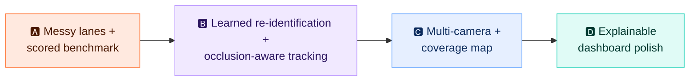

# 🗺️ Roadmap: tracking that holds up in messy lanes

> [!NOTE]
> **Status: proposed.** Nothing on this page is built yet. Each phase lists what changes, which *real models* are involved, and how success gets measured.

Today's lane is clean: boxes slide in a straight line, the only occluder is a slab that appears for 0.6 s, and nothing else ever enters the frame. Real checkout lanes are messy. The goal is a tracker that keeps an exact cart through **occlusion, partial views, distractors and multiple cameras**, and can prove it with numbers.

## 🅰️ Phase A: messy lanes and a scored benchmark *(do this first)*

You can't improve what you can't measure, so the first step is making the simulation hard and scoring it automatically.

**Unity: randomized, realistic scenarios** (`ProPassSimulation.cs` and new scenario scripts)
- 🧍 **Occluders that behave like people:** an animated customer whose arms and body pass in front of items, a second shopper crossing the lane, and a cart or basket blocking the view for several seconds.
- 📦 **Partial views:** items half out of frame, stacked or overlapping boxes, items carried at different heights and rotations.
- 🪀 **Distractors:** non-merchandise objects (phone, bag, coffee cup, the customer's own tool), shelf products in the background, a person walking *past* the lane with a product that must **not** be added.
- 🎲 **Natural motion:** curved paths, pauses, hesitations, back-and-forth, plus walking-speed variation.
- 🎨 **Domain randomization:** lighting, floor and package textures, camera shake, motion blur, sensor noise, JPEG artifacts.

**Benchmark harness** (`training/benchmark.py`)
- Runs N seeds × every scenario through the recorded-replay path, with no Unity needed after recording.
- Reports **exact-cart rate, false adds, false removes, ID switches, review rate and latency** per scenario, and writes a JSON + Markdown table into `models/`.
- **Done when:** the current system has a baseline score on every scenario. Some of those scores will be bad, and that's the point.

## 🅱️ Phase B: real learned models for identity and occlusion

| Upgrade | Model | Why |
|---|---|---|
| 🧬 **Re-identification embedding** | Small CNN or ViT head trained with **metric learning** (triplet / ArcFace) on Unity crops labeled by `physical_id` | Tells *which* box this is, not just *what* SKU. Unity gives perfect identity labels for free. This is the biggest win for identical products after occlusion. |
| 🧭 **Tracker** | **BoT-SORT** with the ReID embedding (replacing ByteTrack) | Appearance-aware association plus camera-motion compensation. Fewer ID switches. |
| 🙋 **Occluder-aware detector** | YOLO26 fine-tuned on **merchandise + person + hand** classes | The ledger can tell "hidden behind a hand" from "gone" and extend the re-attach window only when an occluder covers the last position. |
| 🧩 **Visible-fraction estimate** | YOLO26n-**seg** (instance masks) | Weights SKU and ReID evidence by how much of the box is actually visible, so partial views stop polluting votes. |
| 📈 **Motion model** | Per-object Kalman filter in the ledger | Smoother prediction through occlusion than today's 0.4 s linear extrapolation |

**Done when:** Phase A's benchmark improves on occlusion, identical-product and distractor scenarios with no regression elsewhere. Every number gets reported next to the baseline.

## 🅲 Phase C: multiple cameras and a coverage map

- 📷 **2–3 cameras** (overhead, plus side or angled) rendered in Unity, each streaming with a `camera_id`.
- 🗺️ **Ground-plane mapping:** a calibrated homography per camera projects detections into lane coordinates (meters), so zones become **world-space lines**, not per-camera pixel rows.
- 🔗 **Cross-camera fusion:** one physical ledger in world space. ReID embeddings link the same box seen by different cameras. A box hidden from one camera stays tracked by another.
- 🔦 **Coverage visualization:**
  - In Unity, draw camera frustums as gizmos and generate a coverage heatmap of the lane floor.
  - In the dashboard, add a **top-down lane map** that shows each camera's field of view, overlap regions, blind spots, and every tracked object as a dot with its trail.

**Done when:** a long single-camera occlusion that fails in Phase B passes with two cameras, and the dashboard shows where coverage is thin.

## 🅳 Phase D: explainable, polished dashboard

- 🧾 **"Why is this in my cart?"** Each line expands into that object's timeline (first seen, SKU votes, zone crossings, occlusions, which camera saw it) with thumbnail crops.
- 🚦 **Review queue:** when checkout is blocked, show exactly which object and why, with the frames that caused it.
- 📊 **Benchmark page:** Phase A's scores and trends, built from the JSON reports.
- 🎥 **Demo recording:** a 60–90 s video of a messy scenario passing, for the portfolio.

## 📏 Ground rules that don't change

- Runtime still only receives **pixels + timing**. Unity labels are for training and scoring only.
- Every phase reports measured numbers against the previous baseline, labeled as synthetic.
- When the system is unsure, it asks for review. It never guesses.
