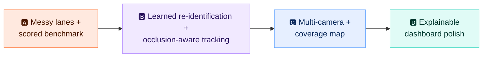
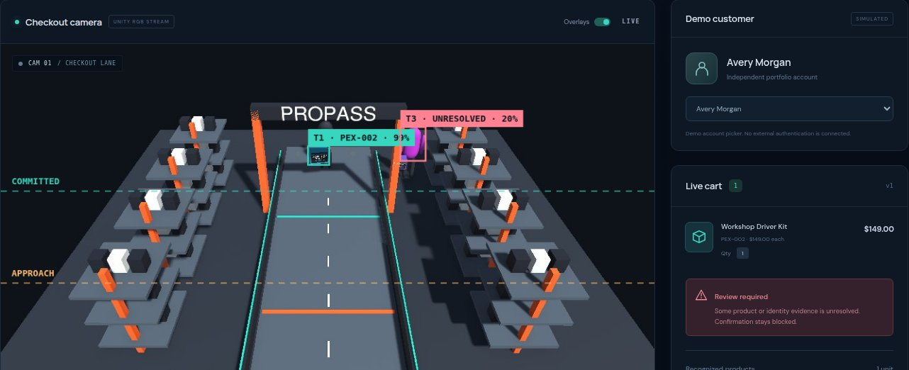

# 🗺️ Roadmap: tracking that holds up in messy lanes

> [!NOTE]
> **Status:** Phase A is ✅ done ([results below](#-phase-a-results)). Phases B–D are next. Each phase lists what changes, which *real models* are involved, and how success gets measured.

Today's lane is clean: boxes slide in a straight line, the only occluder is a slab that appears for 0.6 s, and nothing else ever enters the frame. Real checkout lanes are messy. The goal is a tracker that keeps an exact cart through **occlusion, partial views, distractors and multiple cameras**, and can prove it with numbers.

## 🅰️ Phase A: messy lanes and a scored benchmark ✅

You can't improve what you can't measure, so the first step was making the simulation hard and scoring it automatically.

**What was built**
- 🎲 **Seeded scenario plans** ([ProPassScenario.cs](../unity/Assets/ProPass/Runtime/ProPassScenario.cs)). Every actor's motion is a function of `(scenario, seed, time)`, shared by live Play mode and offline recording. Lighting, light color, camera shake and JPEG quality are randomized per seed.
- 🧍 **Eight messy scenarios:** busy hands, a crossing shopper, a lumber flatbed (long full occlusion), entering from the frame edge along the rail, stacked boxes, distractors (phone, cup, bag), a shopper in the next aisle carrying a product, and hesitation with a step back.
- 🎥 **Offline recorder** ([ProPassBenchmarkRecorder.cs](../unity/Assets/ProPass/Editor/ProPassBenchmarkRecorder.cs)). It renders scenarios × seeds at 8 fps and runs from the menu, the Unity CLI or batch mode.
- 📊 **Scorer** ([training/benchmark.py](../training/benchmark.py)). It measures exact cart, false adds, misses, ID switches, phantom objects, review rate and detection recall, and regenerates [benchmark.md](benchmark.md).

Live failure from the <b>bystander</b> scenario: the product carried in the next aisle (T3, right) gets tracked, so checkout is blocked. Fixing this needs lane-aware zones.

### 📉 Phase A results

The baseline passes **46 / 70** runs: all 30 classic runs, but only 16 of 40 messy ones. The full table is in [benchmark.md](benchmark.md).

| Scenario | Pass | What breaks | Fix planned in |
|---|:-:|---|---|
| 🪵 flatbed | 🔴 0% | A full occlusion longer than the 1.8 s re-attach window: the item is "lost before checkout" and never added (6 items missed) | B: re-ID embedding + occluder-aware re-attach, C: second camera |
| 📦 stacked | 🔴 0% | Two touching boxes get one merged or alternating identity (39 ID switches per run). The top box takes the bottom box's SKU. | B: segmentation masks + re-ID |
| 🚶 bystander | 🔴 0% | Zones are full-width image rows, so a product carried in the **next aisle** crosses them and gets charged or blocks checkout | C: world-space lane zones via ground-plane mapping |
| ↘️ edge | 🔴 20% | Products entering from the frame edge first appear mid-lane, which counts as "first observed beyond boundary", and partial views fragment tracks | B: visible-fraction weighting, C: calibrated zones |
| 🧍 shopper | 🟡 60% | The passing person splits tracks (10 ID switches per run). Untracked phantom objects also appear (1.2 per run), likely the person or track fragments | B: person-class detector + BoT-SORT with re-ID |
| 📱 distractors | 🟡 60% | Props are likely detected as merchandise (1 phantom object per run, with no tracking errors on real items), and that blocks checkout | B: hard-negative training data |
| ⏸️ hesitate | 🟢 80% | Mostly works. One run blocked after the step back | B: Kalman motion model |
| ✋ hands | 🟢 100% | Partial hand occlusion is already handled by short-gap re-attachment | — |

## 🅱️ Phase B: real learned models for identity and occlusion

| Upgrade | Model | Why |
|---|---|---|
| 🧬 **Re-identification embedding** | Small CNN or ViT head trained with **metric learning** (triplet / ArcFace) on Unity crops labeled by `physical_id` | Tells *which* box this is, not just *what* SKU. Unity gives perfect identity labels for free. This is the biggest win for identical products after occlusion. |
| 🧭 **Tracker** | **BoT-SORT** with the ReID embedding (replacing ByteTrack) | Appearance-aware association plus camera-motion compensation. Fewer ID switches. |
| 🙋 **Occluder-aware detector** | YOLO26 fine-tuned on **merchandise + person + hand** classes | The ledger can tell "hidden behind a hand" from "gone" and extend the re-attach window only when an occluder covers the last position. |
| 🧩 **Visible-fraction estimate** | YOLO26n-**seg** (instance masks) | Weights SKU and ReID evidence by how much of the box is actually visible, so partial views stop polluting votes. |
| 📈 **Motion model** | Per-object Kalman filter in the ledger | Smoother prediction through occlusion than today's 0.4 s linear extrapolation |

**Done when:** the Phase A benchmark improves on occlusion, identical-product and distractor scenarios with no regression elsewhere. Every number gets reported next to the baseline.

## 🅲 Phase C: multiple cameras and a coverage map

- 📷 **2–3 cameras** (overhead, plus side or angled) rendered in Unity, each streaming with a `camera_id`.
- 🗺️ **Ground-plane mapping:** a calibrated homography per camera projects detections into lane coordinates (meters), so zones become **world-space lines**, not per-camera pixel rows.
- 🔗 **Cross-camera fusion:** one physical ledger in world space. ReID embeddings link the same box seen by different cameras. A box hidden from one camera stays tracked by another.
- 🔦 **Coverage visualization:**
  - In Unity, draw camera frustums as gizmos and generate a coverage heatmap of the lane floor.
  - In the dashboard, add a **top-down lane map** that shows each camera's field of view, overlap regions, blind spots, and every tracked object as a dot with its trail.

**Done when:** a long single-camera occlusion that fails in Phase B passes with two cameras, and the dashboard shows where coverage is thin.

## 🅳 Phase D: explainable, polished dashboard

- 🧾 **"Why is this in my cart?"** Each line expands into that object's timeline (first seen, SKU votes, zone crossings, occlusions, which camera saw it) with thumbnail crops.
- 🚦 **Review queue:** when checkout is blocked, show exactly which object and why, with the frames that caused it.
- 📊 **Benchmark page:** Phase A's scores and trends, built from the JSON reports.
- 🎥 **Demo recording:** a 60–90 s video of a messy scenario passing, for the portfolio.

## 📏 Ground rules that don't change

- Runtime still only receives **pixels + timing**. Unity labels are for training and scoring only.
- Every phase reports measured numbers against the previous baseline, labeled as synthetic.
- When the system is unsure, it asks for review. It never guesses.
