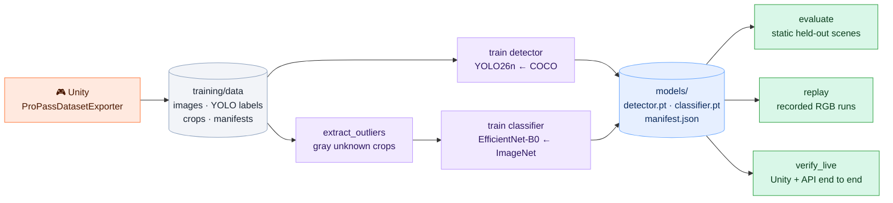

# 🧪 Training and results

Both models are trained only on **procedural Unity data**. There's no human footage and no scraped imagery. Unity's labels are used here, offline, and never at runtime.



## 📦 1. Export a dataset from Unity

Each randomized scene varies camera pose, package placement and rotation, lighting, customer position and occlusion. An extra render pass draws each object in a flat mask color, so the boxes are **tight to visible pixels**, and a half-hidden box gets a half-size label.

Stop Play mode, open the Checkout scene, and run this Editor C# (through Unity CLI or an Editor script), using your absolute path:

```csharp
ProPass.Editor.ProPassDatasetExporter.Begin("/absolute/path/propass/training/data", 450, 90, 60);
```

Wait for `ProPassDatasetExporter.Running == false`, then check that `LastError` is empty. You'll get:

```text
training/data/
  detection/images/{train,val,test}/scene_00001.jpg
  detection/labels/{train,val,test}/scene_00001.txt   ← YOLO, one class: merchandise
  detection/dataset.yaml
  crops/{train,val,test}/{PEX-001…PEX-005, ZZZ-UNKNOWN}/
  manifests/{train,val,test}/scene_00001.json          ← per-object SKU + physical ID
```

The splits are **whole scenes with disjoint random-seed ranges** (450 / 90 / 60), so nearby frames from one recording never land in both train and test.

## 🏋️ 2. Train

```bash
.venv/bin/python -m training.extract_outliers
.venv/bin/python -m training.train detector   --epochs 35 --batch 8  --imgsz 640 --device 0
.venv/bin/python -m training.train classifier --epochs 12 --head-epochs 4 --batch 24 --device cuda:0
```

| | 🔵 Detector | 🟣 Classifier |
|---|---|---|
| Start | COCO-pretrained `yolo26n.pt` | ImageNet EfficientNet-B0 (torchvision) |
| Task | 1 class: merchandise | 5 SKUs + 1 reject (training-only gray package) |
| Recipe | 640 px, AdamW lr 1e-3, mild geometry and lighting augmentation, **no horizontal flip** (it would mirror packaging text), patience 10 | 4 epochs head-only, then 8 epochs fine-tuning the last two feature stages with BatchNorm frozen |
| Calibration | Operating confidence 0.20 | Temperature (0.5) and per-class prototype distance (0.428), chosen on **validation only** |
| Time on RTX 4070 Super | ~71 s | ~25 s |
| Output | `models/detector.pt` | `models/classifier.pt` (also holds SKU order, prototypes and calibration) |

Each run records its checkpoint SHA-256, settings and metrics in [models/manifest.json](../models/manifest.json). AMP is on when CUDA is available. Restart the API after replacing weights.

> [!TIP]
> These training times are for this small synthetic dataset. They aren't estimates for real retail-scale training.

## 📊 3. Results

### Static held-out test (60 scenes, 143 packages)

| Metric | Result |
|---|---:|
| 🎯 Detector mAP50 | **0.995** |
| 🎯 Detector mAP50–95 | **0.868** |
| 📦 Packages found (IoU ≥ 0.5, conf ≥ 0.20) | **143 / 143** |
| 🏷️ SKU top-1 on real detector crops | 139 / 140 |
| ✅ Accepted SKU predictions that were correct | **135 / 135** |
| 🤚 Known products abstained (sent to review) | 5 / 140 |
| ❓ Unknown gray package rejected | **3 / 3** |
| 👻 False boxes in empty scenes | 0 / 2 |
| ⚡ Detector + classifier latency (GPU) | 9.8 ms median · 12.8 ms p95 |

The full per-scene record is in [models/evaluation-static-test.json](../models/evaluation-static-test.json).

### A failure the evaluation caught

The first classifier had **no reject class**, and it accepted 1 of the 3 unknown crops as a known SKU (only 2 of 3 rejected). Adding outlier exposure and the prototype gate fixed that case. The baseline checkpoint and its report are kept in [models/baseline/](../models/baseline) for comparison.

| | Baseline (closed set) | Current (with reject) |
|---|:---:|:---:|
| Unknown detected crops rejected | 2 / 3 ❌ | 3 / 3 ✅ |
| Accepted known predictions correct | 137 / 138 | 135 / 135 |

The trade-off is visible here: the stricter model sends a few more known items to review instead of risking a wrong SKU.

### 🔁 Temporal replay evaluation

```bash
.venv/bin/python -m training.replay --root artifacts/replays --output models/evaluation-temporal.json
```

This feeds recorded JPEGs and their timing through the full vision engine, then compares the final cart against ground truth that's read **afterwards**. It reports exact cart, review behavior, object counts, event idempotency and latency.

| Recorded runs | Exact cart |
|---|:---:|
| 3 × single item | **3 / 3** ✅ |

Source: [evaluation-temporal-initial-single.json](../models/evaluation-temporal-initial-single.json). Recordings for the other scenarios exist under `artifacts/replays/` but haven't been scored yet.

### 🎮 Live end-to-end (Unity → API → cart)

```bash
.venv/bin/python scripts/verify_live.py   # needs Unity in Play mode + the API
```

| Scenario | Expected | Got |
|---|---|:---:|
| Single | 1× PEX-001 | ✅ |
| Identical products | 2× PEX-001 | ✅ |
| Mixed | PEX-001, PEX-003, PEX-005 | ✅ |

Source: [models/evaluation-live.json](../models/evaluation-live.json).

## ⚠️ What these numbers don't prove

- The five packages are visually distinct colored boxes. Look-alike SKUs haven't been tested.
- Unknown rejection was measured against **one** gray package family, so it isn't open-world detection.
- Training and test share the same procedural assets and environment, so held-out assets, stores and real cameras are untested.
- Static accuracy doesn't establish cart accuracy. That's why replay and live results are reported separately.

**Next experiments:** textured package assets with confusing variants and held-out textures, scored temporal runs for occlusion, removal and unknown scenarios, and a small consented real-camera dataset to compare synthetic-only vs synthetic+real fine-tuning.
