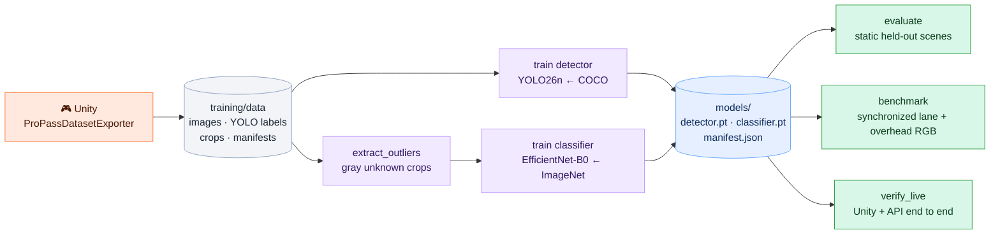

# 🧪 Training and results

Both models are trained only on **procedural Unity data** from the lane and overhead views. There's no human footage and no scraped imagery. Unity's labels are used offline and never at runtime. The current v3 training set has **2,100 scenes**; the dual-view temporal benchmark is separate from those static scenes.



## 📦 1. Export a dataset from Unity

Each randomized scene selects the lane or overhead camera with equal probability, then varies camera pose, lighting and its color, and package placement, rotation and scale. This creates approximately equal numbers of both views; it does not render a paired training image for every scene. The manifest records `camera`. Scenes are deliberately cluttered with the same actors the messy scenarios use:

| In the scene | Label | Why |
|---|---|---|
| 📦 Products, including stacked pairs, rail-edge and half-out-of-frame placements | `0 merchandise` + an SKU crop | What the system must find and recognize |
| 🧍 The customer, other shoppers, loose hands and arms | `1 person` | So people stop being mistaken for products |
| 🪵 Lumber flatbeds | `2 cart` | So large occluders stop being mistaken for products |
| 📱☕👜 Phones, cups, bags | *unlabeled* | **Hard negatives:** learned as background |

Labels come from **one mask render per instance**, with everything else drawn black, so boxes are tight to the *visible* pixels and a half-hidden box gets a half-size label.

Stop Play mode, open the Checkout scene, and run this Editor C# (through Unity CLI or an Editor script), using your absolute path:

```csharp
ProPass.Editor.ProPassDatasetExporter.Begin("/absolute/path/propass/training/data", 1600, 250, 250);
```

With the Unity CLI against the open Editor, wrap it in `unity command eval --code '...; return "ok";' --project-path "$PWD/unity"`. It runs in the background and writes `export-progress.json`; time depends on scene clutter and mask renders. Wait for `ProPassDatasetExporter.Running == false`, then check that `LastError` is empty. You'll get:

```text
training/data/
  detection/images/{train,val,test}/scene_00001.jpg
  detection/labels/{train,val,test}/scene_00001.txt   ← YOLO: 0 merchandise · 1 person · 2 cart
  detection/dataset.yaml
  crops/{train,val,test}/{PEX-001…PEX-005, ZZZ-UNKNOWN}/
  manifests/{train,val,test}/scene_00001.json          ← camera, per-object SKU + physical ID
```

The splits are **whole scenes with disjoint random-seed ranges** (1,600 / 250 / 250), so related frames from one recording never land in both train and test. The current classifier has 4,054 training, 631 validation and 637 test crops, including the gray reject class. The scenario benchmark uses entirely separate seeds and recordings. These are held-out scene seeds, not held-out assets, stores or real cameras.

## 🏋️ 2. Train

```bash
.venv/bin/python -m training.extract_outliers
.venv/bin/python -m training.train detector   --epochs 60 --batch 16 --imgsz 640 --device 0
.venv/bin/python -m training.train classifier --epochs 12 --head-epochs 4 --batch 32 --device cuda:0
.venv/bin/python -m training.calibrate_rejection --clusters 8 --batch 32 --iterations 30 --device cuda:0
```

| | 🔵 Detector | 🟣 Classifier |
|---|---|---|
| Start | COCO-pretrained `yolo26n.pt` | ImageNet EfficientNet-B0 (torchvision) |
| Task | 3 classes: merchandise, person, cart (only merchandise is tracked) | 5 SKUs + 1 reject (training-only gray package) |
| Recipe | 640 px, AdamW lr 1e-3, mild geometry and lighting augmentation, **no horizontal flip** (it would mirror packaging text), patience 10 | 4 epochs head-only, then 8 epochs fine-tuning the last two feature stages with BatchNorm frozen |
| Calibration | Operating confidence 0.20 | Temperature **0.652668**; nearest appearance-bank distance gate **0.536377**, selected on **validation only** |
| v3 entrypoint elapsed on RTX 4070 Super | ~350 s, including detector test evaluation | ~79 s |
| Output | `models/detector.pt` | `models/classifier.pt` (SKU order, legacy means, appearance bank and calibration) |

Each run records its checkpoint SHA-256, settings and metrics in [models/manifest.json](../models/manifest.json). AMP is on when CUDA is available. Restart the API after replacing weights.

### 🎚️ Train-only appearance bank, validation-only gate

The two cameras make each SKU's appearance distribution multimodal. A single mean prototype can sit between valid overhead and oblique views. [training/calibrate_rejection.py](../training/calibrate_rejection.py) freezes the trained EfficientNet, extracts features from **4,054 training crops**, and builds **eight spherical k-means centers per class**. Clustering is deterministic, with at most 30 iterations. The bank has shape `6 × 8 × 1280`, including the gray reject class.

It then opens **only the validation split** (631 crops, 617 known and 14 gray). Known labeled-class distances select the gate; at runtime the crop is compared against its **predicted class's** bank:

```text
known validation distance 99th percentile = 0.486377
bank limit = q99 + 0.05                   = 0.536377
```

No benchmark or test crop is opened by this calibration command. EfficientNet weights, temperature, confidence and temporal SKU-vote thresholds remain unchanged. The bank gate rejects **5/617 known validation crops** by distance; the explicit reject head rejects **14/14 gray validation crops**. Those are validation diagnostics for one synthetic unknown family, not claims about open-world rejection or checkout improvement.

The original mean-prototype gate was 0.45. An intermediate mean-only calibration increased it to 0.633318; the current bank replaces that representation and uses the lower 0.536377 limit. Previous classifier checkpoints and reports remain recoverable in `models/v3-original/` and `models/v3-calibrated-mean/`. [models/rejection-calibration.json](../models/rejection-calibration.json) records bank/classifier hashes, per-class distances and the split-selection procedure. The active classifier hash is `63c35ecea2364e3fc6c62c16cacae815ed4d5baf117d038e01433333a578c078`.

Run bank calibration **after** `training.train classifier` and **before** evaluating the final checkpoint with `training.evaluate` or `training.benchmark`: training writes legacy mean prototypes, while the separate command adds the multi-view bank. Use `.venv/bin/python -m training.calibrate_rejection --help` to inspect the actual `--clusters`, `--batch`, `--iterations` and `--device` flags. Restart the API after replacing the checkpoint.

> [!TIP]
> These training times are for this small synthetic dataset. They aren't estimates for real retail-scale training.

## 📊 3. Results

### Current two-view model reports

| Measurement | v3 training report | Source |
|---|---:|---|
| Detector mAP50–95, all three classes | 0.879 | [models/manifest.json](../models/manifest.json), 250 static test scenes |
| Classifier top-1, labeled test crops including reject | 622 / 637 | Same manifest; this measures classification, not final accepted cart accuracy |
| Accepted SKU precision and abstentions on detector crops | See current static evaluation | [models/evaluation-static-test.json](../models/evaluation-static-test.json) |
| Exact cart, quantities and review behavior over time | See scenario benchmark | [benchmark.md](benchmark.md) |
| Live API/cart behavior | See current live report | [models/evaluation-live.json](../models/evaluation-live.json) |

Run the static evaluator after checkpoint or calibration changes:

```bash
.venv/bin/python -m training.evaluate --split test
```

It reports perfect-label crop results separately from **actual detector crops**, with accepted-correct counts, abstentions, unknown rejection, misses and false boxes. A high top-1 crop score alone does not establish a correct checkout.

### Historical single-view v2 test (150 cluttered scenes, 387 packages)

| Metric | v2 (cluttered lane view) | v1 (clean lane view) |
|---|---:|---:|
| 🎯 Detector mAP50–95, merchandise class | **0.843** | 0.868 |
| 🎯 Detector mAP50–95, all classes | 0.877 | — |
| 📦 Packages found (IoU ≥ 0.5, conf ≥ 0.20) | **380 / 387** | 143 / 143 |
| 🏷️ SKU top-1 on real detector crops | 359 / 372 | 139 / 140 |
| ✅ Accepted SKU predictions that were correct | **301 / 301** | 135 / 135 |
| 🤚 Known products abstained (sent to review) | 71 / 372 | 5 / 140 |
| ❓ Unknown gray package rejected | **8 / 8** | 3 / 3 |
| 👻 Empty scenes with a false box | 1 / 7 | 0 / 2 |
| ⚡ Detector + classifier latency (GPU) | 8.6 ms median · 10.3 ms p95 | 9.8 · 12.8 ms |

The v2 test set was harder than v1: people, hands, flatbeds, distractors, stacked and half-visible boxes. The two columns aren't directly comparable. On that v2 report, **301/301 accepted detected-crop predictions were correct**, with 71 known crops abstained. Those historical results do not describe the current two-view checkpoint. The v1 and v2 checkpoints are preserved locally in `models/v1/` and `models/v2/`.

The historical v2 per-scene report is [models/v2/evaluation-static-test.json](../models/v2/evaluation-static-test.json); the root-level static report is regenerated for the active weights.

### A failure the evaluation caught

The first classifier had **no reject class**, and it accepted 1 of the 3 unknown crops as a known SKU (only 2 of 3 rejected). Adding outlier exposure and the prototype gate fixed that case. The baseline checkpoint and its report are kept in [models/baseline/](../models/baseline) for comparison.

| | Initial closed-set baseline | Initial v1 model with reject |
|---|:---:|:---:|
| Unknown detected crops rejected | 2 / 3 ❌ | 3 / 3 ✅ |
| Accepted known predictions correct | 137 / 138 | 135 / 135 |

The trade-off is visible here: the stricter model sends a few more known items to review instead of risking a wrong SKU.

### 🔁 Temporal evaluation

Use [training/benchmark.py](../training/benchmark.py) for current lane-plus-overhead recordings, as described below. It calls `process_frames` once per synchronized group and reads product ground truth only to score the output.

The older [training/replay.py](../training/replay.py), recordings under `artifacts/replays/`, and [initial single-item report](../models/evaluation-temporal-initial-single.json) remain as historical artifacts. That script's oracle uses the original lane image-space zones and is not the dual-camera benchmark. The live component no longer has Replay Directory or Maximum Replay Frames Inspector settings.

### 🎮 Live end-to-end (Unity → API → cart)

```bash
.venv/bin/python scripts/verify_live.py   # needs Unity in Play mode + the API
```

| Scenario | Expected | Got |
|---|---|:---:|
| Single | 1× PEX-001 | ✅ |
| Identical products | 2× PEX-001 | ✅ |
| Mixed | PEX-001, PEX-003, PEX-005 | ✅ |
| Temporary occlusion | 1× PEX-001 | ✅ |
| Change of mind | empty cart | ✅ |
| Unknown product | empty cart, review required | ✅ |

The table above is the verified **Phase B v2 reference run**. Current live verification is recorded in the report below; inspect it rather than assuming those earlier results still apply after changing models, calibration or fusion.

Source: [models/evaluation-live.json](../models/evaluation-live.json).

## 🎯 Scenario benchmark

The benchmark scores **15 scenarios × 5 seeds = 75 runs** per split. It includes the six classic scenarios, clutter/interaction cases and **parked**, where a flatbed hides merchandise from the lane camera for 7–9 seconds. That scenario tests whether the overhead view adds usable evidence during a prolonged lane-view occlusion.


**1. Record** (Unity renders every run offline at 8 fps, with no Play mode and no API):

- From the menu: **ProPass → Record benchmark suite**, then choose an output folder. The menu's quick-run default is four seeds; use the explicit commands below for the five-seed development/test protocol.
- Or with the Unity CLI against the open Editor:
  ```bash
  unity command eval --code 'return ProPass.Editor.ProPassBenchmarkRecorder.RecordDeferred("/abs/path/propass/artifacts/benchmark", 5);' --project-path "$PWD/unity"
  unity command eval --code 'return ProPass.Editor.ProPassBenchmarkRecorder.RecordDeferred("/abs/path/propass/artifacts/benchmark-test", 5, null, 5);' --project-path "$PWD/unity"
  ```
- Or headless, with the project closed:
  ```bash
  Unity -batchmode -quit -projectPath unity -executeMethod ProPass.Editor.ProPassBenchmarkRecorder.RunFromCommandLine -benchmarkOut "$PWD/artifacts/benchmark" -benchmarkSeeds 5
  ```

Run these recording calls **one at a time**, waiting for the completion log before scheduling another. Recording replaces matching output run folders, so choose a fresh directory if you need to preserve them. The existing development and held-out dual-view recordings are already complete; scoring them does not require Unity or re-recording.

```text
artifacts/benchmark/<scenario>/seed_00/
  000001.jpg           lane RGB
  000001.overhead.jpg  overhead RGB at the same instant
  000001.json          timing and separate offline truth
  run.json             seeded scenario and expected cart/review
```

The per-frame truth stores SKU, physical ID, lane projected bounds and world position. The expected cart comes from **world-space motion**: a product counts when carried inside the lane from behind the orange marker to past the teal marker. The same `(scenario, seed)` renders the same run. Only JPEGs and source timing enter inference; the scorer reads truth separately. Identity-switch/recall matching uses the **lane view's** ground-truth boxes, so those metrics do not measure overhead visibility directly.

**2. Score:**

```bash
.venv/bin/python -m training.benchmark --root artifacts/benchmark --label c-image --image-mode
.venv/bin/python -m training.benchmark --root artifacts/benchmark --label c-world-1cam --cameras lane
.venv/bin/python -m training.benchmark --root artifacts/benchmark --label c-world-2cam
```

These runs isolate image zones, world zones and the extra view on the **same RGB recordings and current weights**. They are distinct from comparing v2 single-view weights against v3 two-view weights. Reports include camera IDs, mode, seeds, checkpoint/config hashes, quantities, false adds, missed units and review behavior. A review blocking a wrong cart is reported separately from a successful exact cart.

**Tune on development seeds 0–4 only.** Once settings are fixed, score held-out seeds 5–9 and update [benchmark.md](benchmark.md):

```bash
.venv/bin/python -m training.benchmark --root artifacts/benchmark-test --label c-heldout-image --image-mode
.venv/bin/python -m training.benchmark --root artifacts/benchmark-test --label c-heldout --docs --compare models/benchmark-c-heldout-image.json
```

`--docs` regenerates the benchmark table and chart. The example compares frozen image-mode and two-camera configurations on the **same held-out runs**. Score each fixed mode once, and do not tune afterward on these outcomes. If comparing against a different split, scenario set or model generation, label that difference explicitly. The [roadmap](roadmap.md) records the final selected configuration and measured release results.

## ⚠️ What these numbers don't prove

- The five packages are visually distinct colored boxes. Look-alike SKUs haven't been tested.
- Unknown rejection was measured against **one** gray package family, so it isn't open-world detection.
- Training and test share procedural assets and environment, so held-out assets, stores and real cameras are untested. A second synthetic camera does not establish synthetic-to-real transfer.
- Static accuracy doesn't establish cart accuracy. That's why replay and live results are reported separately.

**Next experiments:** textured package assets with confusing variants and held-out textures, carry-height variation and calibration error, and a small consented real-camera dataset comparing synthetic-only against synthetic+real fine-tuning.
