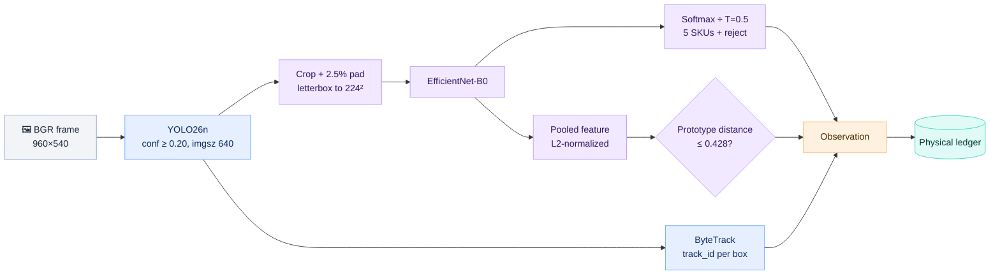
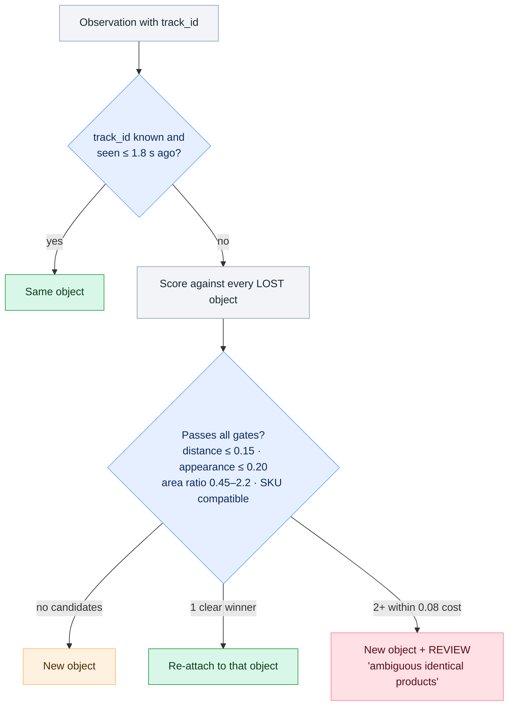
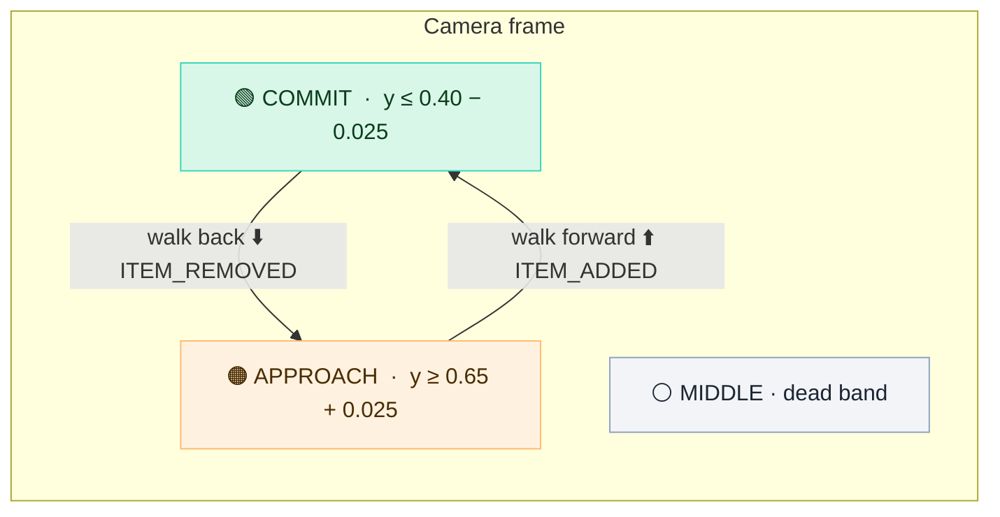

# 👁️ Vision and tracking

The vision package turns a single RGB frame into **observations** (boxes, SKU probabilities, appearance embeddings). The **physical ledger** then turns a stream of observations into **physical objects and cart events**. Everything here lives in [vision/](../vision).

Fine-tuned YOLO26n on held-out Unity scenes. Every package is labeled `merchandise`, and the SKU comes from a separate model.

## 🧬 Per-frame inference

| Stage | Model / method | Why it's built this way |
|---|---|---|
| **Detect** | YOLO26n fine-tuned from COCO, **one class: merchandise** | It finds *any* package, including unknown ones, without committing to an identity |
| **Track** | Ultralytics ByteTrack (`bytetrack.yaml`), persisted across frames | Gives cheap frame-to-frame IDs. They break under occlusion, and the ledger repairs that. |
| **Classify** | EfficientNet-B0 fine-tuned from ImageNet, with 5 SKU outputs plus a reject class | Recognizes the exact SKU from a crop, aspect-preserving padded to 224 px |
| **Reject** | Two gates: argmax lands on the reject class, **or** the cosine distance to that class's feature prototype is above 0.428 | Out-of-distribution packages get flagged instead of being forced into a known SKU |
| **Quality** | `quality = min(1, box_area / 1800 px²)` | Tiny sliver boxes from partial views don't outvote clear ones |

Each **Observation** carries `track_id`, `bbox`, `detector_confidence`, SKU `probabilities`, `embedding`, `quality` and `unknown`. That is all the ledger ever sees.

## 🧾 The physical ledger

[vision/ledger.py](../vision/ledger.py) holds the logic that makes the cart correct. It keeps one `PhysicalObject` per real box, and that object outlives any number of tracker IDs.

### 1. Associating observations with objects

The match cost is `0.7 × position distance + 0.3 × appearance distance`. Position is checked against **both** a short motion prediction (capped at 0.4 s) and the last seen spot, because a held item can stop suddenly behind an occluder. Matching is one-to-one, so two identical boxes can never merge into one.

### 2. Recognizing the SKU over time

- Evidence is sampled at most every **0.12 s**, and only from crops with `quality ≥ 0.25`. An `unknown` crop contributes a uniform vote.
- The last **8** votes are averaged. An SKU is accepted once there are **≥ 3 views**, the top probability is **≥ 0.85**, and its lead over the runner-up is **≥ 0.20**.
- After an SKU is accepted, it's never silently changed. Conflicting evidence raises a review, because a class flip usually means two IDs were swapped.

### 3. Zones and events

The lane is split by two horizontal lines in normalized image coordinates (y grows downward):

- An object's zone only changes after it has **stayed** in the new zone for 0.12 s, so jitter on the line doesn't flicker.
- **ITEM_ADDED** requires an object that was *observed* in APPROACH, then reaches COMMIT, with an accepted SKU and no open review.
- **ITEM_REMOVED** requires a member that's *observed* back in APPROACH.
- **Disappearing never removes anything.** If an object vanishes before committing and stays gone for more than 1.8 s, that triggers a completeness review.
- An object first seen *inside* COMMIT triggers a review, because it never made a forward journey.

### 4. When checkout is blocked

`review_required` is true while **any** object is pending (visible or mid-lane, and not yet a member), or **any** object has a review reason:

| Review reason | Triggered by |
|---|---|
| Ambiguous tracker fragmentation | Two or more lost identical objects match a reappearing box equally well |
| Conflicting SKU evidence | The SKU vote flips on an object that already has an SKU |
| First observed beyond boundary | Object appears already in COMMIT |
| Crossing lacks accepted SKU | Committed but still unrecognized 0.5 s after first being seen (for example, the gray unknown box) |
| Disappeared after crossing / before checkout | Unresolved or entered objects that vanish |

Event IDs are deterministic (`uuid5(run:object:sequence:type)`), so a replayed frame or retried event never double-counts in the database.

## 🎚️ Tuning: `vision/config.json`

The live API, the offline evaluator and the replay evaluator all load this file. Any `LedgerConfig` field can go under `"ledger"`.

| Key | Default | Raise it to… | Lower it to… |
|---|---:|---|---|
| `detector_conf` | 0.20 | cut false boxes | catch faint or occluded boxes |
| `ledger.approach_y` / `commit_y` | 0.65 / 0.40 | move the zone lines down the image | move them up. **Recalibrate for any new camera.** |
| `ledger.hysteresis` | 0.025 | widen the dead band (less jitter) | make crossings register sooner |
| `ledger.dwell_seconds` | 0.12 | demand steadier zone changes | react faster |
| `ledger.minimum_views` | 3 | require more evidence before trusting an SKU | resolve SKUs faster |
| `ledger.sku_threshold` / `sku_margin` | 0.85 / 0.20 | be stricter (more reviews) | be looser (more risk of a wrong SKU) |
| `ledger.reattach_seconds` | 1.8 | survive longer occlusions | reduce the chance of a wrong re-attach |

Other fields, such as `reattach_distance`, `reattach_appearance`, `reattach_margin`, `evidence_window`, `minimum_quality` and `unknown_timeout`, have defaults in `LedgerConfig`. Restart the API after editing.

## 🧪 Tests that pin this behavior

[tests/test_vision_ledger.py](../tests/test_vision_ledger.py) feeds synthetic observations straight into the ledger. Each test name describes the behavior it checks:

> one unit seen in 100 frames is added once · two simultaneous identical products stay two units · a short gap with a new tracker ID reuses the object · lost visibility doesn't remove membership · a brief pre-commit occlusion recovers · reverse removal then re-add keeps the identity · duplicate frames don't repeat events · an unknown product crossing requires review · boundary jitter creates no events · ambiguous identical fragments are reviewed, not merged · a conflicting SKU doesn't silently change a purchase

Those tests check **logic**. Model accuracy is measured separately in [training.md](training.md).
