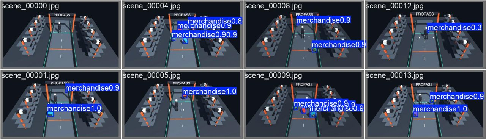
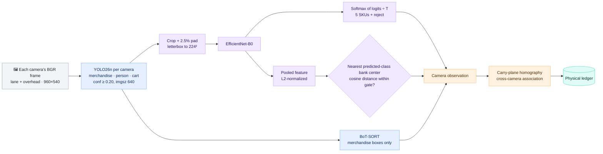
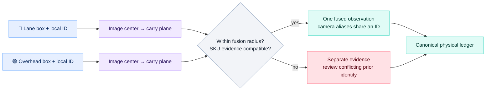
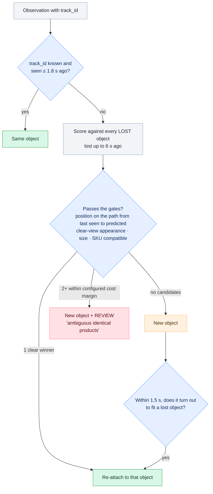
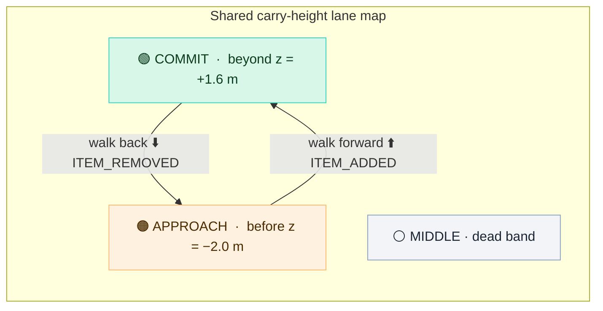

# 👁️ Vision and tracking

The vision package turns synchronized **lane and overhead RGB images** into camera observations, projects them onto a shared carry-height plane, and fuses views of the same merchandise. The **physical ledger** then turns those observations into **physical objects and cart events**. Camera-local tracker IDs, shared physical identity and SKU are separate concepts. Everything here lives in [vision/](../vision).

Fine-tuned YOLO26n on held-out Unity scenes. Every package is labeled `merchandise`, and the SKU comes from a separate model.

## 🧬 Per-frame inference

| Stage | Model / method | Why it's built this way |
|---|---|---|
| **Detect** | YOLO26n fine-tuned from COCO on cluttered scenes: **merchandise**, plus **person** and **cart** | It finds *any* package, including unknown ones, without committing to an identity. Learning people and carts as their own classes stops shoppers, hands and flatbeds from being boxed as products. |
| **Track** | One Ultralytics BoT-SORT tracker per camera (`botsort.yaml`, set by `tracker`) on merchandise boxes only | IDs are namespaced by camera. Occlusion can break them; fusion and the ledger supply continuity. |
| **Classify** | EfficientNet-B0 fine-tuned from ImageNet, with 5 SKU outputs plus a reject class | Recognizes the exact SKU from a crop, aspect-preserving padded to 224 px |
| **Reject** | Two gates: argmax lands on the reject class, **or** the nearest cosine distance among that predicted class's eight feature-bank centers exceeds the checkpoint's limit | The current two-view checkpoint uses **0.536377**, selected from known validation crops. The bank is built from training crops; unknown performance is only measured for one gray-package family. |
| **Quality** | `quality = min(1, box_area / 1800 px²)` | Tiny sliver boxes from partial views don't outvote clear ones |

Each **CameraObservation** carries the camera ID, camera-local tracker ID, image box, confidence, SKU probabilities, appearance embedding, quality, unknown flag and projected `(x, z)`. `process_frames({camera_id: image}, frame_id, timestamp, run_id)` accepts pixels and source-frame metadata. Product transforms, simulator object IDs and labels never enter that call.

## 🗺️ Calibration and cross-camera fusion

[vision/cameras.json](../vision/cameras.json) contains fixed **camera geometry**, exported by [ProPassCalibration](../unity/Assets/ProPass/Editor/ProPassCalibration.cs): point correspondences, camera positions, lane markers and coverage footprints. It contains no product or customer identity. Use **ProPass → Export camera calibration** after moving a camera, and restart the API. Export uses the 960×540 capture aspect, rather than the Editor's Game-view aspect.

- **Lane:** the oblique camera saved in the scene, at `(0, 7.5, −8)` m.
- **Overhead:** created by [ProPassCameras](../unity/Assets/ProPass/Runtime/ProPassCameras.cs) at `(0, 7.55, 0)` m, looking down. Image right points along travel `+z`.
- **Plane:** package centers are approximated as lying at **0.9 m** above the floor. Each normalized image-box center is mapped through that camera's homography to world `(x, z)`.
- **Map:** world `x ∈ [−5, 5]`, `z ∈ [−7, 7]` becomes a virtual 1000×1000 ledger frame. Map `v` decreases as a customer moves forward.

Fusion is **one-to-one across cameras**, with a default radius of **0.45 m**. Two boxes from the same camera never become one observation. An established, geometrically plausible pair takes priority over a nearer competing pair during a crossing. Distinct established identities cannot join a competing partner while their existing partners are still present.

SKU disagreement is handled differently during **acquisition** and **continuity**. A new pair is refused when its current non-rejected views strongly predict different SKUs. An established pair survives a transient crop error; splitting on SKU disagreement requires **sustained, differing camera-local votes**. Each `(camera_id, tracker_id)` has its own deque, reset for each run. It reuses the ledger's default **8-vote window**, **3-view minimum**, **0.85 top probability** and **0.20 margin**. These camera histories update once per fusion call; the canonical ledger separately applies its timed/quality evidence sampling.

Camera aliases follow the fused ID through loss of either view and replacement of an ID in the other view. When previously separate camera tracks are joined, their aliases are redirected, preventing an old ID from reappearing after a camera disappears. If the proposed join spans **two already distinct canonical ledger objects**, `Observation.conflicting_tracks` carries both prior fused IDs to the ledger. It reviews every lane-relevant prior unit, including a cart member now outside the lane; changing aliases cannot silently erase that conflict.

If observations belonging to one prior identity split into separate groups, `ambiguous_identity` raises a review for lane-relevant merchandise; the system cannot silently charge two units from that disagreement. A split entirely outside the lane is not a checkout failure unless the object previously entered or became a cart member.

When a **strong non-rejected view** exists (top probability and margin pass the configured SKU thresholds), only strong views contribute quality-weighted SKU evidence, position and the chosen appearance embedding. Weak or rejected crops cannot pull that confident view below the acceptance threshold or shift its position toward a partial box. With no strong view, non-rejected evidence is used; if all views are rejected, positions are retained as unresolved merchandise.

The fused ledger box is a **map marker**, so `sized=False` disables apparent-image-size matching. `full_view` comes from whether any camera saw a box clear of its image border, and `at_entry_edge` comes from world `z ≤ −4.2 m`.

> [!NOTE]
> A homography is an approximation for a particular height, not 3D reconstruction. Stacking, unusual carrying heights, partial boxes and camera shake can make two projections disagree. A footprint shows geometric coverage at the plane; it does not account for products hidden by people or flatbeds. The extra view reduces occlusion only when it actually supplies usable evidence.

### 🧬 SKU appearance bank

One mean feature vector per SKU places distinct overhead and oblique appearances around an artificial average. [vision/rejection.py](../vision/rejection.py) instead compares a crop against **eight centers within its predicted class**, using the minimum cosine distance. The centers describe SKU appearance modes, not unique physical products; two identical packages can share the same bank while remaining separate ledger objects.

The bank is built by deterministic spherical k-means from **4,054 training crops**. Its shape is `6 × 8 × 1280`: five SKU classes plus the reject class, eight centers each, 1,280-dimensional EfficientNet features. Calibration loads **631 validation crops**, and only the **617 known crops** select the threshold. Their labeled-class distance has `q99 = 0.486377`, giving **`q99 + 0.05 = 0.536377`**. Runtime uses the **predicted** class's bank. Network weights, temperature and temporal SKU-vote thresholds stay fixed.

The original v3 mean-prototype gate of 0.45 and its intermediate validation-calibrated 0.633318 version remain in `models/v3-original/` and `models/v3-calibrated-mean/`. The active bank checkpoint and selection details are recorded in [rejection-calibration.json](../models/rejection-calibration.json). No benchmark or test examples built the bank or selected its gate. Temporal cart reports measure its effect on checkout; validation distances alone do not establish that.

## 🧾 The physical ledger

[vision/ledger.py](../vision/ledger.py) holds the logic that makes the cart correct. It keeps one `PhysicalObject` per real box, and that object outlives any number of tracker IDs.

### 1. Associating observations with objects

- **Position:** the reappearance has to lie near the line from the object's last position to where its smoothed velocity predicts it would be. A box can slow down or stop while hidden. Image mode uses a normalized image gate; world mode uses normalized **map** distance. Current world settings are `reattach_distance=0.06` and `occlusion_gate_growth=0.02` per extra second. Those units depend on the map extents, not camera pixels.
- **Appearance:** compared against a **gallery of clear views** (crops taken when the box wasn't shrinking behind something), not the last, possibly half-hidden crop. After a long gap, an item emerging from behind a flatbed is often half-visible, so a poor appearance match is tolerated there as long as the SKU isn't confidently different.
- **Changing views:** overhead and oblique crops of the same package can have different embeddings. For short gaps in world mode, tight motion plus a non-rejected, strong vote for the object's existing SKU can pass even when appearance differs. It still must satisfy one-to-one matching and the ambiguity margin; an SKU match alone cannot merge units.
- **Late merge:** a track that reappears half-hidden may fail the gates on its first frame. If, within 1.5 s, it turns out to fit exactly one lost object, it's merged back into that identity.
- Matching is one-to-one: one lost object cannot accept two observations in the same frame. Equally good candidates go to review instead of a guess. This prevents a per-SKU deduplication shortcut from collapsing two simultaneous identical units; it does not guarantee association accuracy in every occlusion.

### 2. Recognizing the SKU over time

- Evidence is sampled at most every **0.12 s**, and only from crops with `quality ≥ 0.25`. An `unknown` crop contributes a uniform vote.
- The last **8** votes are averaged. An SKU is accepted once there are **≥ 3 views**, the top probability is **≥ 0.85**, and its lead over the runner-up is **≥ 0.20**.
- After an SKU is accepted, it's never silently changed. Conflicting evidence raises a review, because a class flip usually means two IDs were swapped.

### 3. Zones and events

In world mode the lane has two physical markers: **APPROACH at `z = −2.0 m`**, and **COMMIT at `z = +1.6 m`**. The ledger converts them into map coordinates; `hysteresis` adds a dead band around the markers.

- An object's zone only changes after it has **stayed** in the new zone for 0.12 s, so jitter on the line doesn't flicker.
- **ITEM_ADDED** requires an object that was *observed* in APPROACH, then reaches COMMIT, with an accepted SKU and no open review.
- **ITEM_REMOVED** requires a member that's *observed* back in APPROACH.
- **Disappearing never removes anything.** An object that vanishes mid-lane keeps checkout blocked (pending) while it could still be hidden. After 6 s it becomes an explicit completeness review.
- An object first seen *inside* COMMIT triggers a review, because it never made a forward journey.
- **Lane polygon:** calibration supplies the lane outline at carrying height, with 0.1 m lateral tolerance. A product whose center remains outside it is **OUTSIDE**, rather than pending or charged. A product that already entered the lane can still require a completeness review if it disappears without a resolved crossing or return. Coming back in needs a small margin (`lane_margin`), so boxes riding the lane edge don't flicker.
- **Quiet exits:** an unresolved object that was only ever seen cut off by the frame border becomes a **FRAGMENT** once it's superseded. An item carried back out through the entry edge becomes **LEFT**. Neither one blocks checkout.

Without calibration, **image mode** retains the lane camera's original zone lines (`approach_y=0.65`, `commit_y=0.40`, `hysteresis=0.025`). Use `--image-mode` in the benchmark to compare that baseline against the same recordings.

### 4. When checkout is blocked

`review_required` is true while **any** object is pending (visible or mid-lane, and not yet a member), or **any** object has a review reason:

| Review reason | Triggered by |
|---|---|
| Ambiguous tracker fragmentation | Two or more lost identical objects match a reappearing box equally well |
| Camera projections disagree | One established camera-fusion identity splits into multiple observations |
| Camera fusion joined distinct identities | Proposed camera association spans multiple established ledger objects; all relevant prior units receive review |
| Conflicting SKU evidence | The SKU vote flips on an object that already has an SKU |
| First observed beyond boundary | Object appears already in COMMIT |
| Crossing lacks accepted SKU | Committed but still unrecognized 0.5 s after first being seen (for example, the gray unknown box) |
| Disappeared after crossing / before checkout | Unresolved or entered objects that vanish |

Event IDs are deterministic (`uuid5(run:object:sequence:type)`), so a replayed frame or retried event never double-counts in the database.

## 🎚️ Tuning: `vision/config.json`

The live API, static evaluator and benchmark all load this file. Any `LedgerConfig` field can go under `"ledger"`. In world mode, calibration first replaces the zone lines and lane polygon, then `"world_ledger"` applies map-specific overrides.

| Key | Default | Raise it to… | Lower it to… |
|---|---:|---|---|
| `detector_conf` | 0.20 | cut false boxes | catch faint or occluded boxes |
| `prototype_rejection` | `true` | enable the calibrated appearance-distance gate | `false` tests reject-head-only behavior; an ablation, not a selected release change |
| `cameras` | `lane`, `overhead` | configure additional registered views | select one registered camera for an ablation |
| `fuse_radius_m` | 0.45 m | tolerate more projection disagreement | reduce accidental nearby-object pairings |
| `ledger.approach_y` / `commit_y` | 0.65 / 0.40 in image mode | move the image zone lines down | move them up. World zones come from calibration. |
| `ledger.hysteresis` | 0.025 | widen the dead band (less jitter) | make crossings register sooner |
| `ledger.dwell_seconds` | 0.12 | demand steadier zone changes | react faster |
| `ledger.minimum_views` | 3 | require more evidence before trusting an SKU | resolve SKUs faster |
| `ledger.sku_threshold` / `sku_margin` | 0.85 / 0.20 | be stricter (more reviews) | be looser (more risk of a wrong SKU) |
| `ledger.reattach_seconds` | 1.8 | trust tracker IDs over longer gaps | re-check identity sooner |
| `ledger.occlusion_seconds` | 6.0 | survive longer full occlusions | raise completeness reviews sooner |
| `ledger.lane_polygon` | image polygon; calibrated map outline in world mode | — | export calibration after moving cameras |
| `tracker` | `botsort.yaml` | — | use `bytetrack.yaml` for ~4 ms less per frame |

Other fields, such as `reattach_distance`, `reattach_appearance`, `reattach_margin`, `occlusion_gate_growth`, `late_merge_seconds`, `lane_margin`, `evidence_window`, `minimum_quality` and `unknown_timeout`, have defaults in `LedgerConfig`. The current `world_ledger` values are overrides, not meter distances. Restart the API after editing. Tune on development seeds **0–4**; held-out seeds **5–9** are for reporting.

## 🧪 Tests that pin this behavior

[tests/test_vision_ledger.py](../tests/test_vision_ledger.py) feeds synthetic observations straight into the ledger. Each test name describes the behavior it checks:

> a product outside the lane is never charged · a long occlusion re-attaches when the motion fits · edge fragments and exits are dropped quietly · one unit seen in 100 frames is added once · two simultaneous identical products stay two units · a short gap with a new tracker ID reuses the object · lost visibility doesn't remove membership · a brief pre-commit occlusion recovers · reverse removal then re-add keeps the identity · duplicate frames don't repeat events · an unknown product crossing requires review · boundary jitter creates no events · ambiguous identical fragments are reviewed, not merged · a conflicting SKU doesn't silently change a purchase

Those tests check **logic**. Model accuracy is measured separately in [training.md](training.md).

[test_vision_fusion.py](../tests/test_vision_fusion.py) bypasses model loading and checks one box in two cameras, two identical units, camera disappearance, replacement of one or both tracker IDs, crossing associations, SKU conflicts, alias reconciliation, and reviews for projection splits. [test_geometry.py](../tests/test_geometry.py) checks carry-plane correspondences, map round trips, resolution independence, zone locations and invalid calibration inputs. These are association and geometry tests, not model-accuracy measurements.
